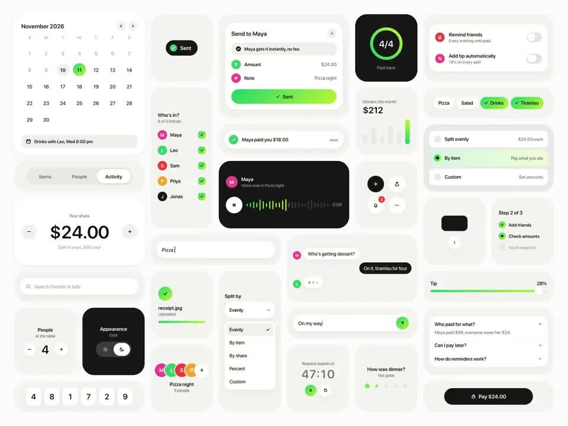
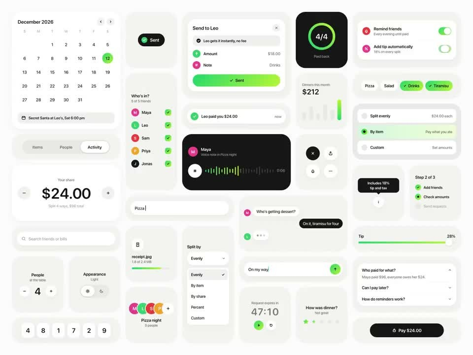
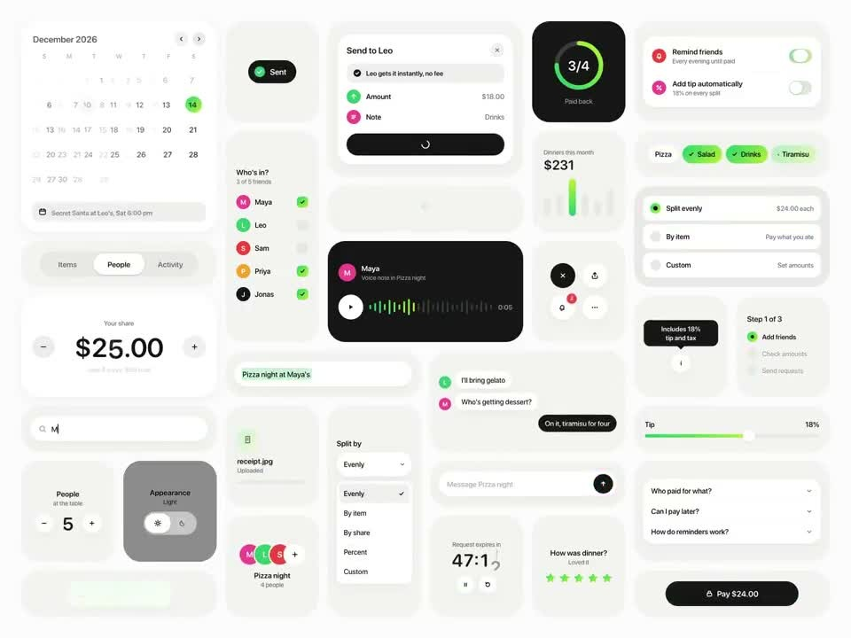

## 問題

元件種類很多的展示頁，需要讓日期、表單、清單和數據卡看起來屬於同一套系統，又保留各自狀態。

## 做法

*月曆、清單、音訊和表單以中性圓角卡片組合。*

*亮綠色集中於選取日期、進度與啟用狀態。*

*後段金額與控制項狀態改變，整體配色與卡片語言維持一致。*

- 影片先由少量空白卡片展開為一組 UI 拼貼，包含月曆、待辦清單、開關、付款金額、音訊播放、進度環與登入表單。
- 多數卡片使用淡灰白底與圓角，黑色留給強調卡片或按鈕，亮綠色集中於選取日期、進度、啟用開關與主要操作。
- 後段可見金額、輸入欄、進度數字與切換狀態變化，但沒有展示完整產品任務。原文只有「can actually design」評語，此卡不推定生成提示詞或真實產品能力。

## 為什麼有效（推論）

- 固定中性底與強調色角色，可能讓多種元件同時展示時仍保持一致的狀態語言。

## 借鑑要點

- **適合**：設計系統概念稿、元件展示與視覺方向評審。
- **不適合**：需要完整流程與錯誤處理證據的產品驗收。
- **移植時注意**：把選取、成功和主要動作的語義分開核對；不能只靠一種顏色傳達所有狀態。

## 來源與核實範圍

- [@dominikmartn 原帖](https://x.com/dominikmartn/status/2120154832694858224)；發表時間：2026-11-10T14:01:17+00:00。
- 依原帖文字與本次實際檢視的素材整理；未操作產品驗證功能。`date` 為收錄日期；原帖發表日期另記於 `published_at`。
