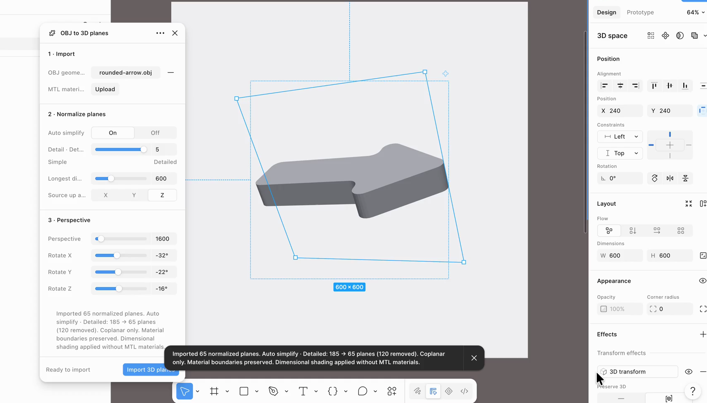
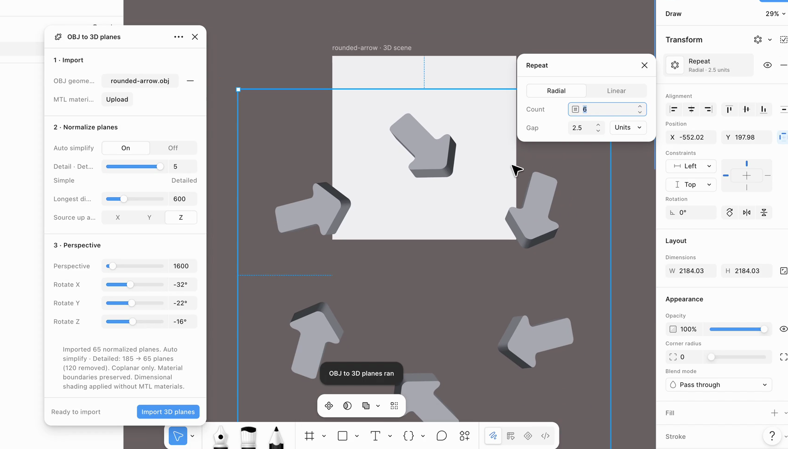
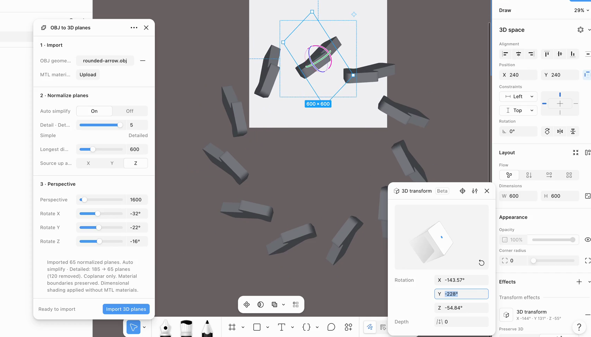
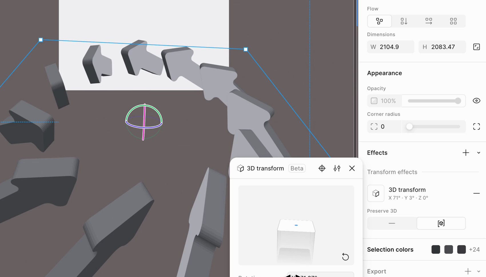

## 問題

把三維外觀用在平面品牌圖形時，設計者既需要調單一物件的角度，也需要控制整組排列。若直接匯入一張渲染圖片，就難以保留這兩層編輯。

## 做法

[作者原帖](https://x.com/miggi/status/2123916881090445400)稱使用 Figma agent 製作 OBJ／MTL 匯入與簡化外掛，再配合 Figma Draw 的 repeater；[Kubai 引用](https://x.com/Kubai087/status/2124144040014934073)認為適合品牌物料。工具製作方式來自作者文字，本次未執行 agent 或外掛；以下僅描述45.766秒影片。影格裁去頂部帳號與非設計區域，未保留原始影片。

*6秒：左側「OBJ to 3D planes」面板保留匯入、Normalize planes、Perspective 與旋轉參數；畫布中是一個有側面厚度的灰色箭頭。*

*10秒：多個同形箭頭繞圓排列，右上顯示 Repeat 的 Radial 模式面板。*

*20秒：旋轉控制旁的箭頭改變朝向，環形排列同時呈現不同的側面與正面比例。此畫面不能獨立證明所有圖層均為即時連結。*

*35秒：畫面放大環形群組，選取框與3D旋轉控制疊在整組上，右側保留圖層屬性與3D transform效果。*

- **編排層次**：影片先出現單個立體箭頭，再進入環形重複；後段調整物件角度，最後以整組視角呈現傾斜排列。不是直接展示一張完成的品牌圖。
- **控制與預覽**：匯入／簡化、來源旋轉與 Repeat 屬不同面板，畫布一直提供可見結果；3D transform 另用小物件方向預覽交代旋轉。
- **觀察限制**：未量測控制的反應時間，也沒有驗證匯入保真度、模型材質或最後匯出。Figma 原生能力與自製外掛的責任邊界不能只憑影片推定。

## 為什麼有效（推論）

- 把單個物件的外觀與整組排列分開調整，可能讓設計者先處理辨識度，再探索構圖。
- 旋轉參數旁保留即時形狀參考，可能比只輸入角度容易理解方向；來源沒有提供效率或可用性比較。

## 借鑑要點

- **適合**：物件匯入、重複陣列、品牌圖形或需要分層變換的編輯器。
- **不適合**：以此示範推定具備完整三維建模、材質或動畫輸出能力。
- **移植時注意**：區分來源物件與群組參數，說清重複項目是否連結更新；補上匯入失敗、複雜度限制、撤銷與重設。若要實作同類工具，另測不同模型、鍵盤操作及大量物件效能。
