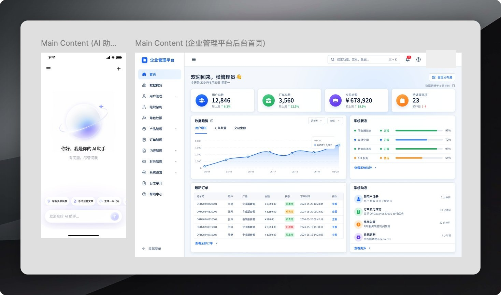

## 問題

把生成 UI 交成設計稿時，如何讓不同終端的資訊密度各有重點，而不是等比例縮放？

## 做法

- 附圖在同一設計畫布並排放置手機助手與桌面企業管理首頁，各自帶 Main Content 標題。
- 手機以大幅球體視覺、短問候和底部輸入為主；桌面上方有四張數值卡，中段並排趨勢圖與排名，下方是表格及活動資訊。
- 作者稱這是 image2 圖轉 Figma 的新版流程測試；本次僅核對公開附圖，未打開 Figma 或驗證圖層是否可編輯。

*手機助手採單一對話入口，桌面管理首頁分層放置摘要、圖表與明細。*

## 為什麼有效（推論）

手機聚焦開始對話、桌面聚焦多項業務概覽，可能比把同一面板縮小更符合不同的使用情境。這不是響應式同頁證據。

## 借鑑要點

- **適合**：需要同時展示行動入口與桌面管理資訊的設計交付。
- **不適合**：以一張輸出圖判定設計系統或自動轉換能力已完成。
- **移植時注意**：檢查元件、文字、Auto Layout 與真實長內容；圖稿中的指標與圖表不構成業務資料。

## 來源與核對範圍

- [原帖 2090386706000400412](https://x.com/NiallxYoung/status/2090386706000400412)：已核對 X 官方公開 HTML 內嵌的同 ID Tweet／NoteTweet 正文；發佈時間為 2026-08-20T10:33:22+00:00。
- 已下載並檢視原始媒體；影片僅保留關鍵影格，沒有保存原始影片。媒體出處與擷取時間見本目錄 `evidence.json`。
- 本卡只把貼文文字、附圖與錄影可確認的內容列為觀察；未執行產品驗收，效果解讀列為推論。
