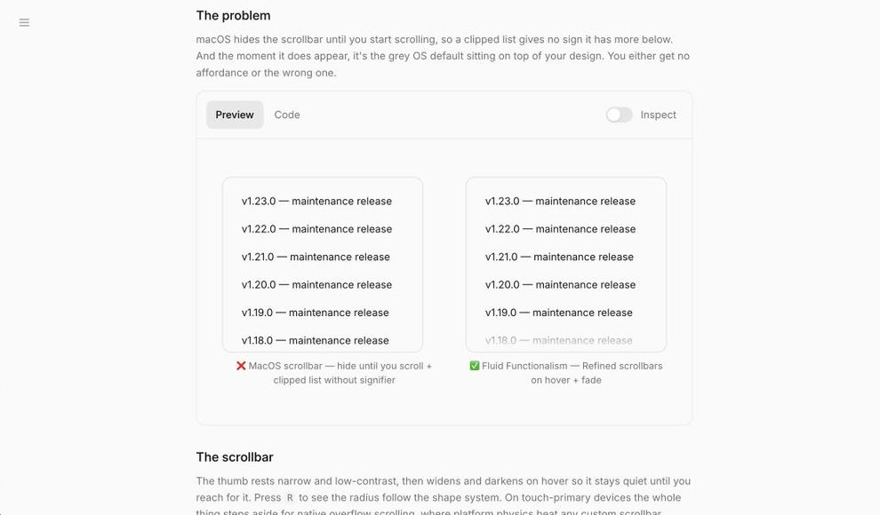

## 問題

系統捲軸在未捲動時隱藏，截斷清單缺乏下方仍有內容的提示。

## 做法

- 原帖圖片把兩個相同版本清單並排：左側底端直接截斷；右側底端加淡出，明示內容繼續。
- 圖片文案說明捲軸平時較窄、低對比，懸停才變寬變深。觸控裝置則退回原生 overflow 捲動。
- 這是原帖展示的設計說明，不是本卡實測跨平台行為。

### 已檢視素材

*左右比較清單底端：右側以淡出提示溢出，下方文字說明捲軸的懸停增強。*

## 為什麼有效（推論）

淡出提示能在捲軸隱藏時保留內容延續線索；懸停增強可兼顧安靜外觀與操作目標。

## 借鑑要點

- **適合**：有固定高度的可捲清單。
- **不適合**：完整內容沒有溢出的區域。
- **移植時注意**：只在真有剩餘內容時顯示淡出；不能把最後一列變成不可讀，也須保留鍵盤捲動。

## 來源與核實

- [原帖](https://x.com/dingyi/status/2081982238405894446)；原始資料已核對 ID，本文不代表產品實機驗收。
