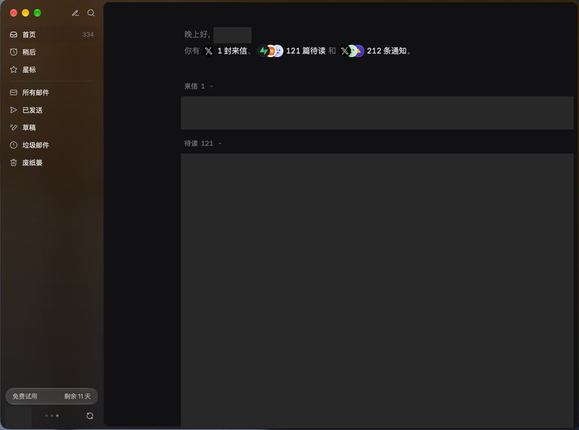

## 問題

郵件首頁以多個分組呈現內容時，如何讓摘要數字同時成為定位入口？

## 做法

- 原圖左側是資料夾導覽，右側先呈現問候與三種郵件摘要，下面是來信與待讀分組。
- 作者在 v0.9.1 更新說明中表示：點摘要中的來信、待讀或通知，頁面會捲到相應分組。這是作者描述，靜態圖不能驗證點擊結果。
- 摘要與正文沿用同一分類名稱及數量，形成對應線索；不把示範帳戶的數量當作產品能力。

*首頁摘要與郵件分組；帳戶頭像姓名及郵件寄件人、主旨與日期均已遮除。*

## 為什麼有效（推論）

若摘要可跳至原位，使用者可能不必先在長頁搜尋對應標題；維持分類名稱一致也有助建立位置關係。實際效率與捲動焦點行為尚未測試。

## 借鑑要點

- **適合**：分組收件匣、長首頁、待辦摘要。
- **不適合**：分組內容很短時加入大幅捲動，或只有顏色能辨識入口。
- **移植時注意**：給摘要明確可點樣式、鍵盤焦點、跳轉後的位置提示，處理零項與分組動態更新。

## 來源與核對範圍

- [Zayn Hao 原帖](https://x.com/ZaynHao/status/2124873975407022504)：官方 NoteTweet 全文、日期及原圖已核對。
- [Kubai 轉發](https://x.com/Kubai087/status/2124883118570283301)：官方頁同時提供原作者資料，按原帖去重。
- [產品網站](https://fog.fehey.com/)本次讀取失敗；未測試作者另述的性能、草稿同步與快捷鍵修復。不將其列為已驗收行為。
