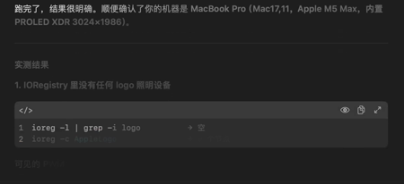
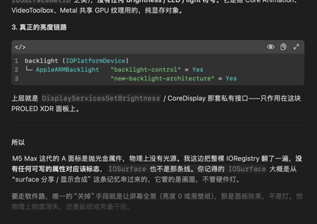
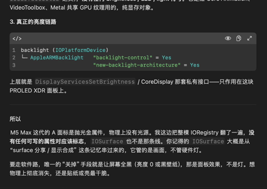

## 問題

桌面聊天產生長篇回答時，新增段落與程式碼會持續增加高度；使用者需要保留閱讀位置，也需要看到最新輸出的內容。

## 做法

*首張另裁去頂部 112 px 的推理與工具紀錄，只保留正式回答、分隔線及下方程式碼區塊；欄寬未變。*

*較早的段落移到視窗上方，新增的程式碼與說明占據中段。*

*程式碼下方的補充說明與下一段引導繼續在相同欄寬內呈現。*

- 約 23.4 秒的作者影片顯示深色桌面聊天視窗，左側是對話清單，右側是主要回答與底部輸入區；本卡只保留回答區，裁掉歷史、標題與底部模型／執行資訊；首張再從原保留圖（450 × 318 px）頂部裁去 112 px，成為 450 × 206 px，以移除推理與工具紀錄並保留正式回答，沒有重繪內容。未保存完整提示詞或思考文字。
- 畫面側欄標示「浮望」，但原帖只寫「有点不太习惯这么优雅。」；以概念／開發展示收錄，不推定已發布產品。
- **動效過程**：開頭在輸入區輸入並送出短句，接著顯示等待文字；回答逐段增加，內容向上移動，後段呈現帶語言標記與工具圖標的程式碼區塊及補充說明。影片在回答末段結束，未展示錯誤或取消。
- 輸出文字沒有再包一層明顯氣泡邊框；程式碼區塊使用較亮底色，讓段落與程式碼分區。整段示範中側欄與輸入區仍維持在工作區邊緣。
- 影片可觀察到內容增加與視窗位移，但無法確認是自動跟隨還是作者操作捲動，也沒有幀率或延遲測量。
- 來源：[作者原帖](https://x.com/Lakr233/status/2124884172183683419)。來源發現於 X-2026-11-24.md，原始來源欄為「点赞」。

## 為什麼有效（推論）

- 回答維持單一欄寬，並只在程式碼處增加視覺容器，可能減少長文閱讀時的邊界干擾。
- 輸入區保留固定入口，有助於讓閱讀與後續輸入共享同一工作區；此為對影片的解讀，未驗證操作成效。

## 借鑑要點

- **適合**：會生成長文與程式碼的桌面 AI 對話。
- **不適合**：必須固定對照多份回答、精確逐行審閱差異的任務。
- **移植時注意**：將是否跟隨最新內容做成明確規則；使用者往上讀時停止跟隨，提供回到最新位置的入口，並用長段落、程式碼與延遲輸出測試。這些是移植建議，並非影片已驗證功能。
