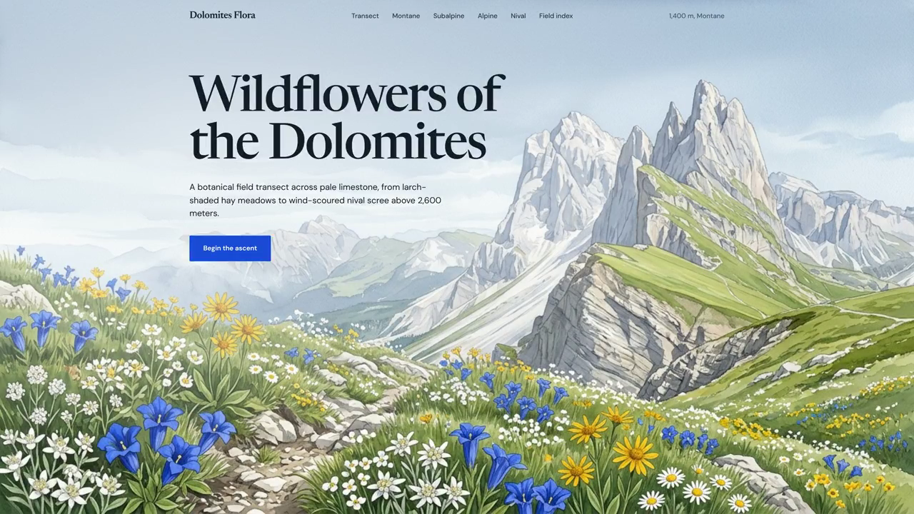
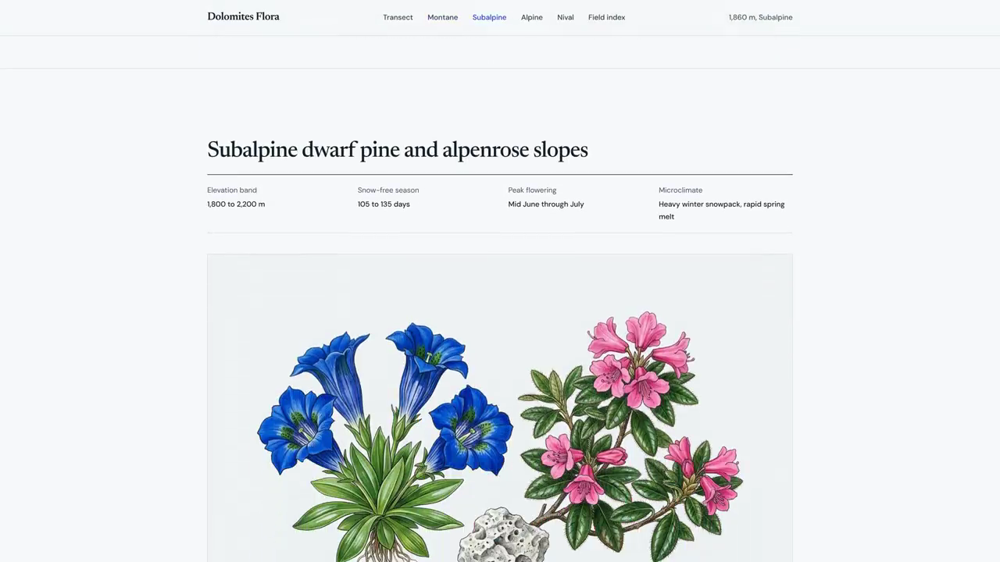
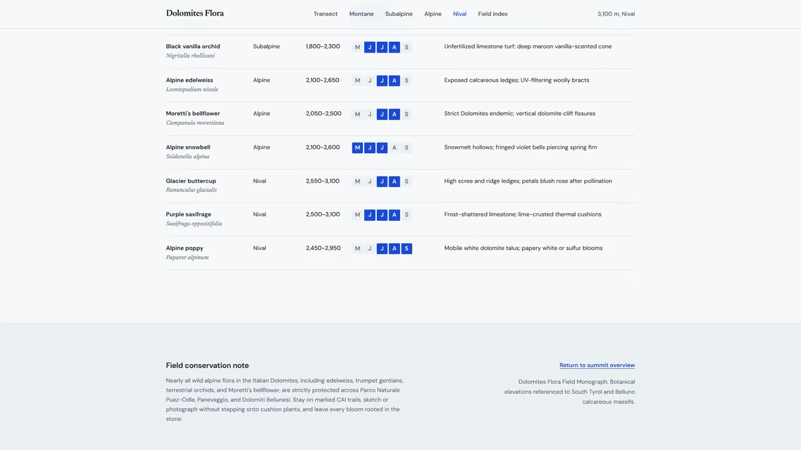

## 問題

有多個自然分類與比較維度的長文，需要從吸引閱讀過渡到可查找的資料。

## 做法

*1 秒：全幅山景承載大標題與單一藍色主按鈕，頂端是章節導覽。*

*8 秒：Subalpine 章節先列海拔、季節與棲地，再呈現植物插畫。*

*16 秒：頁尾以表格列植物、分區、高度與月份，接續保育說明。*

作者影片由山景首屏向下捲動 → 進入依高度分區的插畫章節 → 抵達植物比較表。正文以大襯線標題、細分隔線與留白建立層次，藍色僅突出少數按鈕和月份格；未展示手機版，不以轉介文字代替窄螢幕證據。

## 為什麼有效（推論）

先呈現場景、再列章節屬性、最後提供表格，可能兼顧連續閱讀與定點查找；沒有閱讀或轉換率數據。

## 借鑑要點

- **適合**：圖文長文、自然觀察與需要比較屬性的專題。
- **不適合**：內容稀少卻為大圖增加捲動成本的功能頁。
- **移植時注意**：按內容選色；檢查文字與背景對比、插畫載入及手機表格。保留主題策略，不複製完整提示詞。

## 來源與核對範圍

[Philipp Schmid (@_philschmid)；ZHU YAJUN (@YajunZhu36691)（轉介） 原帖](https://x.com/YajunZhu36691/status/2125259653684789392)，發布：`2026-11-24T16:06:01+00:00`。2026-11-27 核對官方 X 頁內嵌完整文字及媒體；各影片保留三張影格，未保存原始影片。
原示範由 [Philipp Schmid 發布](https://x.com/_philschmid/status/2125206633722601572)（`2026-11-24T12:35:20+00:00`）；僅摘記版面策略，不保存完整提示詞，也未安裝技能或驗證模型能力宣稱。
