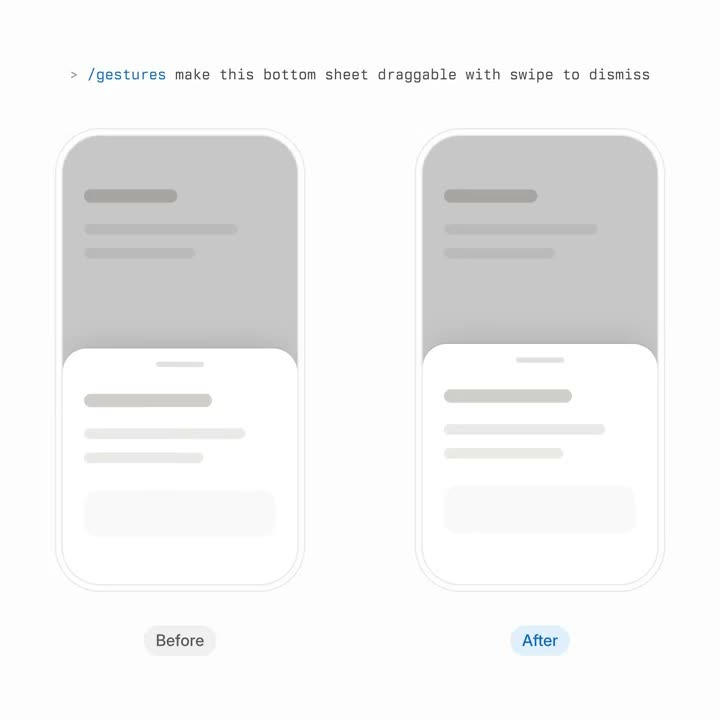
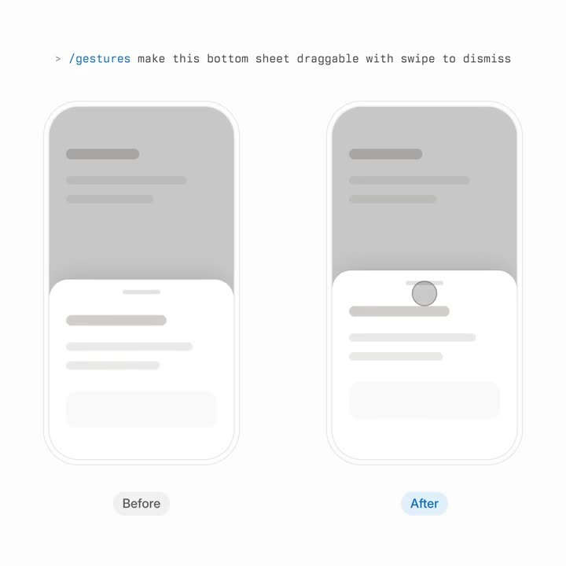
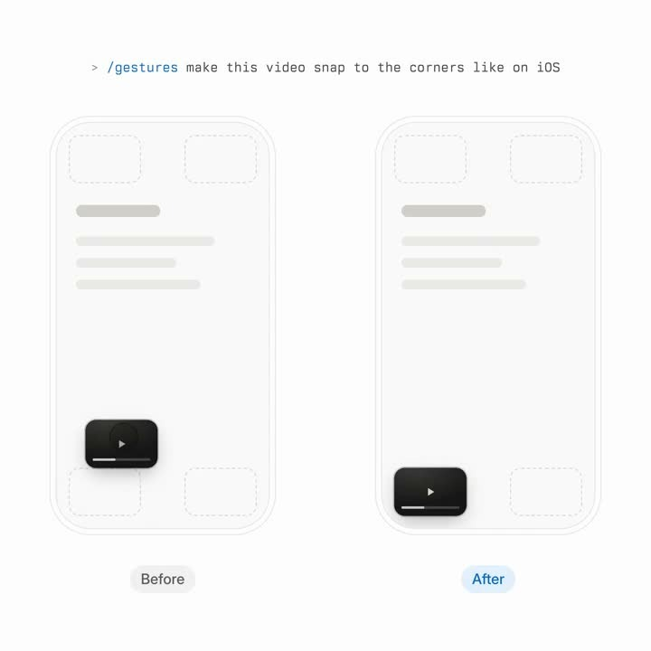
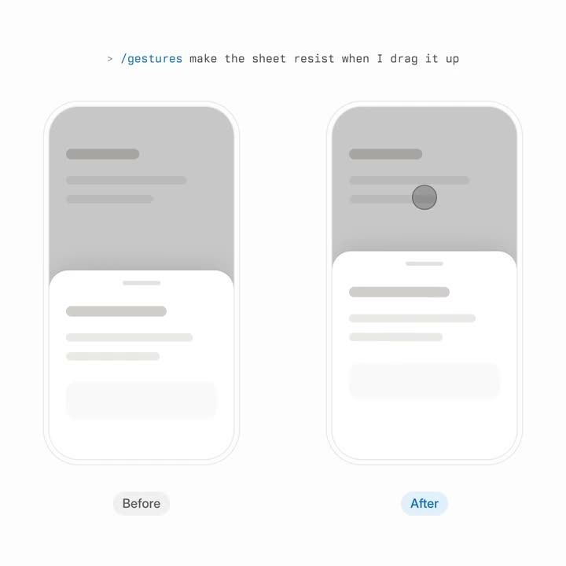
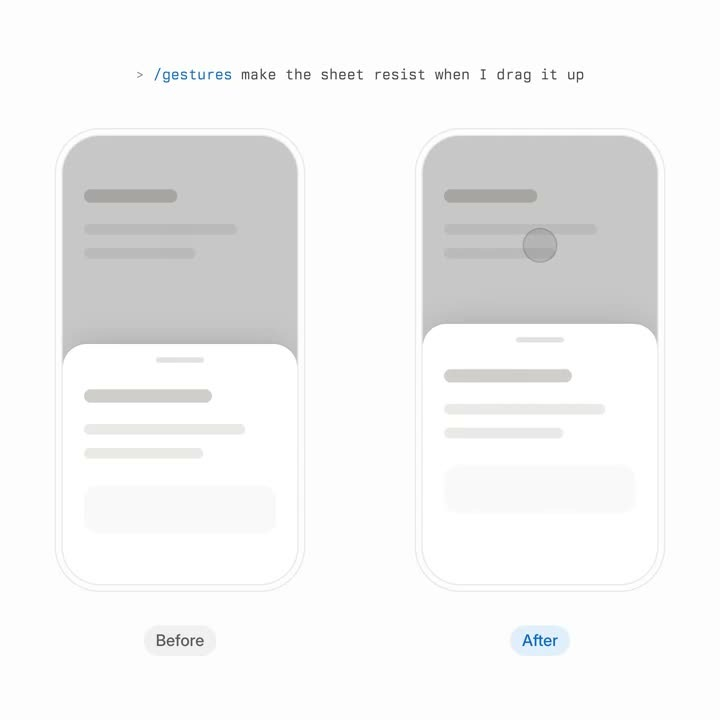

## 問題

面板能拖動卻缺少邊界阻力與釋放後的動態回饋時，操作容易顯得僵硬。

## 做法

*Before／After 並排展示同一底部面板。*

*灰色接觸點與面板位移呈現拖曳過程。*

*小型播放器示例比較角落吸附。*

*短面板向上拖動時呈現不同的跟手狀態。*

*後段呈現面板拖動後的狀態，原帖另說明慣性與回彈。*

- 原文列出 rubber banding、拖曳速度與保留動量；影片以 Before／After 並排比較。
- 示範先拖動底部面板，後段包含小型播放器吸附到角落，以及短面板往上拖動的變化；手指位置以灰色圓點表示。
- 影片中的操作先有接觸與位移，再呈現釋放後的落位；無法只由稀疏影格還原彈簧參數與速度門檻。另一則貼文補充技能原始碼入口。

## 為什麼有效（推論）

- 將阻力與慣性連在同一次手勢裡，可能讓使用者更容易預期邊界與結束位置。

## 借鑑要點

- **適合**：底部面板、可拖動小窗與抽屜。
- **不適合**：唯一入口依賴精細拖曳，沒有按鈕或鍵盤替代方案的流程。
- **移植時注意**：先決定關閉、展開和吸附的落點，再調速度門檻；提供減少動態效果與替代操作。

## 來源與核實範圍

- [@emilkowalski 原帖](https://x.com/emilkowalski/status/2119406396160540738)；發表時間：2026-11-08T12:27:16+00:00。
- [@emilkowalski 原帖](https://x.com/emilkowalski/status/2119407376344461672)；發表時間：2026-11-08T12:31:09+00:00。
- [作者技能原始碼](https://github.com/emilkowalski/skills)。
- 依原帖文字與本次實際檢視的素材整理；未操作產品驗證功能。`date` 為收錄日期；原帖發表日期另記於 `published_at`。
