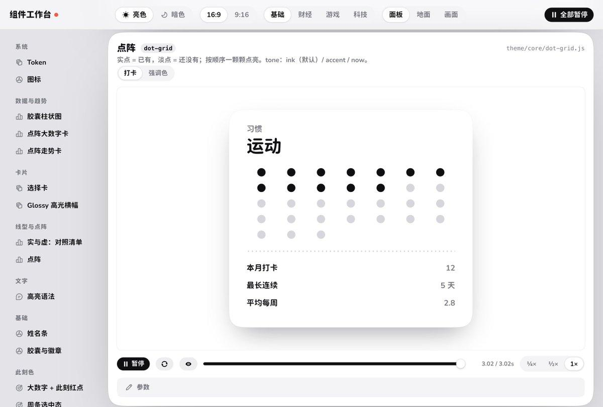

## 問題

製作影片包裝的人需要在挑選元件時，同時比較畫幅、視覺主題與播放狀態，避免每次另開完整影片檢查。

## 做法

作者介紹正在迭代的影片剪輯與包裝 Skill。附圖顯示「组件工作台」，未提供足以確認為正式產品的發布證據，因此記為 concept；觀看量改善只屬作者陳述，不作效果證據。

*單張原圖：左側按系統、資料與趨勢、卡片等群組列元件；中央點陣打卡卡片下方直接排列播放、進度、速度與參數入口。*

- 頂部集中亮色／暗色、16:9／9:16、基礎／財經／遊戲／科技及面板／地面／畫面等切換，右上另有「全部暫停」。
- 左側導覽把元件依用途分組；主區用名稱「点阵 dot-grid」與短說明交代實點、淡點的語義，並有打卡與強調色選項。
- 預覽示例使用黑點與淺灰點表示不同狀態；卡片下半列本月打卡、最長連續、平均每周等指標。
- 預覽下直接放暫停、重播、眼睛圖示、進度滑桿與 3.02 / 3.02s，右邊列 ¼×、½×、1×；更下方有可展開的參數列。截圖不能證明這些控制已正常執行。

## 為什麼有效（推論）

- 把全域風格放頂部、個別元件選項放預覽附近，可能減少調整時的定位負擔。
- 預覽旁提供慢速與重播，有利於檢查動效細節；實際可用性仍需操作驗證。

## 借鑑要點

- **適合**：影片包裝、動效元件庫與需要反覆比較風格的編輯工具。
- **不適合**：只有靜態素材卻沒有時間軸的圖庫。
- **移植時注意**：標明全域／局部設定作用範圍；清楚呈現暫停狀態；讓滑桿與速度控制可用鍵盤操作，另驗證不同畫幅的內容安全區。
