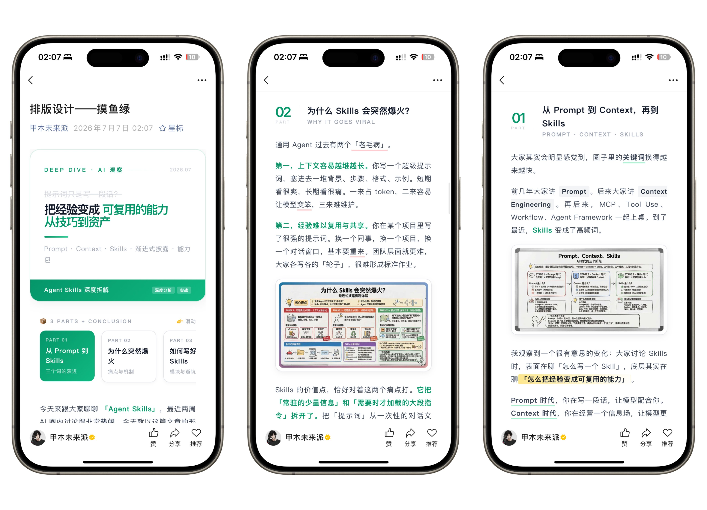
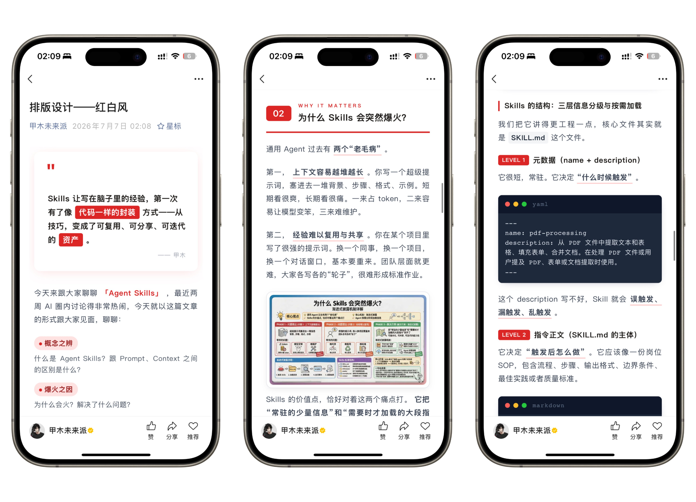
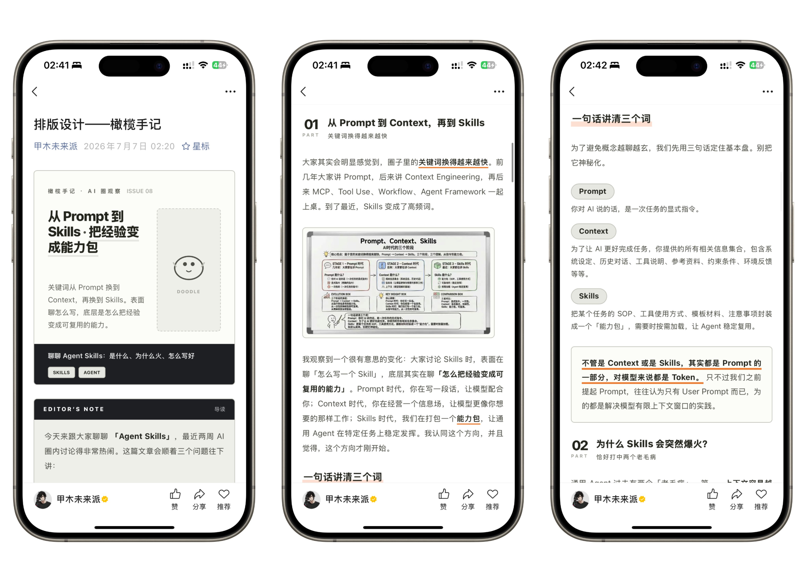

## 問題

把 Markdown 轉成手機文章時，只換主色容易讓長文章仍然沒有章節節奏，也無法判斷樣式是否適合實際閱讀。

## 做法

*綠色主題以三個手機畫面展示不同章節與圖文組合。*

*紅白主題同時改變重點標記與程式碼區塊。*

*石墨方案使用較低彩度的閱讀層次。*

- 附圖以多支手機並排展示同一類文章內容；綠色主題使用大標題、綠色強調和深底摘要區，紅白主題以紅色標記與深色程式碼塊形成節奏。
- 另一組淺灰／石墨方案使用較安靜的底色、章節編號和框線區塊；圖片與示例區仍嵌在正文之間，而不是只展示主題色票。
- 作者說明有主題生成器、預覽頁的「複製到公眾號」以及平台限制校驗。這些屬原文功能說明；本次沒有實測剪貼簿、貼入保真或六套完整主題。

## 為什麼有效（推論）

把標題、摘要、引文、程式碼與插圖作為一套元件一起設計，可能比只換色更能建立文章的閱讀節奏；手機預覽也能提早暴露換行問題。

## 借鑑要點

- **適合**：長文排版、文件主題與內容匯出工具。
- **不適合**：短訊通知，或不容許富文字樣式的內容通道。
- **移植時注意**：先建立代表性文章，包含長標題、連結、程式碼和多圖；每套主題都驗證窄螢幕與貼入後結果，不能僅憑預覽宣稱樣式不掉。

## 來源與核對範圍

- [jiamu_future 原文](https://x.com/jiamu_future/status/2074309164239864032)（發布：2026-07-07T01:46:58+00:00）。

已核對 X 公開原文的嵌入式 Tweet／NoteTweet 資料及本卡所列原始素材。`kind: concept` 表示本次僅確認公開展示／設計方法，沒有把示範等同正式上線或端到端驗證。
