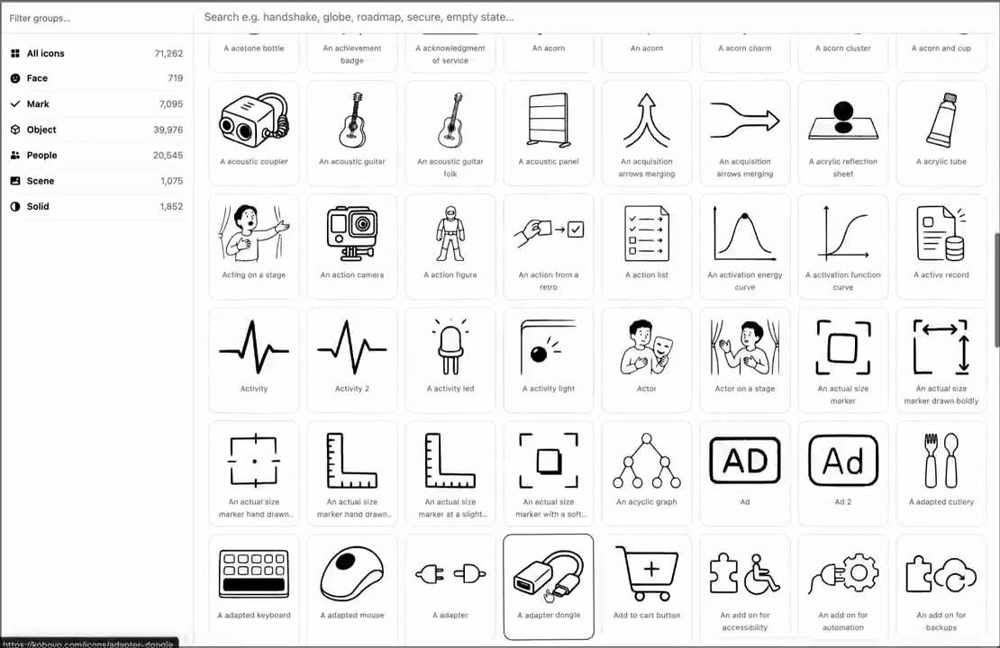
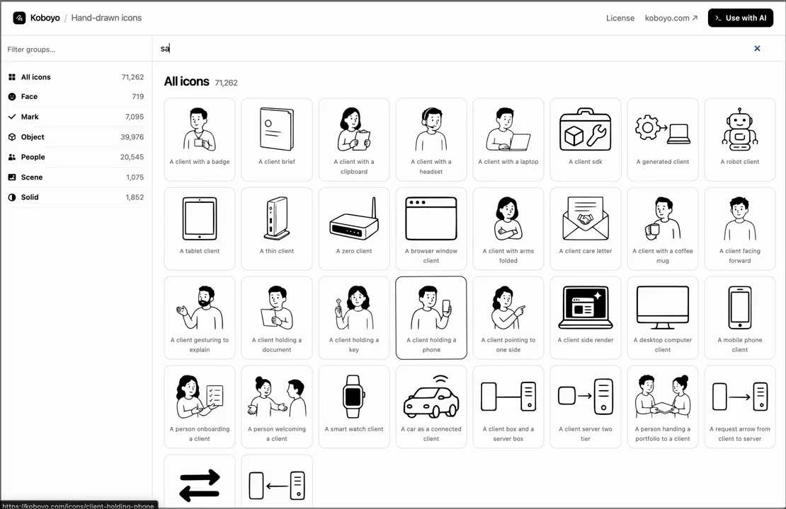
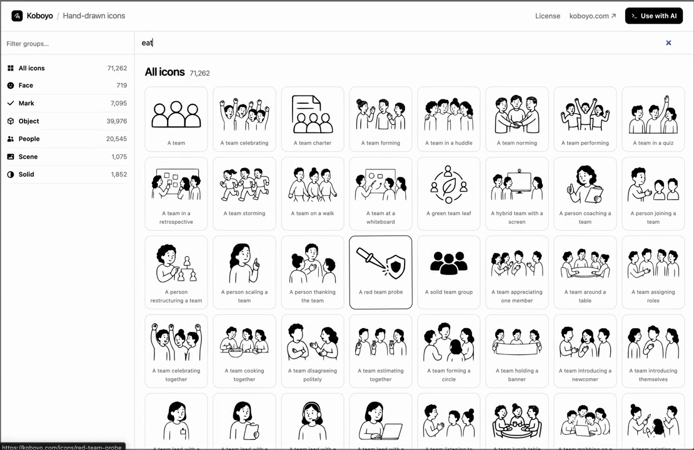
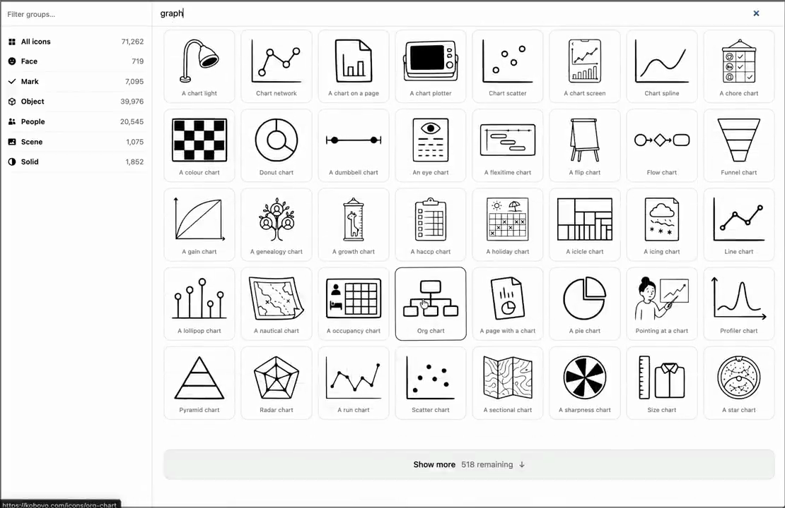
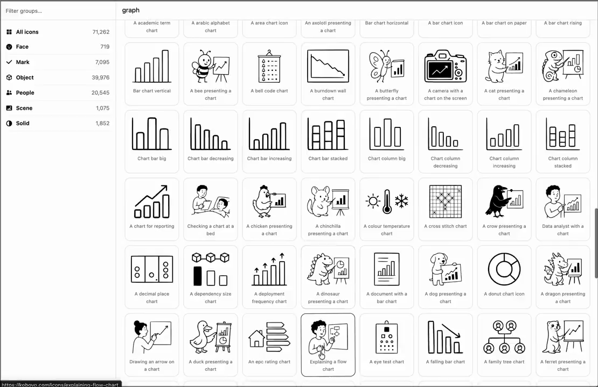

## 問題

大量圖標若只提供整頁縮圖，使用者很難同時找到正確語義與一致筆觸。

## 做法

*左側風格分類與上方搜尋共同控制右側網格。*

*AI 關鍵字顯示人物、機器與裝置變體。*

*群體圖標在一致格位內並排比較。*

*圖表類素材保留短名稱和不同構圖。*

*graph 搜尋聚合多種統計圖形。*

- 作者發布影片展示左側風格清單、頂部文字搜尋與右側規則圖標網格；每個小格以圖形為主、下方附短名稱。
- 影片輸入 AI、all、graph 等字詞後，主區分別展示人物／裝置、群體及圖表類圖標；搜尋結果保留同一網格結構。
- 同批 @li9292 的貼文附上相同圖標庫演示，故合併本卡。作者稱 70K+、免費且不需署名，這只是發布時的主張，不能代替目前素材授權條款。
- 末段圖表搜尋把多種長條、折線與圓餅變體並排；靜態影格未展示下載或套用到產品後的效果。

## 為什麼有效（推論）

語義搜尋與筆觸分類分開處理，可能讓「找對意思」與「保持風格」各有清楚的入口；規則網格則方便直接比較細節密度。

## 借鑑要點

- **適合**：大型圖標庫、插圖庫及有多風格的素材選擇器。
- **不適合**：只有十幾個固定功能圖標，或需高精度辨識且不適合裝飾性線條的工具列。
- **移植時注意**：補上同義詞、零結果和下載格式；選用前檢查小尺寸辨識度、筆畫粗細及授權版本。不要將不同風格混成一套功能圖標。

## 來源與核對範圍

- [nilbuild 原文](https://x.com/nilbuild/status/2083692182633107540)（發布：2026-08-01T23:11:44+00:00）。
- [合併來源 @li9292](https://x.com/li9292/status/2083922657658249264)（發布：2026-08-02T14:27:33+00:00）。

已核對 X 公開原文的嵌入式 Tweet／NoteTweet 資料及本卡所列原始素材。`kind: concept` 表示本次僅確認公開展示／設計方法，沒有把示範等同正式上線或端到端驗證。
