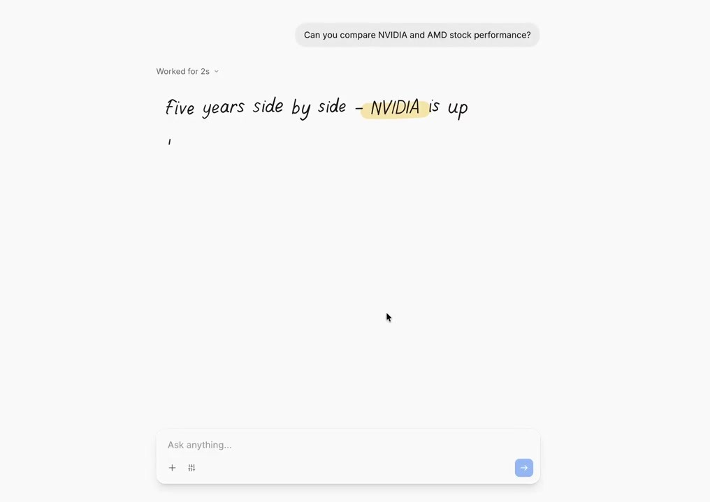
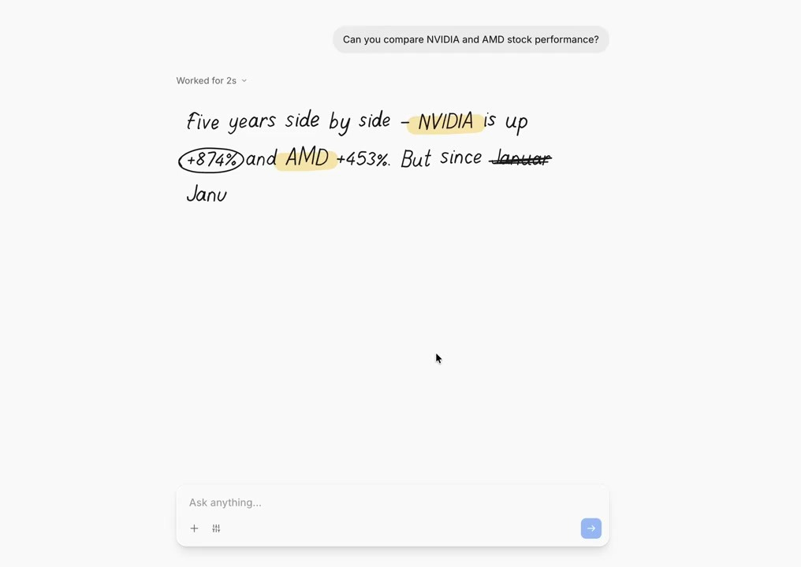
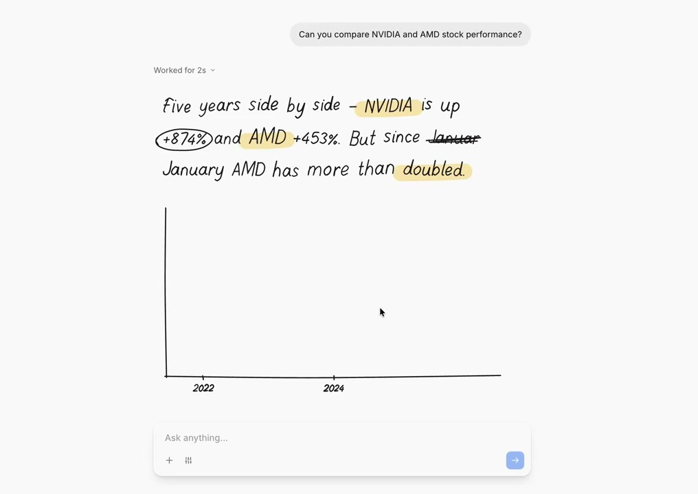
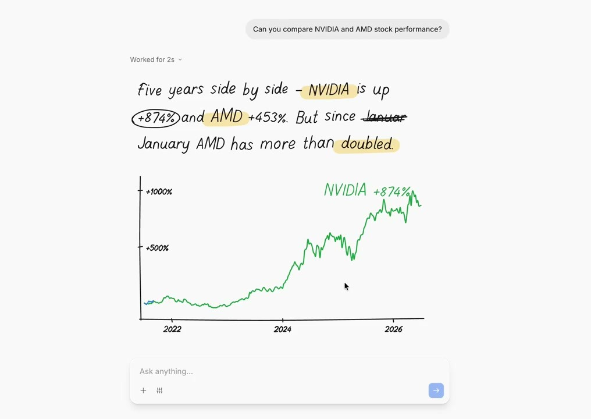

## 問題

生成的解釋文字與圖表容易呈現機械化、一次傾倒的感覺。

## 做法

- 原帖描述 AI 輸出加入手寫感標註、塗抹，以及手寫字體圖表。
- 文字配合流式輸出逐行展示，將視覺質感與內容揭露節奏組合。
- 媒體來源欄位指向 nilseller 的示範；op7418 是轉述者，不認定其為原設計者。

### 已檢視的素材

*解釋先出現一行文字，強調處有淡色標記。*

*後續文字加入圈選與劃除，呈現筆記式修正。*

*文字下方先出現圖表座標框。*

*圖表補上曲線及手寫標籤，形成完整說明。*

## 為什麼有效（推論）

逐行揭露可能幫助追蹤解說順序；手寫標註則將強調方式與筆記情境連結。

## 借鑑要點

- **適合**：教學解釋與可逐步閱讀的筆記。
- **不適合**：需要快速掃讀、精確數字比較或低視力閱讀。
- **移植時注意**：保留可選取的文字與靜態完整版本；不要讓裝飾筆跡混淆原文與校正。

## 來源與核實

- [原帖](https://x.com/op7418/status/2084978122894815677)：已取得 X 公開頁面內嵌原始 Tweet / NoteTweet 資料，按相同 status ID 核對正文。
- 本卡的「做法」依原帖文字與已檢視素材撰寫；沒有執行產品功能驗收，效果解讀列為推論。
