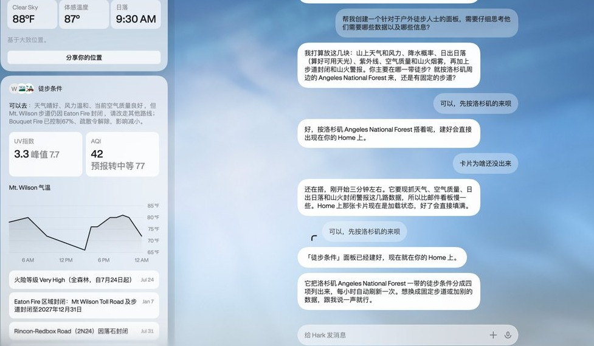

## 問題

使用者透過對話建立日常資料面板時，結果若只藏在訊息流，後續不易回看。

## 做法

*左側資料卡與右側生成對話並排；已裁去瀏覽器列、帳號頭像與地點標題。*

- 原圖左側是垂直資料卡，右側是對話串和輸入框；背景一致，但卡片與訊息各自形成清楚區域。
- 左側徒步條件卡把簡短判斷、UV／AQI 數值、氣溫折線與道路／火險提醒放在同一卡片；右側對話則保留建立面板的問答。
- 原文稱左側卡片可由 AI 自訂；截圖中訊息也描述自動刷新，但本次沒有驗證更新頻率與實際資料來源。

## 為什麼有效（推論）

- 把可持續使用的結果從訊息流分出來，可能減少重複詢問，讓對話專注在修改需求。

## 借鑑要點

- **適合**：個人助理、監測摘要與可持續更新的生成式面板。
- **不適合**：把來源或新鮮度不明的資料包裝成即時權威結果。
- **移植時注意**：資料卡保留更新時間、來源與錯誤狀態；截圖中的動效說法無法由靜態圖核實。

## 來源與核實範圍

- [@op7418 原帖](https://x.com/op7418/status/2107523062619054174)；發表時間：2026-10-06T17:27:08+00:00。
- 依原帖文字與本次實際檢視的素材整理；未操作產品驗證功能。`date` 為收錄日期；原帖發表日期另記於 `published_at`。
