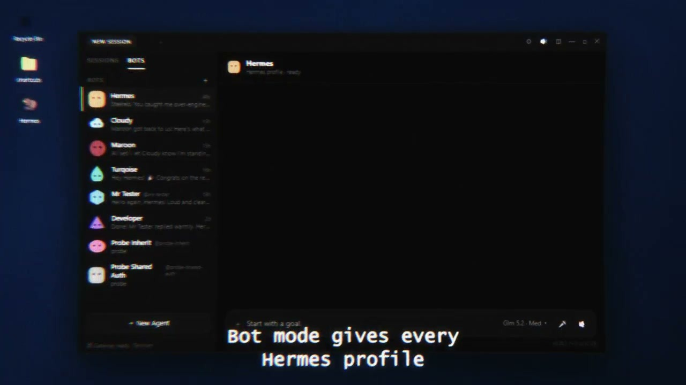
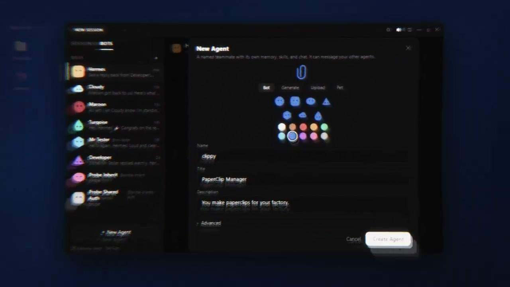
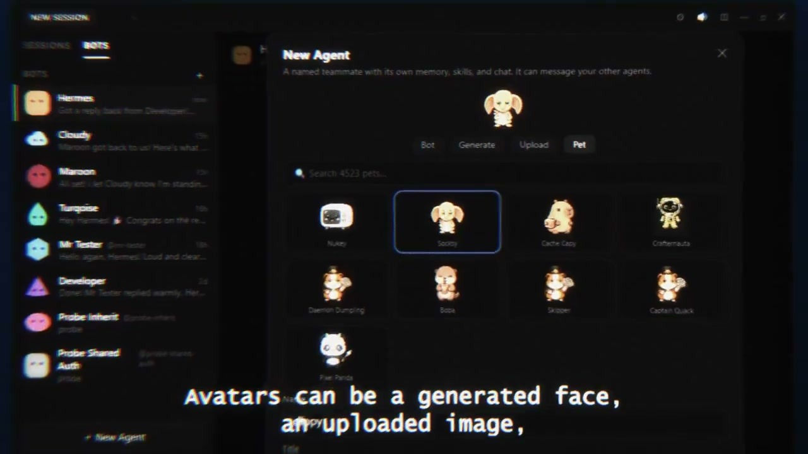

## 問題

重複使用專長不同的 Agent 時，使用者不想每次重建模型、角色和上下文。

## 做法

- 官方原帖把 agent profiles 呈現為一系列有名字的 Bots。
- 每個 Bot 各自擁有角色、模型、記憶、skills 與頭像，可選不同模型，並能互相通訊。
- 原帖未說明權限或記憶隔離保證，不能把不同角色等同於安全隔離。

### 已檢視的素材

*具名 Bots 在左側排列，對話位於主要區域。*

*建立角色表單提供圖標、名稱與角色描述。*

*角色頭像選擇提供多種圖像與生成方式。*

*對話框以 @ 形式指定要聯絡的角色。*

## 為什麼有效（推論）

具名角色與頭像可幫助辨認工作對象；持久設定可能降低重複配置的成本。

## 借鑑要點

- **適合**：專家型助手與重複任務。
- **不適合**：以角色外觀當作權限控制。
- **移植時注意**：在切換入口顯示模型和記憶範圍；跨 Bot 通訊應交代資訊流向。

## 來源與核實

- [原帖](https://x.com/NousResearch/status/2089429432612147572)：已取得 X 公開頁面內嵌原始 Tweet / NoteTweet 資料，按相同 status ID 核對正文。
- 本卡的「做法」依原帖文字與已檢視素材撰寫；沒有執行產品功能驗收，效果解讀列為推論。
