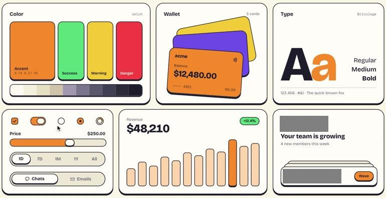
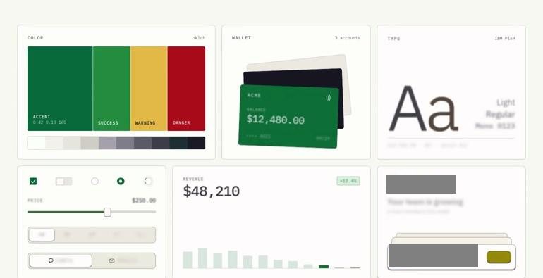
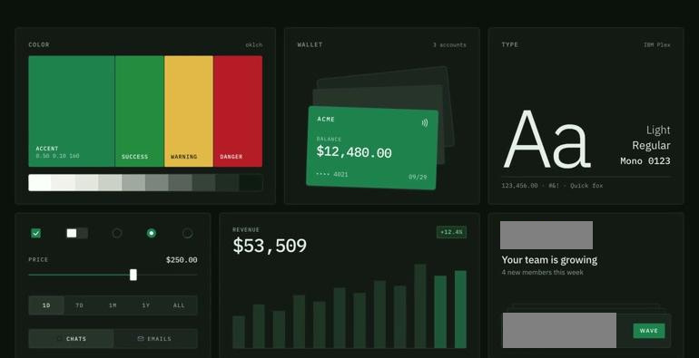

## 問題

替換主題時，如何看出變動是否同時覆蓋資料、控制項和明暗模式？

## 做法

- 影片先顯示同一組 Color、Wallet、Type、控制項、圖表與成員卡，再替換整組配色、邊框、字體和陰影。
- 厚邊框與硬陰影方案保留元件排列；接著改為綠色細線風格，最後切入深色畫面。
- 只記錄樣本可見的外觀變化；不把作者所稱保留可及性與互動視為測試結果。

*固定六組元件以厚邊框、橙色與硬陰影呈現。*

*同一排列換成綠色、細線與較輕的視覺重量。*

*深色版本保留六組樣本，供檢查文字、圖表和控制項。*

三張本地圖片均以不透明灰色區塊遮除成員姓名、通知頭像及上方頭像組；遮罩是收錄時處理，不是原設計。

## 為什麼有效（推論）

保留相同元件類別與排列，可能降低比較不同主題時的干擾；同時暴露圖表、文字和控制項的配色缺口。樣本資料並非固定：營收數字、增幅與長條圖形狀會變動，因此不是嚴格的同內容對照。

## 借鑑要點

- **適合**：主題評審、設計系統視覺回歸樣本。
- **不適合**：僅憑樣本宣稱整站可及性或所有互動正常。
- **移植時注意**：將人物通知替換為無個資樣本，補齊焦點、錯誤、禁用和長文狀態。

## 來源與核對範圍

- [原帖 2124548375853084935](https://x.com/meow2149/status/2124548375853084935)：已讀官方 SSR 同 ID 正文與 NoteTweet（如有），發佈時間 2026-11-22T16:59:39+00:00。
- 已逐張檢視官方影片抽樣影格；僅留三張裁切畫面，未保存原始影片、完整提示詞或私人帳號。示範不等於功能或成效驗收。
