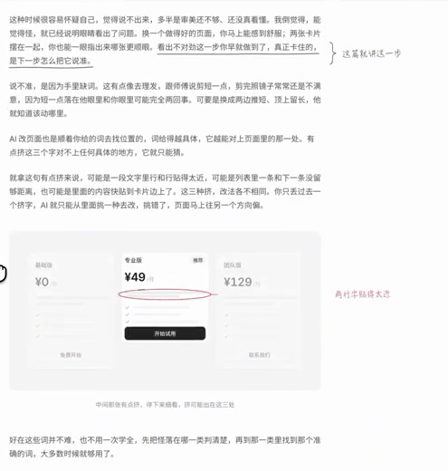
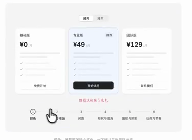
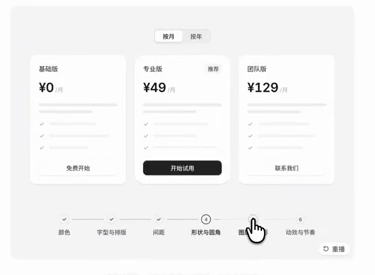
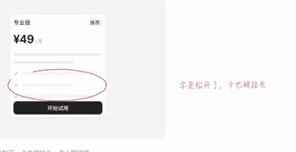

## 問題

長文在說明介面哪裡需要調整時，讀者需要把抽象描述對應到元件位置；如果配圖只是裝飾，仍得自行想像改動後的樣子。

## 做法

- 影片中的 denotes.dev 閱讀頁採左側課程索引、中央正文、右側本頁導覽。正文內直接插入定價卡範例，不需離開文章另開工具。
- 第一組在正文旁以粉紅細圈圈出定價卡的文字區，手寫批註指向局部；另一個畫面出現三欄定價卡，下方有六個具名步驟與選中編號。
- 游標在配圖下方的步驟間移動後，卡片先以淡藍色突出中間方案，後續回到更中性的樣式，步驟上的勾選標記與選中位置也隨之改變。這段提供同一內容的逐步比較，而不是換一張無關圖片。
- 往下閱讀時，另一組單卡範例以粉紅圈和批註標示過鬆的文字區與卡片高度。作者稱是「跟著閱讀一起動」的配圖；本次只觀察到錄影中的捲動、游標操作與狀態變化，不能斷定每處都由捲動自動觸發。

*8.77 秒：文章中直接圈選定價卡的文字區，右側短批註指向局部。*

*13.15 秒：三欄定價卡下方排列六個步驟，中間方案以淡藍底凸顯。*

*17.53 秒：同一組卡片變為中性底，步驟列已出現勾選與後段選中狀態。*

*26.30 秒：單張定價卡的文字區被粉紅線圈起，旁邊指出卡片被拉長；已裁掉左側範例指令。*

## 為什麼有效（推論）

把批註貼近被討論的部位，可減少讀者往返比對；同一張定價卡逐步變化，可能更容易區分顏色、間距與形狀等不同改動。這是閱讀設計推論，未測量理解率。

## 借鑑要點

- **適合**：教學長文、設計評審解說與需要逐步拆解的案例。
- **不適合**：將重要知識只放在不可暫停的動畫中，或用持續動效打斷正文閱讀。
- **移植時注意**：每個步驟標出所改屬性，保留靜態摘要與重新開始入口；手寫批註也要有文字替代。此處是閱讀內演示，另見[選詞查找工具](../ian-design-terminology-comparison/case.md)，不能因作者相同就視為同一流程。

## 來源與核實

[作者原帖](https://x.com/ianneo_ai/status/2123318001017708571)發布於 2026-11-19T07:30:35Z，NoteTweet 全文說明第五篇新增互動配圖與手寫批註；[Kubai RT](https://x.com/Kubai087/status/2123326282901704779)發布於 08:03:29Z。使用既有指定 fetch.py 官方 Tweet／NoteTweet 資料核對作者、時間與影片 ID `2123316729866772480`。檢視 52.62 秒影片的 12 個等距取樣及關鍵原尺寸影格，保存四張裁切影格，移除瀏覽器工具列、完整提示詞與原片。

較早的[四課介紹](https://x.com/ianneo_ai/status/2122950259475410951)發布於 2026-11-18T07:09:19Z；[Kubai RT](https://x.com/Kubai087/status/2123035164221870186)發布於 12:46:41Z。四張宣傳圖片可見相同 Denotes 課程閱讀版型，但沒有新增的互動序列，因此僅作同產品背景核對，不另建卡，也不把它當作本卡動效的證據。
