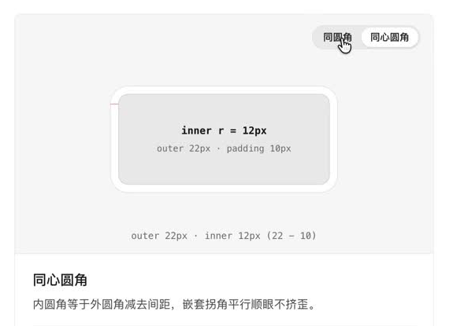

## 問題

想改善介面的人常能感覺到差異，卻無法把它對應到「點綴色」「同心圓角」「視覺對齊」等名稱；單靠靜態定義也難判斷究竟改了哪裡。

## 做法

- 左側垂直列出詞彙，選中項有灰色膠囊底。右側聚焦一張示範卡：上半部是效果，右上角兩段切換，下方附名稱與一句解釋。
- 開頭顯示「點綴色」，四個操作並列，只有 Publish 使用綠色，其餘是中性底。兩段選項標為「花哨搶眼／克制聚焦」。
- 游標接著移到同心圓角的比較：示範用外框 22px、內距 10px、內框 12px 標示內外半徑關係；右上角可切同圓角與同心圓角。
- 後段先經過極細描邊，再切到「視覺對齊」；圓形按鈕中的播放三角搭配參考線，右上角在幾何居中與視覺居中之間切換，畫面文字指出 +2px 的視覺微調。這是作者錄影呈現的切換，未親自操作網站。
- 原畫面另有給 AI 的範例文字及複製圖示，本卡裁掉該區，不保存完整提示詞，也不把圖示可見視為複製成功。

*0 秒：左側詞彙索引對應右側單一比較卡，Publish 是唯一綠色操作。*

*5.64 秒：外框 22px、內距 10px、內框 12px 與切換控件同屏呈現。*

*12.70 秒：播放三角旁的參考線與 +2px 標記，把抽象對齊名稱連回具體位移。*

## 為什麼有效（推論）

固定一個示範物件、只改一項屬性，有助於把名稱與差異對上；詞彙索引提供查找入口，局部兩態切換避免必須記住上一頁。沒有學習成效數據。

## 借鑑要點

- **適合**：設計術語教學、視覺規格溝通與小範圍參數比較。
- **不適合**：用展示片段判定某種風格在所有情境都較好。
- **移植時注意**：保持比較物件尺寸與內容一致，明確標記所改屬性；補上鍵盤操作與降低動效模式，不要只靠游標示意。

## 來源與核實

[原帖](https://x.com/ianneo_ai/status/2123582654503366977)發布於 2026-11-20T01:02:13Z；[Kubai RT](https://x.com/Kubai087/status/2123582954308087941)發布於 01:03:25Z。指定 fetch.py 的官方頁面內嵌 Tweet 資料核對作者、時間及影片 ID `2123582358423257088`。檢視 16.93 秒影片的 12 個等距取樣與關鍵原尺寸影格，保存三張裁切圖，不保留原片。

同作者的[文章內互動配圖](../ian-design-notes-reading-illustrations/case.md)是閱讀中逐步解說，與本卡的選詞查找流程分開。同介面的[普通圓角／超橢圓比較](../kubai-999-004-nested-continuous-corners/case.md)已合併到既有圓角卡。既有 [KAWAI APP 模式詞典](../ui-pattern-dictionary-named-requests/case.md)作者與內容不同，沒有合併為同產品。
