## 問題

想改善介面的人常能感覺到差異，卻無法把它對應到「點綴色」「同心圓角」「視覺對齊」等名稱；單靠靜態定義也難判斷究竟改了哪裡。

## 做法

- 左側垂直列出詞彙，選中項有灰色膠囊底。右側聚焦一張示範卡：上半部是效果，右上角兩段切換，下方附名稱與一句解釋。
- 開頭顯示「點綴色」，四個操作並列，只有 Publish 使用綠色，其餘是中性底。兩段選項標為「花哨搶眼／克制聚焦」。
- 游標接著移到同心圓角的比較：示範用外框 22px、內距 10px、內框 12px 標示內外半徑關係；右上角可切同圓角與同心圓角。
- 後段先經過極細描邊，再切到「視覺對齊」；圓形按鈕中的播放三角搭配參考線，右上角在幾何居中與視覺居中之間切換，畫面文字指出 +2px 的視覺微調。這是作者錄影呈現的切換，未親自操作網站。
- 原畫面另有給 AI 的範例文字及複製圖示，本卡裁掉該區，不保存完整提示詞，也不把圖示可見視為複製成功。

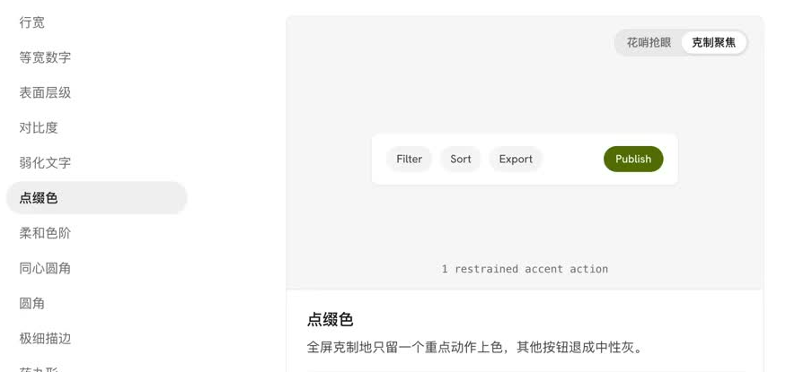
*0 秒：左側詞彙索引對應右側單一比較卡，Publish 是唯一綠色操作。*

*5.64 秒：外框 22px、內距 10px、內框 12px 與切換控件同屏呈現。*

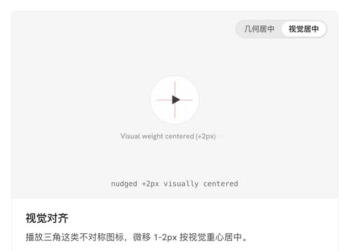
*12.70 秒：播放三角旁的參考線與 +2px 標記，把抽象對齊名稱連回具體位移。*

## 為什麼有效（推論）

固定一個示範物件、只改一項屬性，有助於把名稱與差異對上；詞彙索引提供查找入口，局部兩態切換避免必須記住上一頁。沒有學習成效數據。

## 借鑑要點

- **適合**：設計術語教學、視覺規格溝通與小範圍參數比較。
- **不適合**：用展示片段判定某種風格在所有情境都較好。
- **移植時注意**：保持比較物件尺寸與內容一致，明確標記所改屬性；補上鍵盤操作與降低動效模式，不要只靠游標示意。

## 來源與核實

[原帖](https://x.com/ianneo_ai/status/2123582654503366977)發布於 2026-11-20T01:02:13Z；[Kubai RT](https://x.com/Kubai087/status/2123582954308087941)發布於 01:03:25Z。指定 fetch.py 的官方頁面內嵌 Tweet 資料核對作者、時間及影片 ID `2123582358423257088`。檢視 16.93 秒影片的 12 個等距取樣與關鍵原尺寸影格，保存三張裁切圖，不保留原片。

同作者的[文章內互動配圖](../ian-design-notes-reading-illustrations/case.md)是閱讀中逐步解說，與本卡的選詞查找流程分開。同介面的[普通圓角／超橢圓比較](../kubai-999-004-nested-continuous-corners/case.md)已合併到既有圓角卡。既有 [KAWAI APP 模式詞典](../ui-pattern-dictionary-named-requests/case.md)作者與內容不同，沒有合併為同產品。

## 2026-11-21 公開上線補充

延續同作者、同一「選詞 → 比較示例」流程，補入原卡，不另建案例。前述三張圖保留為 11 月 20 日預覽證據；本節是後續公開上線版本。

### 來源與公開部署

- [Ian 上線原帖](https://x.com/ianneo_ai/status/2124095043644612637)，作者 Ian（@ianneo_ai），發布於 **2026-11-21T10:58:16Z**。原帖展開連結為 **https://www.topinspo.design/vocabulary**，作者宣稱首批 50 個可點擊互動示例；數量與全面功能完整性未逐一驗證。
- [Kubai 引用帖](https://x.com/Kubai087/status/2124098904027447340)，作者枯白 Kubai（@Kubai087），發布於 **2026-11-21T11:13:37Z**，引用上述 Ian 原帖並推薦互動式學習；不是 Kubai 製作或另行部署的工具。
- 以指定官方頁面資料擷取器及當日 Kubai 公開資料核對 ID、作者、時間、引用關係與展開網址。HTTP 與 Chromium 均可免登入開啟公開頁面，回應 200，最終網址仍為上述 www 網域；未登入、未進入社群或付費流程。這補足公開部署證據，因此本卡從 concept 改為 product；不代表所有功能皆驗收。
- 頁面品牌為 Topinspo；上方有情境分類與搜尋入口，內側詞彙索引選中項使用膠囊底。公開頁預設英文，提供中文切換入口；作者錄影使用中文。未因同作者而將本站等同 denotes.dev。

### 原片可見的比較流程

以下四張是上線原帖影片 ID `2124091499294167040` 的實際影格（原片 34.833 秒），裁去瀏覽器、作者側欄與下方完整提示詞區；不保存原影片。

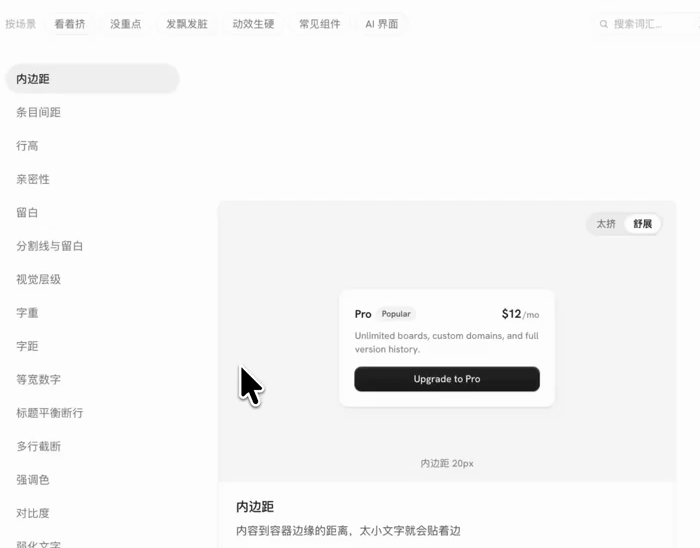
*0 秒：內邊距示例顯示同一張 Pro 卡，舒展狀態標記為 20px。*

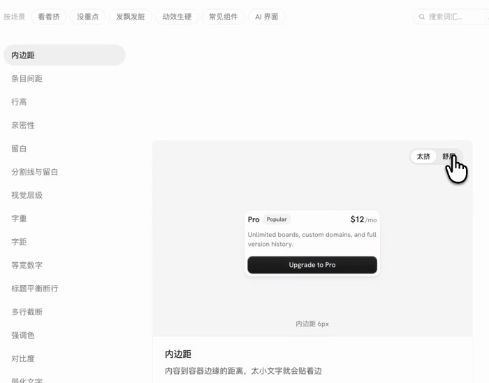
*2 秒：切到「太擠」後，卡片收緊，標記改為 6px，卡片內容保持相同。*

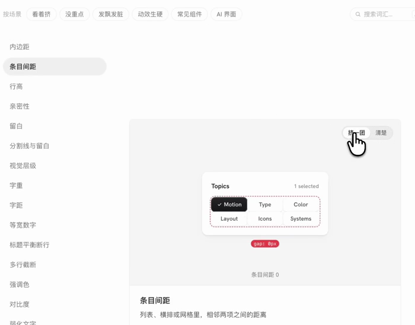
*5 秒：切換詞彙到條目間距，以 Topics 分段選項示範 gap 0 的擁擠狀態。*

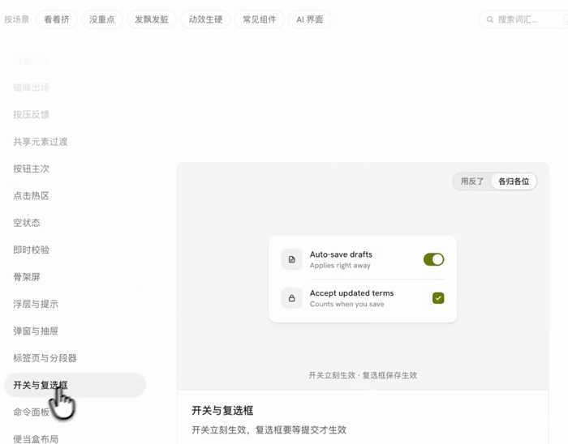
*20 秒：切換到開關與複選框，並排文案指出立即生效與儲存後生效的語義差異。*

- 動作順序：選中詞彙 → 在同一展示區按兩段控件 → 觀察尺寸或間距與數值變化；換詞後示範物件及解釋一起更新。開關／複選框畫面只作語義展示證據，未據此宣稱已執行真實儲存。

### 公開網站功能查證

以 Node.js Playwright test runner 執行公開頁檢查，最終 **1 passed**：選 Padding → Tight，標記顯示 `padding: 6px`；切 Balanced 後顯示 `padding: 20px`，示例 article 的畫面位元組不同；再選 Optical Alignment，出現 Geometric／Optical 比較控件。這證明抽查流程可操作及畫面會更新，未精確量測渲染內距，也未逐項驗證所有詞彙。

前次檢查曾把 Tight 預期誤設成 8px，及以祖先元素 CSS padding 當作示例變化判據而失敗；依實際狀態修正腳本後重跑通過，並未修改遠端產品。腳本位於本次工作暫存目錄；本次只整理參考卡，未開發本站或新增本倉庫應用功能。

### 借鑑補充（推論）

- 當使用者只會說「看著擠」時，可先按情境縮小詞彙，再在同一物件比較 6px／20px；情境入口與具體數值可能幫助把感受轉為可討論的修改要求，沒有學習成效數據。
- 移植到自家教學工具時應保留比較物件的內容，只改目標屬性；把「立即生效／提交後生效」這類行為語義與純視覺比較分清，不用一個通用好／壞標籤取代情境說明。

## 2026-11-22 補充：視覺層級的兩態比較

[原帖](https://x.com/ianneo_ai/status/2124008184063086861)由 Ian（@ianneo_ai）發布於 **2026-11-21T05:13:07Z**；[Kubai RT](https://x.com/Kubai087/status/2124008455245820268)發布於 **2026-11-21T05:14:12Z**。指定 `fetch.py` 從 X 官方公開頁面擷取的兩筆資料，正文及影片 ID `2124007606889205760` 一致；另直接核對 Ian 原帖。RT 是傳播入口，原作者及主要證據均為 Ian，沒有把轉發算成新作品。

### 做法（官方影片觀察）

左側詞彙索引、右側兩段切換與下方解釋的結構，與本卡既有詞彙工具相同；本片只切換「視覺層級」示例，因此合併，不另建案例。影片本身未顯示網址，產品歸屬依相同作者與相同介面判定，沒有獨立驗證此片的部署版本。

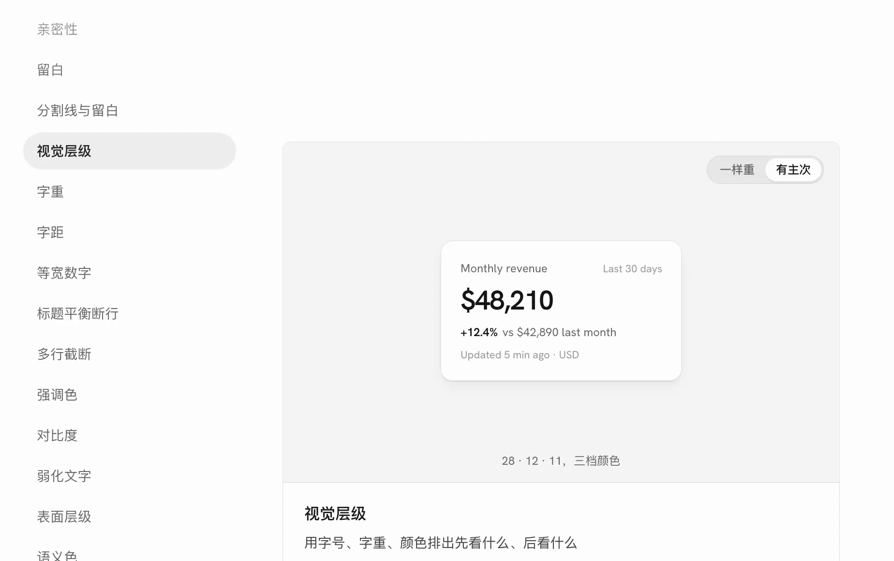
*0 秒：「有主次」顯示同一營收卡，48,210 是最大的核心數字，標籤與更新資訊較小且較淡。*

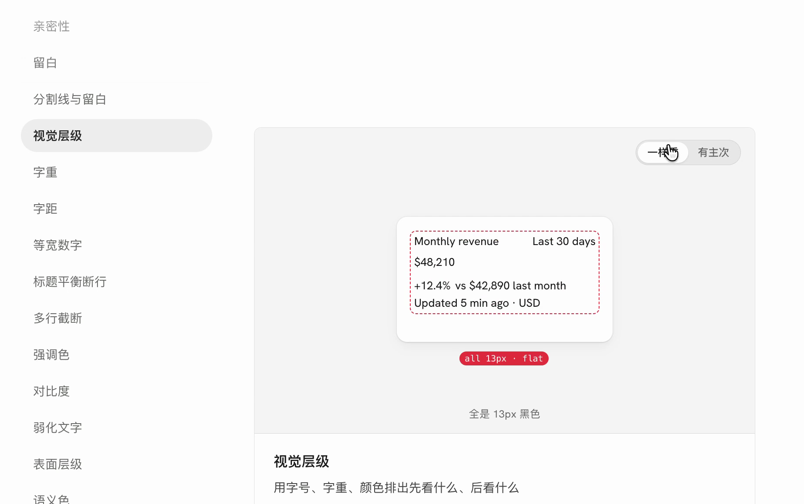
*2 秒：選中「一樣重」，營收數字、標籤與更新資訊均縮為相近文字大小，紅色標記寫著 all 13px · flat。*

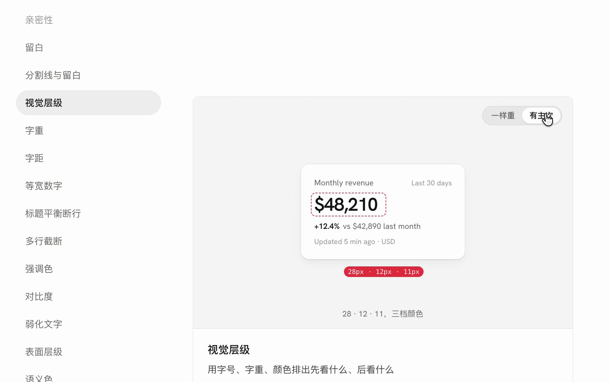
*4 秒：回到「有主次」，核心數字放大，紅色標記列出 28px／12px／11px，底部標示三檔顏色。*

*7 秒：反覆比較後回到「有主次」，同一組內容保持不變，虛線框突出核心數字。*

游標點擊兩段控件 → 同卡內字級、字重與灰階改變 → 再點回時恢復主次；片中反覆切換，不是兩張不同資料卡。作者文案稱「看這 10 秒」，官方媒體與本地探測實長 **8.433 秒**、1848 × 1712。檢視每秒取樣總覽與原尺寸裁圖後保留四張影格，裁去完整提示詞區；未保留本次原片。未操作複製功能或驗證 AI 生成結果。

### 借鑑（推論）

- **適合**：指標卡、帳務摘要與設計規格溝通；固定內容再切換權重，可讓討論落到具體字級和對比。
- **不適合**：把 28／12／11px 當成所有產品的通用規範，或以示範推斷閱讀速度已改善。
- **移植時注意**：先指定主要決策資訊，再依實際裝置、字體、縮放與對比調整層級；不要單靠淡灰色承載必要資訊。本片沒有成效或可及性測試數據。

## 2026-11-26 補充：五種元件與狀態詞彙

### 來源與邊界

[Ian 原帖](https://x.com/ianneo_ai/status/2125385669325541442)發布於 **2026-11-25T00:26:45Z**；[Kubai RT](https://x.com/Kubai087/status/2125398737883431054)發布於 **2026-11-25T01:18:41Z**。作者是 Ian（@ianneo_ai），Kubai 是轉發者。兩筆官方頁面資料的正文與影片 ID `2125385352231976960` 一致，並另取原帖核對。作者稱詞彙已增至 70 個、當日補五個，這是作者公布的數量，未逐項清點。[作者直接回覆](https://x.com/ianneo_ai/status/2125385672739758322)連到 [新增詞彙頁](https://topinspo.design/vocabulary?feel=new)，支持沿用本卡產品歸屬；本次未重新操作網站或確認當前部署狀態。

完整原帖列出禁用態、圖示容器、數字角標、載入態按鈕、麵包屑導覽；影片按相反方向演示。檢視 23.583 秒、1982 × 1514 影片每兩秒取樣共 12 張及六張原尺寸裁圖，保存以下六張。裁去完整提示詞區，未新增原片至倉庫，既有素材全部保留。

### 做法（影片觀察）

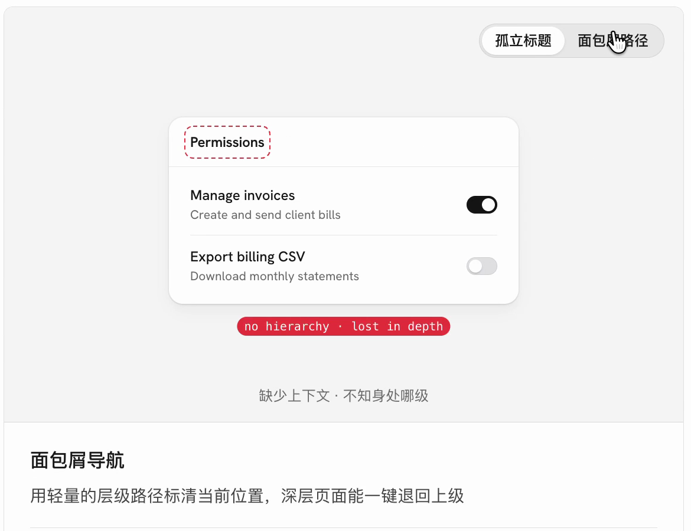
*2 秒：選中「孤立標題」，卡片只顯示 Permissions，沒有上層路徑；紅色標記指出缺少層級上下文。*

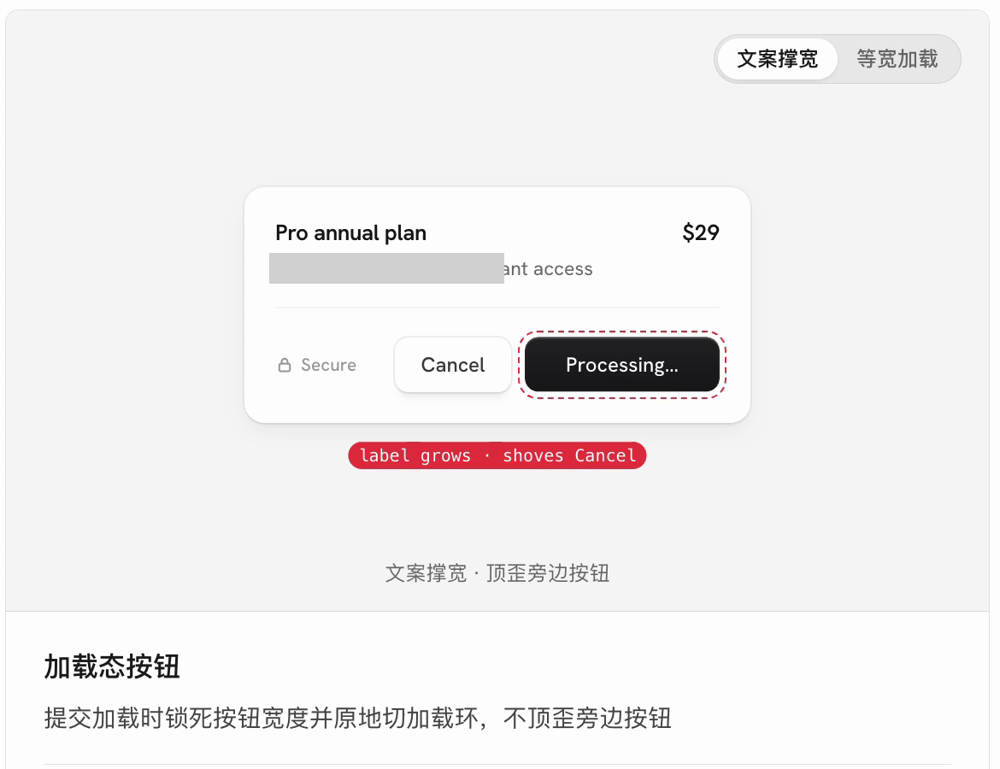
*6 秒：選中「文案撐寬」，按鈕顯示 Processing...；紅色註解指出文案擠壓 Cancel，並非等寬載入環的正例。示範卡號尾碼已遮除。*

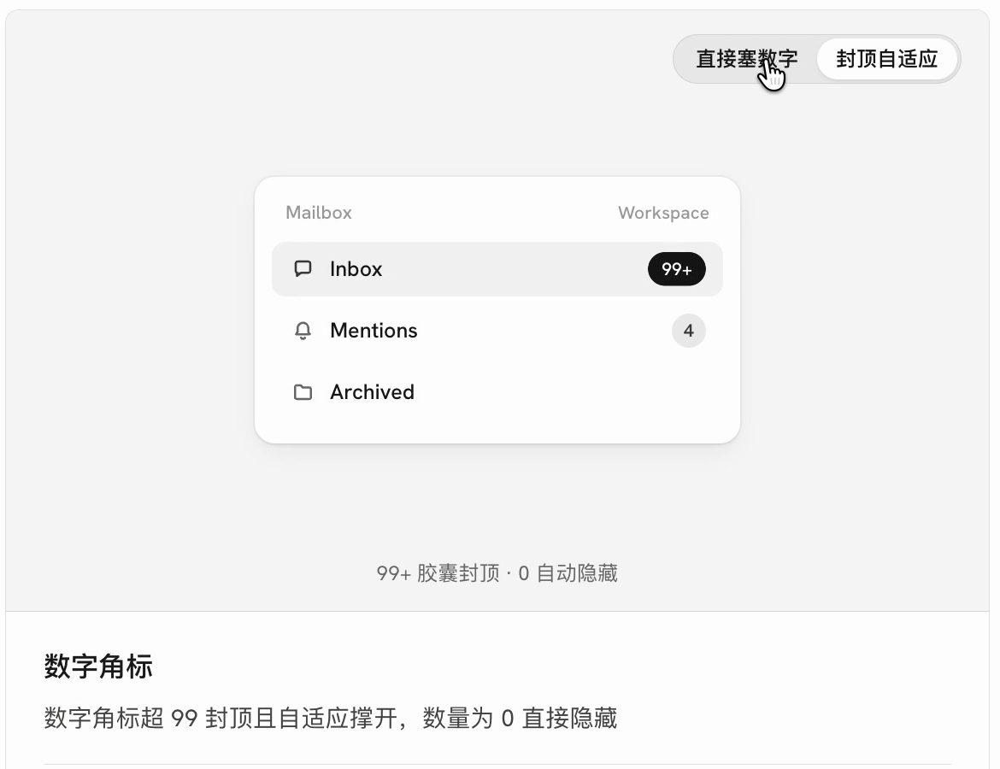
*10 秒：已選中「封頂自適應」，Inbox 顯示 99+ 膠囊，Mentions 顯示 4，Archived 沒有零角標。*

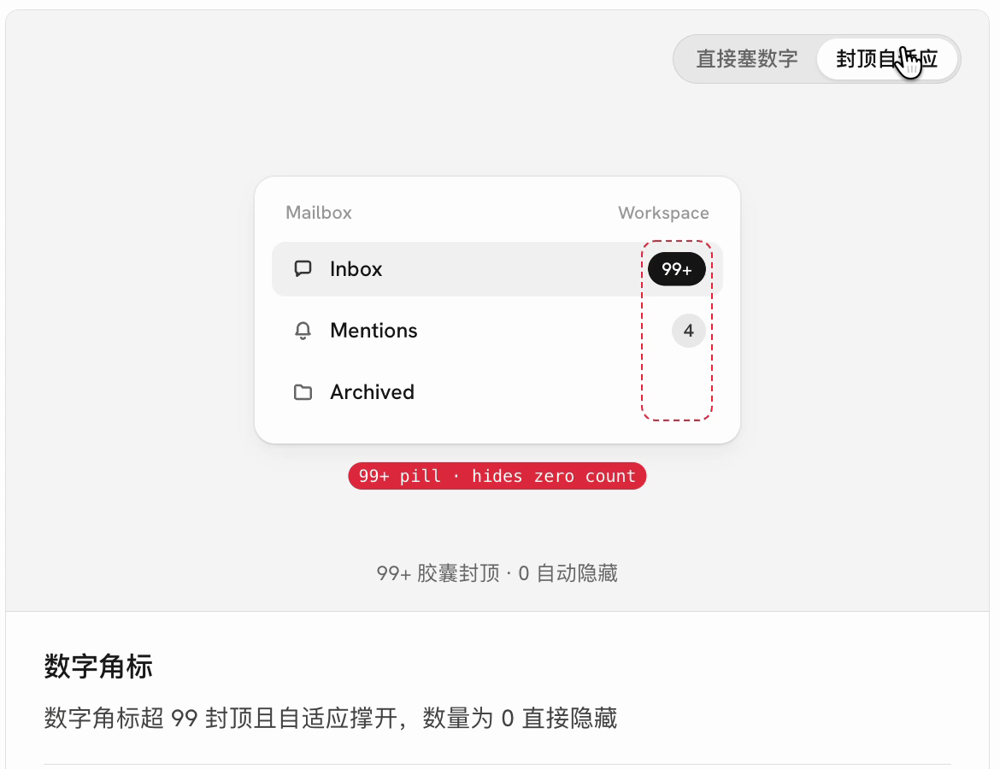
*12 秒：切換後 148 顯示為 99+ 膠囊，4 保留小角標，Archived 的零角標消失。*

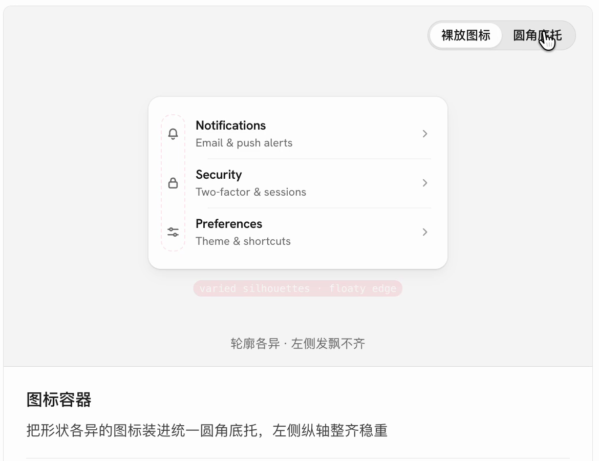
*16 秒：選中「裸放圖標」，Notifications、Security、Preferences 的三個圖示沒有底托；虛線與說明指出輪廓不同、左側不齊。*

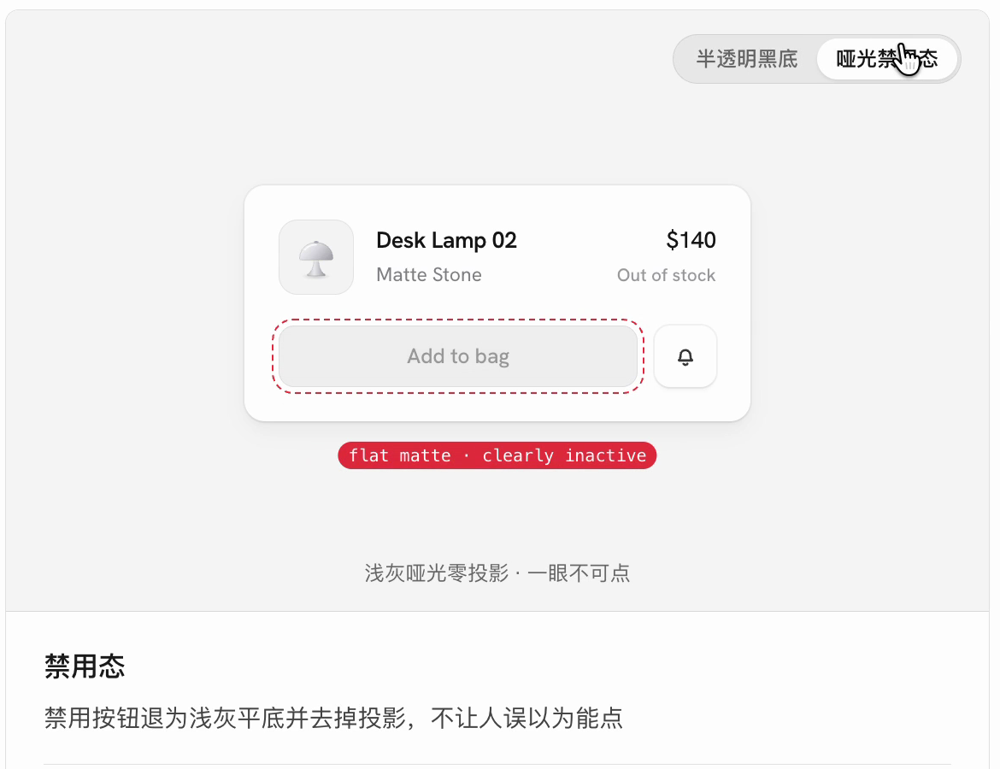
*22 秒：缺貨商品的 Add to bag 改為淺灰底、淡字及無投影，旁邊鈴鐺操作保持可辨認。*

- 觸發方式是左側選詞，再用右上兩段控件反覆切換；結果在同一示範物件內更新，沒有換成不同任務或資料。
- 麵包屑在孤立標題與完整路徑之間切換；錄影有可點路徑的說明，沒有實際跳到上層頁的證據。
- 載入按鈕的文字與載入環原位交替，最後回到 Pay $29；未看到真實付款請求或交易完成。
- 圖示容器比較裸放圖示與統一底托，畫面標示 30×30；禁用態比較仍有黑底投影的半透明按鈕與淺灰平底。這些是教學示例的視覺狀態，不代表已驗證語義 disabled、鍵盤焦點或螢幕閱讀器行為。

### 為什麼有效（推論）與移植界線

- 固定比較內容可讓使用者把「數字角標」「禁用態」等名稱對上具體差異；沒有學習或轉換成效數據。
- **適合**：設計評審、元件狀態教學與規格討論；以兩態呈現一個可修改的決策。
- **不適合**：把 99+、隱藏零、30×30 容器或灰色禁用態直接套成所有業務的規則；精確計數、零庫存等情境可能需要保留零與完整數字。
- **移植時注意**：依層級決定麵包屑，依數據含義決定封頂及零值；固定載入按鈕尺寸時補上防重送與狀態通知，禁用控制項要有程式語義及原因說明。這些是移植建議，並非影片已驗收功能。
