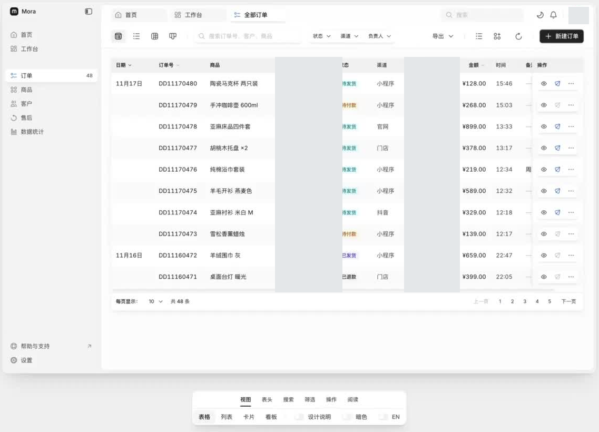
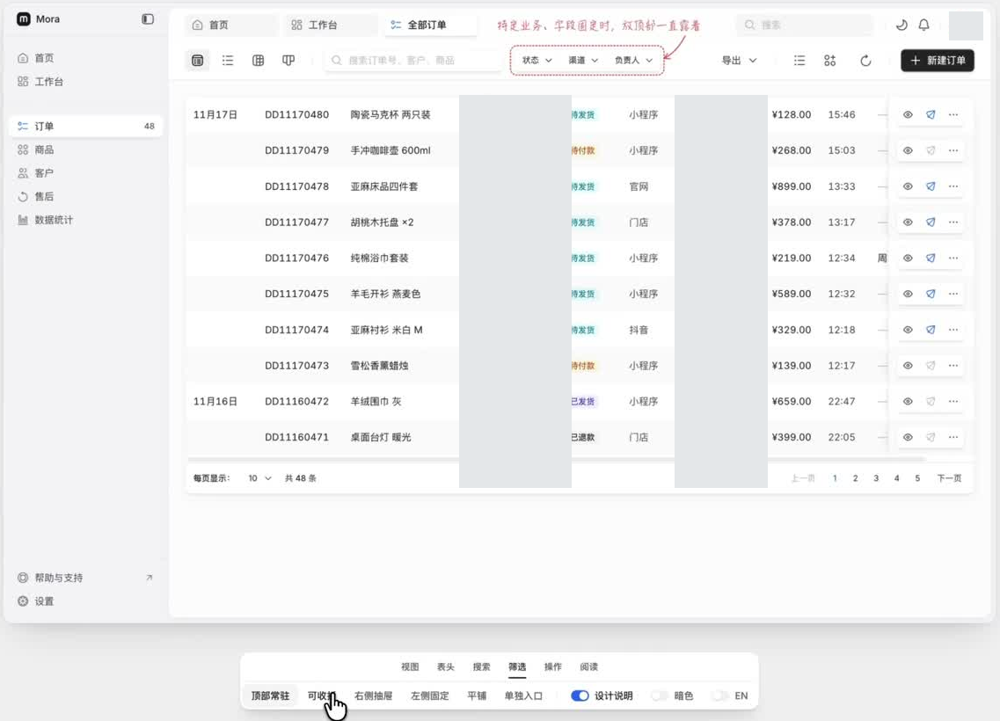
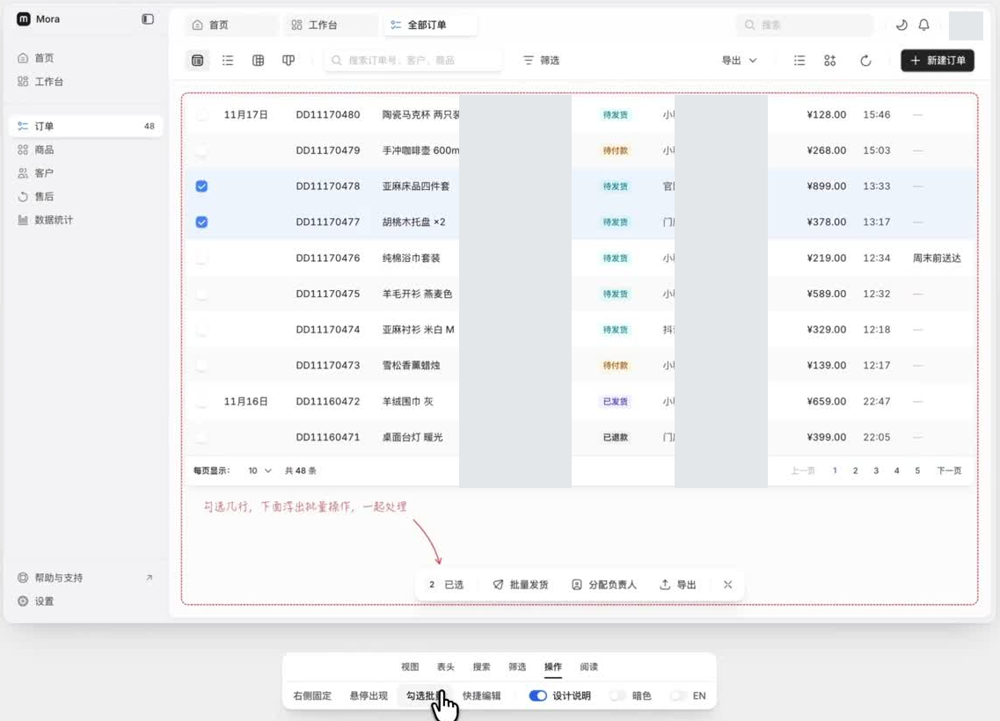

## 問題

表格設計需要決定篩選放哪裡、操作何時出現，以及勾選多列之後怎麼處理。只有靜態截圖，難以比較不同操作策略的前後狀態。

## 做法

作者稱把一份規範與一篇文章交給 Claude，做出可點的表格 Demo；本次只核對其公開展示，不推定生成流程或資料正確性。影片以標示 Mora 的訂單頁示範，沒有確認為上線產品。畫面中姓名、頭像與帳戶標記均已遮除；訂單、金額、數量僅作示例，不是真實業務證據。

*0.00 秒：左側導覽與上方工具列包住訂單表格；底部比較列提供視圖、表頭、搜尋、篩選、操作、閱讀等分類。*

*17.42 秒：狀態、渠道、負責人留在上方工具列；註解指出固定欄位的篩選位置。*

*26.13 秒：兩列以藍色勾選與淡藍底標記，下方浮出「2 已選」、批量發貨、分配負責人、匯出及關閉入口。*

- **比較框架**：底部先選設計面向，再挑具體做法；視圖分類可見表格、列表、卡片與看板選項。影片確有切到按狀態分欄的看板，不以一個選項標籤代替行為證據。
- **篩選位置**：在篩選分類切換做法後，影片顯示頂部常駐選項，並以紅色輪廓與短註解指向狀態、渠道、負責人；同頁仍保留搜尋、匯出與新增訂單。
- **按選取狀態顯示操作**：操作分類切到勾選批次，表格出現勾選狀態，選取兩列後下方新增批次工具列。工具列列出可做的事與已選數量；影片未證明批量發貨或匯出真的執行。
- **說明與閱讀控制**：影片可見設計說明開關，以及後段閱讀分類下的行距／顯示密度選項。它們屬示範比較層，不應誤當成訂單產品的正式設定。

## 為什麼有效（推論）

在同一批資料與頁面骨架內比較，可能讓人專注於篩選位置與操作時機。勾選後才顯示批次工具列，可能使操作範圍更清楚；仍需驗證跨頁選取、取消與失敗處理，影片無法證明可用性提升。

## 借鑑要點

- **適合**：後台表格審稿、比較篩選與批次操作策略的原型。
- **不適合**：直接以展示中的訂單數或金額支援營運決策，或認定按鈕出現即代表後端動作已完成。
- **移植時注意**：清楚區分原型控制與產品工具列；定義「全選」涵蓋本頁還是全部結果，顯示選取數量並保留取消入口。批次發貨另需權限、確認、部分失敗與重試回饋；補做鍵盤、讀屏及大量資料驗證。

## 來源與核對範圍

[原帖](https://x.com/ianneo_ai/status/2122860352094523695)發布於 2026-11-18T01:12:03+00:00；[Kubai 轉發](https://x.com/Kubai087/status/2122868968298041349)發布於 2026-11-18T01:46:17+00:00。以指定 fetch.py 取得 X 官方頁面嵌入 JSON，核對兩個 ID、作者、正文與相同影片。檢視整段影片的 12 個等距取樣及關鍵原尺寸影格，保留三張裁切、去識別影格；秒數是取樣位置，未保存原始影片或完整提示詞。

既有[價格區間圖](../kubai-interactive-data-visualization/case.md)處理圖表數值聯動，[元件展示](../kubai-zahra-ui-components/case.md)呈現不同作者的靜態帳單／排程元件，均非本帖的表格比較流程，因此新增卡片。此為參考資料收錄，未新增可執行功能，未執行 Playwright 或操作 Demo。
