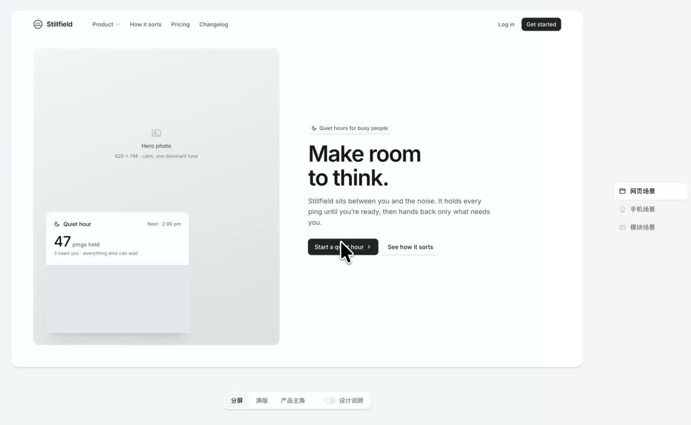
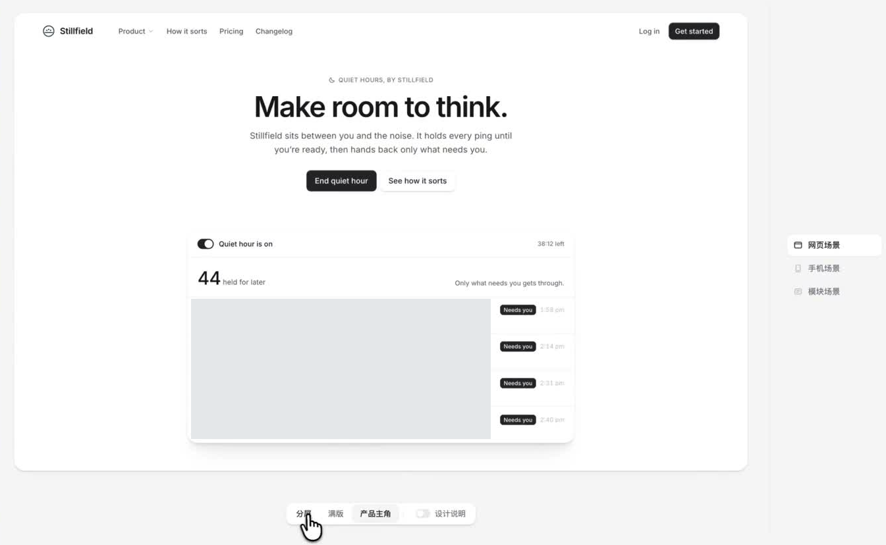
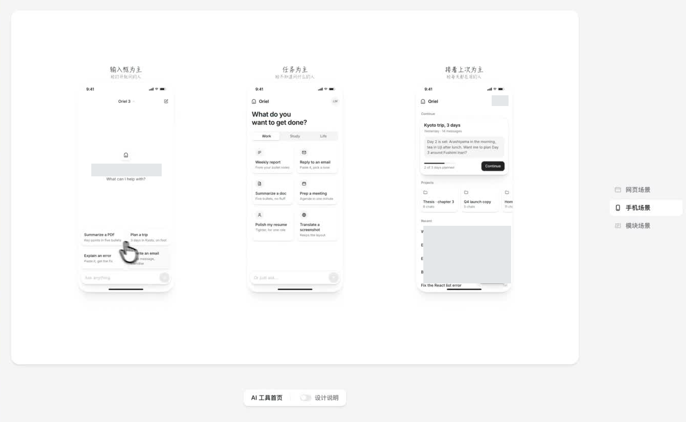
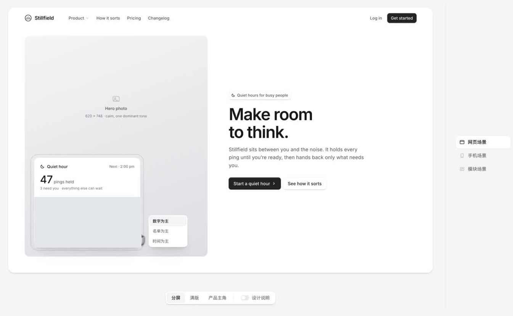
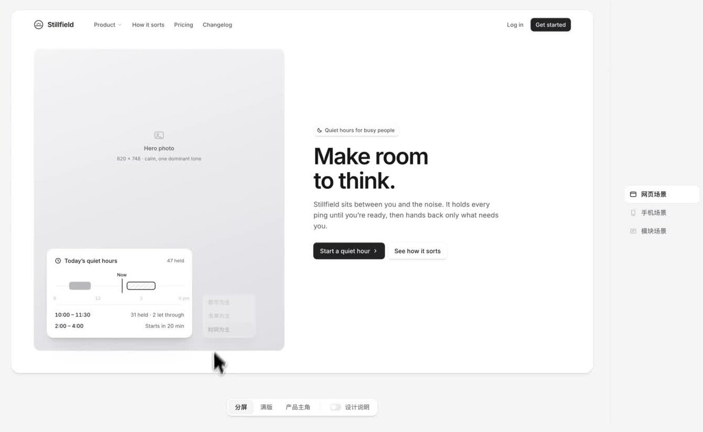

## 問題

評審喜歡某版整體佈局，卻偏好另一版的局部卡片時，整版二選一無法表達這種組合。比較控制也容易與設計本身混在一起。

## 做法

作者表示以 Claude 改進多方案原型，涵蓋網頁、手機與單一模組；這是作者對流程的陳述，不是本庫重現結果。影片可見右側場景切換、底部整體方案控制，以及卡片旁的局部選單。以下秒數為影片取樣位置，不是動效時長；灰塊是本次遮除的示例姓名、訊息或頭像。

*0.00 秒：左圖右文的網頁預覽，下方有「分屏／滿版／產品主角」與設計說明開關。*

*1.96 秒：標題與主要動作移到中央，產品內容位於下方，仍保留同一組比較控制。*

*5.87 秒：手機場景並列「輸入框為主／任務為主／接著上次為主」三種入口安排。*

*17.62 秒：回到分欄網頁，卡片旁出現「數字為主／名單為主／時間為主」選單。*

*19.58 秒：主標題與分欄結構保留，左下卡片改成時間軸與時段資訊。*

- **整體比較**：先在右側切換場景，再使用底部選項改變網頁整體方向；手機場景則讓三種首頁安排同時可見。
- **局部替換**：在既定整體佈局內叫出卡片選單，選擇不同資訊重心，結果留在相同卡片位置。影片呈現選單出現至卡片更換的順序，不能據此推定所有組合均已實作。
- **說明開關**：影片中可見設計註解開啟與隱藏；作者亦明說可以關掉說明，只看頁面本身。

## 為什麼有效（推論）

把整體方向與局部做法拆開，可能讓回饋精確到「保留這個骨架，換掉這張卡片」。將審稿控制留在預覽外圍，並允許隱藏註解，也可能減少註解對版面判斷的干擾；沒有比較效率的量化證據。

## 借鑑要點

- **適合**：同一需求的多方向審稿、需要保留局部優點的原型迭代。
- **不適合**：未定使用者任務就任意拼接不同資訊架構，或把可點展示當成正式產品驗收。
- **移植時注意**：整體與局部控制分別命名；保存組合選擇與理由。切換時保留可比較的資料與尺寸，為不可組合的變體說明限制，另驗證鍵盤操作、狀態保存與窄螢幕。

## 來源與核對範圍

[原帖](https://x.com/ianneo_ai/status/2122673879562731637)發布於 2026-11-17T12:51:04+00:00；[Kubai 轉發](https://x.com/Kubai087/status/2122690700781531461)發布於 2026-11-17T13:57:55+00:00。以指定 fetch.py 取得 X 官方頁面嵌入 JSON，核對原帖作者、全文、影片與轉發文字。檢視整段影片的 12 個等距取樣及關鍵原尺寸影格，保留五張裁切、去識別影格；未保存完整提示詞或原始影片。

與[共用任務的工具比較頁](../design-skill-comparison-shared-scenarios/case.md)不同，本卡處理同一原型的整體與局部組合控制；也不同於[價格區間圖](../kubai-interactive-data-visualization/case.md)的數值聯動，因此新增獨立卡片。此為參考資料收錄，沒有新增可執行功能，未執行 Playwright 或實機驗證。
