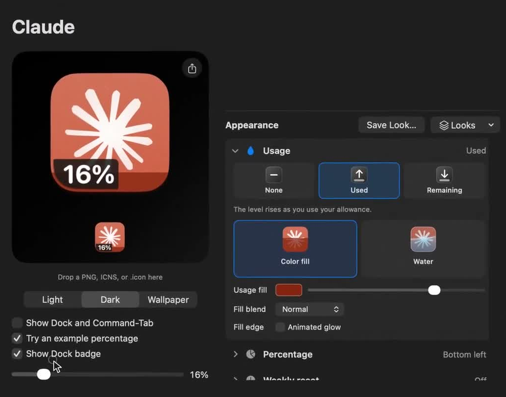
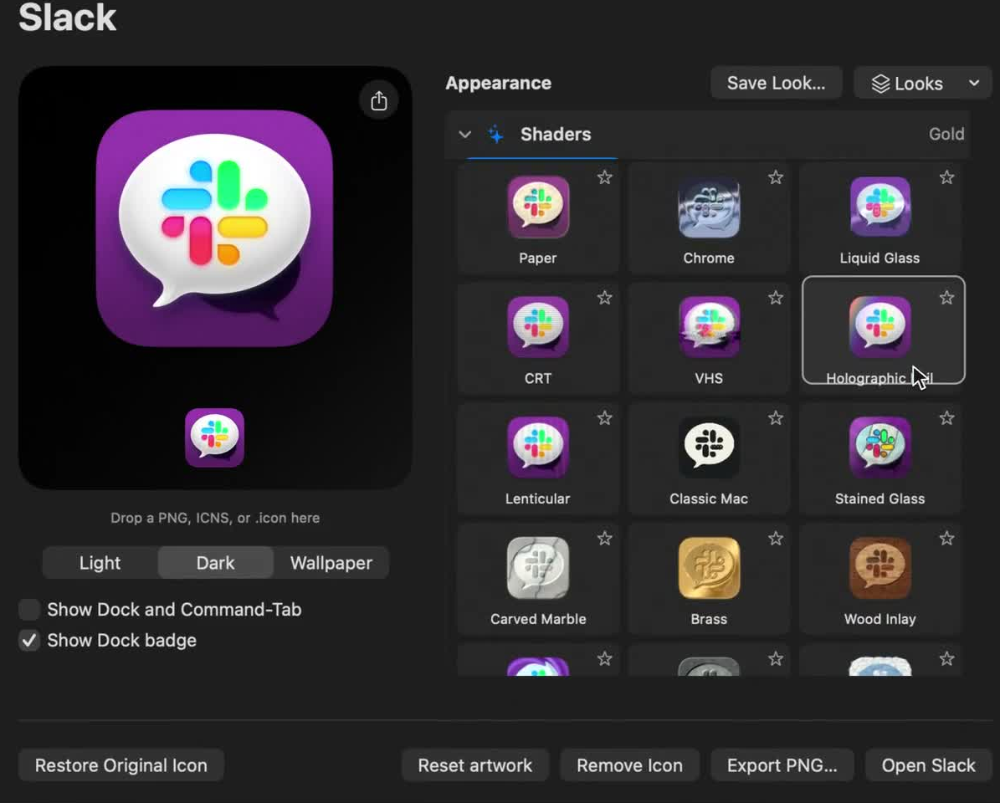
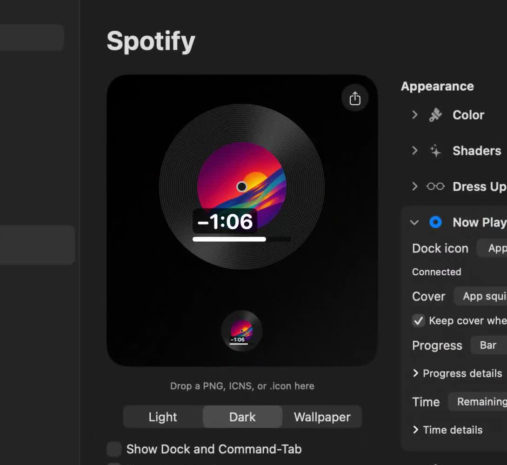

## 問題

自訂 Dock 圖示既要保留小尺寸辨識度，又可能承載用量或播放進度；只看放大的圖稿，不容易知道數字與材質縮小後是否仍清楚。

## 做法

- 示範介面以左側 App 清單、中間圖示預覽、右側 Appearance 分組構成；中間同時顯示放大與小尺寸圖示，並提供 Light、Dark、Wallpaper 背景切換。
- 影片先展示 Claude 用量設定：右側 Usage 有 None、Used、Remaining，填色可選 Color fill 或 Water。中央可見 16% 與填色高度；下方勾選了「Try an example percentage」，因此這一幕是示例值，不能證明真實帳號用量。
- 接著切到 Slack 的 Shaders 網格，以帶縮圖與名稱的選項呈現 Paper、Chrome、Liquid Glass 等材質；中央仍保留兩個尺寸的預覽。底部可見 Restore Original Icon、Reset artwork 與 Export PNG 等動作，未實際操作驗收。
- 後段切到 Spotify，圖示變成黑膠唱片式封面，疊加剩餘時間與進度條；右側 Now Playing 分組與圖示緊鄰。影片呈現不同 App 的設定片段，不是一次完整匯入至套用的連續操作。

*10.59 秒：Claude 的 16% 示例值同時出現在大、小圖示，右側分開選用量方向與填色樣式；帳號區已遮除。*

*42.37 秒：具名材質縮圖與大、小預覽並排，底部保留恢復與匯出動作。*

*58.26 秒：Spotify 封面採唱片造型，在圖示內疊加 -1:06 與進度條。*

## 為什麼有效（推論）

大預覽適合調材質，小預覽適合檢查辨識度；把狀態值直接放回 App 圖示，可能減少另外開啟儀表板的需要。這是介面推論，未量測辨識速度，也未驗證資料更新延遲。

## 借鑑要點

- **適合**：圖示編輯器、主題設定與單一用量／進度的周邊狀態顯示。
- **不適合**：需要同時精讀多個配額，或必須精確監控的儀表板。
- **移植時注意**：同時檢查真實顯示尺寸與背景；明確標出示例資料、斷線與過期狀態。材質動效不應蓋過 App 辨識與數值。

## 來源與核實

以指定 fetch.py 取得 X 官方頁面的 Tweet 資料。作者 [flarup 原帖](https://x.com/flarup/status/2122777694123200541)發布於 2026-11-17T19:43:36Z，明言「Out now for Mac」；[官方預告](https://x.com/IconSwapper/status/2122773878686802176)發布於同日 19:28:26Z，當時寫「More soon」。產品分類依較晚的作者推出聲明，並非本次安裝驗收。

[Kubai 分享](https://x.com/Kubai087/status/2123242586983063896)發布於 2026-11-19T02:30:55Z，是自行撰寫的介紹，並非 RT。其所附影片與 flarup 原帖同為 media ID `2122751300118986752`；原作者及官方帖並非分享日才發布。檢視 63.55 秒影片的 12 個等距取樣與關鍵原尺寸影格，保留三張裁切影格，不保留原始影片。
