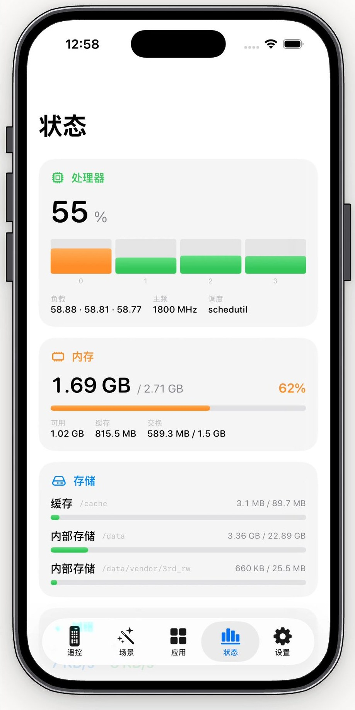

## 問題

系統狀態頁如何讓人先看 CPU 與記憶體概況，再查細項，而不是一開始就閱讀整張技術表？

## 做法

- 原帖第二張圖展示手機狀態頁：CPU 卡以 55% 大數值和一排分段色條為主；記憶體卡以 1.69 GB、容量比例和橫向進度條為主。
- 下方「儲存」區再列快取與各儲存路徑，底部有固定分頁導覽；技術文字與數值被放在各自主題卡中，而不是橫跨整頁。
- 原帖主要推薦設計 skills；本卡只收錄實際附圖的資訊層級，不能用它證明安裝某個 skill 就會帶來同樣品質。

*手機狀態畫面先呈現 CPU 與記憶體摘要，明細置於下方。*

## 為什麼有效（推論）

把概況放大、細節下移，可能縮短找主要狀態的路徑；色條必須搭配文字，才能避免僅靠顏色辨識。

## 借鑑要點

- **適合**：監控、裝置資訊與健康概況類行動頁。
- **不適合**：需要同時比較大量細項的桌面診斷工具。
- **移植時注意**：標示採樣時間、單位與更新頻率；調整字體後要能換行，並提供高負載與讀取失敗狀態。本次未驗證數值準確性。

## 來源與核對範圍

- [原帖 2101578929786228924](https://x.com/pengchujin/status/2101578929786228924)：已核對 X 官方公開 HTML 內嵌的同 ID Tweet／NoteTweet 正文；發佈時間為 2026-09-20T07:47:16+00:00。
- 已下載並檢視原始媒體；影片僅保留關鍵影格，沒有保存原始影片。媒體出處與擷取時間見本目錄 `evidence.json`。
- 本卡只把貼文文字、附圖與錄影可確認的內容列為觀察；未執行產品驗收，效果解讀列為推論。
