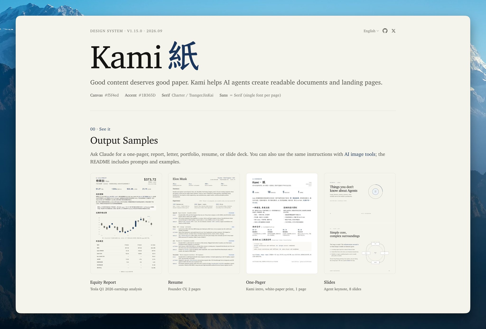
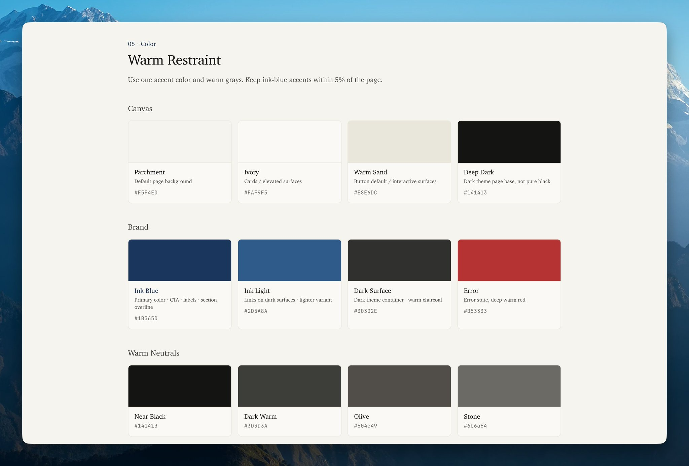
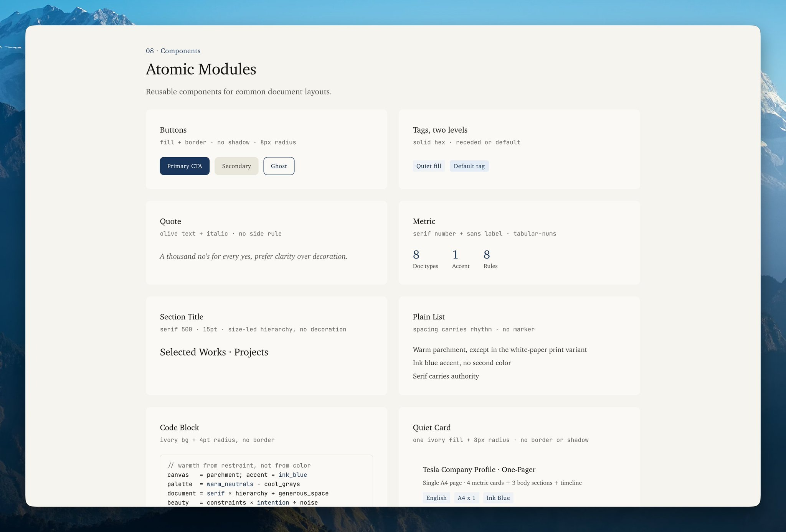
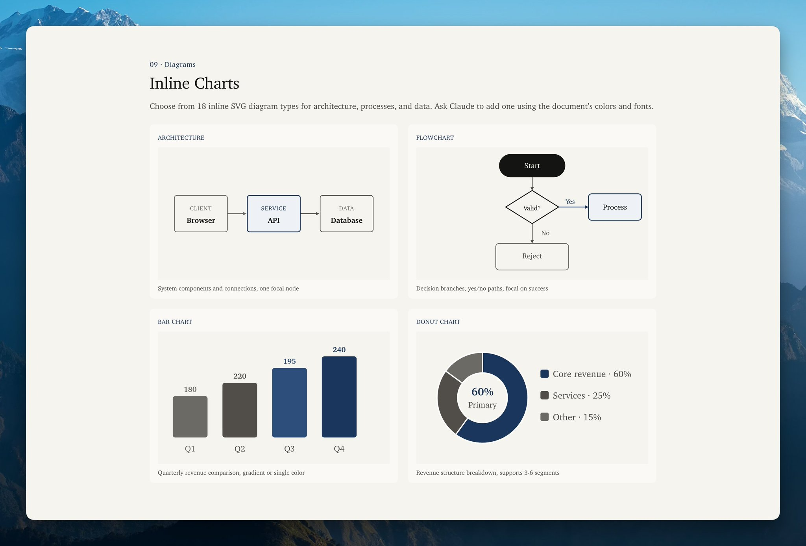

## 問題

長文件如何讓讀者找到起點、主體和補充，同時避免為了版型刪改內容？

## 做法

- 原帖展示 Output Samples、Warm Restraint 色票、Atomic Modules 和 Inline Charts 四頁；底色偏暖白，文字及圖表以深色和少量藍色構成。
- 元件頁以規則網格列出按鈕、引文、數字、章節標題與列表；圖表頁把架構圖、流程圖、長條圖與圓環圖各放在獨立區域並附說明。
- 作者明說刪除標題裝飾短線、提示塊藍色豎條與多餘陰影，並將表格線變淡、間距拉開。截圖可核對現有外觀，未提供逐項改版前後對照。

*首頁先示範可產出的文件類型，再讓使用者進入樣本。*

*色票把畫布、品牌及中性色的用途分開。*

*原子模組用字級、間距與對齊建立規則。*

*圖表各帶用途標題和說明，服務文件的閱讀順序。*

## 為什麼有效（推論）

當字級和對齊足以交代關係時，減少裝飾可能讓注意力回到內容；是否更易讀仍需用真實長文和讀者任務驗證。

## 借鑑要點

- **適合**：報告、內部文件、內容導向的產品說明。
- **不適合**：需要強烈品牌演出或大量互動控制的主畫面。
- **移植時注意**：先保留內容，再安排版面；長表格需要足夠對比與行列定位，不能把淡線和大留白當成固定配方。

## 來源與核對範圍

- [原帖 2097700029012320675](https://x.com/HiTw93/status/2097700029012320675)：已核對 X 官方公開 HTML 內嵌的同 ID Tweet／NoteTweet 正文；發佈時間為 2026-09-09T14:53:54+00:00。
- 已下載並檢視原始媒體；影片僅保留關鍵影格，沒有保存原始影片。媒體出處與擷取時間見本目錄 `evidence.json`。
- 本卡只把貼文文字、附圖與錄影可確認的內容列為觀察；未執行產品驗收，效果解讀列為推論。
