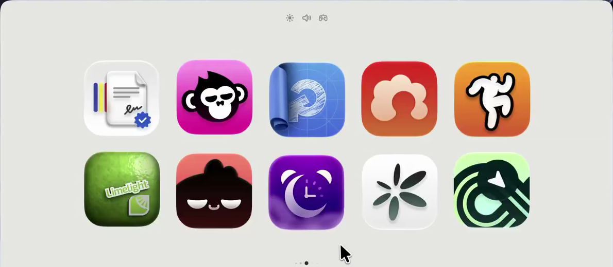
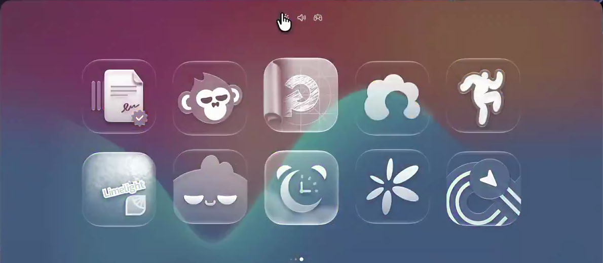
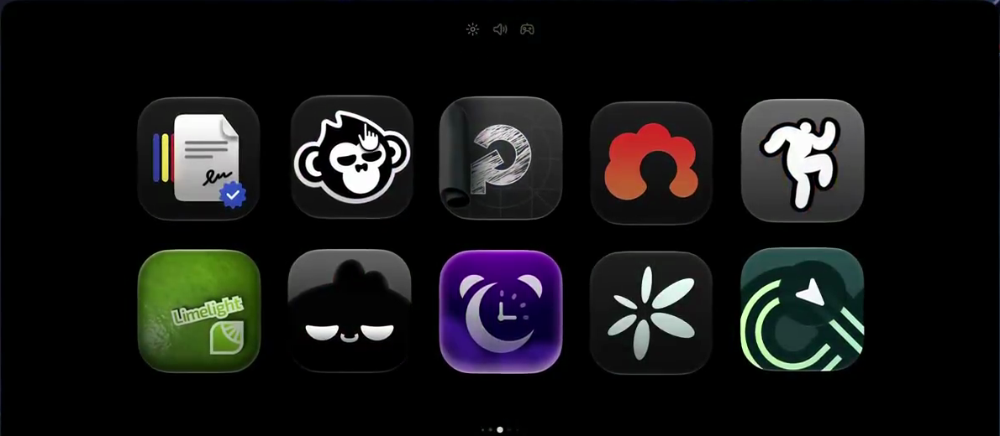
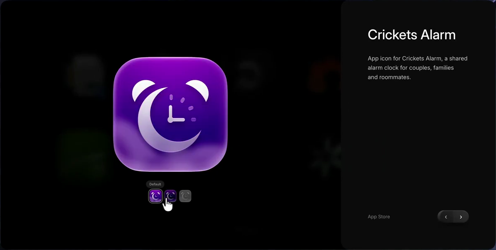
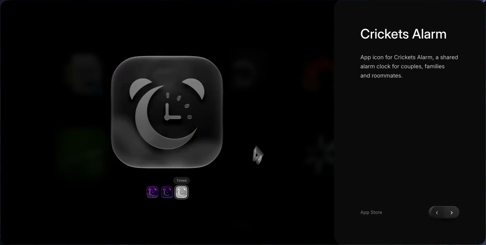

## 問題

訪客如何從一組 App 圖示看見個別作品的細節，並比較同一圖示在不同外觀下的樣子，而不離開作品探索情境？

## 做法

Katya N. 於 **2026-11-24 10:50:45 UTC** 發布網站進度展示，文字表示接近完成；本卡按設計師作品收錄，不宣稱已正式上線。Kubai 於同日 **10:54:59 UTC** 引用稱讚並表示也想製作自己的圖示網站，並非作品作者。這與既有 [Kubai Icons 工作流](../kubai-icons-generation-workflow/case.md) 是不同作品，不合併。

官方原帖附一段約 45.9 秒影片，沒有獨立照片；以下五張均為該影片影格，只裁留設計本身，網格畫面另去除頁尾頭像與帳號區。時間相對影片起點。

*00:00：淺色底上以兩列、每列五個圖示呈現作品，頂部置中放置小型控制圖示。*

*00:02：游標位於頂部外觀控制附近，網格位置不變，背景換成彩色波形，圖示呈透明底框與淺色符號。*

*00:05：同一組圖示位於黑色背景，部分圖示換成深色底板；不是只將整頁背景反相。*

- **整組外觀切換**：影片前段在淺色、彩色玻璃與深色網格間變化，圖示仍維持兩列五欄。這是展示中可見的狀態序列，未量測轉場時間或確認切換是否跨瀏覽階段保存。
- **進入作品詳情**：選取作品後，中央顯示放大的圖示，原網格留在背後並模糊；右側出現獨立說明欄。放大預覽下方有三個外觀縮圖，右欄底部可見作品連結與前後箭頭。

*00:10：Crickets Alarm 的紫色 Default 圖示置於左側放大區，右欄包含名稱、用途說明與 App Store 入口。*

*00:11：下方第三個縮圖被選中並標示 Tinted，主預覽改成深灰玻璃與灰白符號，右側作品內容維持原位。*

- **單件外觀比較**：Crickets Alarm 從 Default 換為 Tinted，預覽位置與右側說明不變。不要把全站背景模式與單件圖示變體當成同一個控制；兩者在影片中有不同入口。
- **內容完成度**：其他作品詳情（如 Placed、Foodra）可見說明尚待補上的佔位文案；本卡不把這些佔位當作值得照搬的正式內容。
- **作者製法說明，非畫面反推**：Katya 在同日 **11:11:19 UTC** 的直接回覆說明，tinted mode 使用 Icon Composer 匯出的 mono 版本，在背景加透明玻璃框，再把圖示本身設為 Hard Light 混合模式。本次未查驗原檔，不能推定網站採用哪種 CSS 或渲染技術，也不能推定這等同 iOS 系統實際著色結果。

## 為什麼有效（推論）

- 網格先提供整體風格，再把個別作品放大，可讓探索與細看共享同一背景脈絡；模糊背景可能協助聚焦，但沒有可用性或轉換數據。
- 縮圖切換只替換主圖，讓比較不同外觀時不必重新辨認名稱與說明的位置。
- 把作品說明放在側欄，可讓圖示保持展示尺度；這是桌面寬版的觀察，不代表窄螢幕也能維持同樣可讀性。

## 借鑑要點

- **適合**：作品數量有限、需要檢視材質與外觀變體的圖示作品集或品牌資產展示。
- **不適合**：大量資源的快速搜尋、批次下載或授權採購流程；影片沒有示範這些能力，不能以此取代篩選、檔案格式與授權資訊。
- **移植時注意**：分開標示全站外觀與單件變體；縮圖提供名稱、可見選中態及鍵盤焦點。深淺與彩色背景都要檢查符號對比；Hard Light 效果受背景影響，應用實際底色與小尺寸驗證。窄螢幕可改成上下排列，減少動態偏好下保留直接切換。這些是移植建議，並非來源已驗證的能力。

## 來源

- [Katya 原帖 2125180314775674957](https://x.com/ktnr23/status/2125180314775674957)：2026-11-24 10:50:45 UTC；網站進度與官方影片。
- [Kubai 引用 2125181381286510817](https://x.com/Kubai087/status/2125181381286510817)：2026-11-24 10:54:59 UTC；只提供評論與引用關係。
- [Katya 直接回覆 2125185489644953813](https://x.com/ktnr23/status/2125185489644953813)：2026-11-24 11:11:19 UTC；tinted mode 製法，直接回覆上述 Kubai 引用帖。
