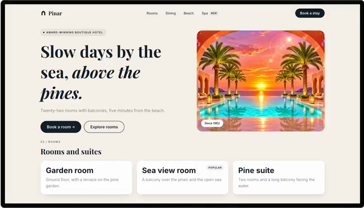
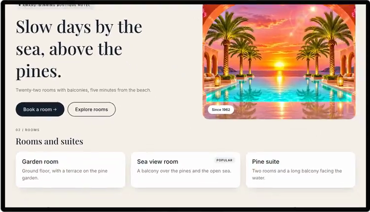
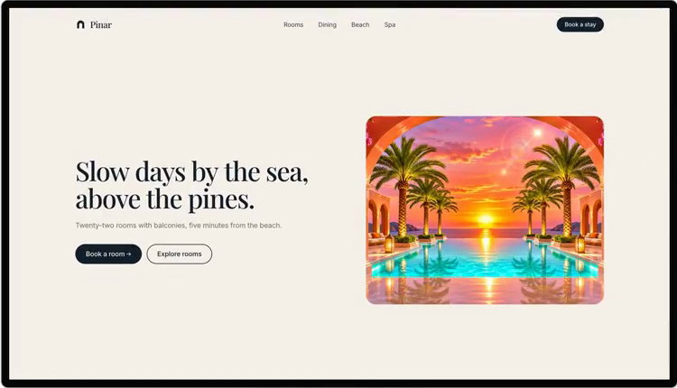
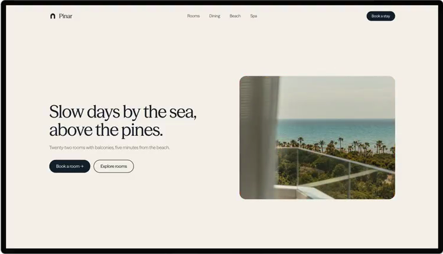

## 問題

生成頁面即使有完整區塊，也可能讓大標題、卡片標題、徽章和按鈕同時搶注意力。如何先用小幅度、可比較的修改改善閱讀主次，而非繼續增加效果？

## 做法

[kev原帖](https://x.com/koppkev/status/2124238399192060138)提供13條排版與內容規則及23.8秒影片；[Kubai引用](https://x.com/Kubai087/status/2124337913760756206)另補充等距內縮圓角與嵌套間距。兩者都屬作者建議，不能推定每個產品應使用同一數值。本卡僅摘要並觀察四個狀態，未轉存完整指令。

*0秒：左側大標題混用直立與斜體，下方三張房型卡；右側是高飽和夕陽配圖與小標籤。*

*7秒：標題改為較克制的直立字，房型卡仍在同一列；字級與文字密度的改變比新增裝飾明顯。*

*16秒：主要內容收斂為標題、說明與兩個操作，起始的裝飾標籤及房型卡區不再出現在保留視區；不能只憑裁圖判定整頁內容被刪除。*

*19秒：右側改成海岸與陽台照片，配圖色彩比起始夕陽圖柔和，左側仍保留主標題與操作。*

- **文字規則（作者建議）**：用少量一致字級，讓卡片標題低於區塊標題；正文及標題保持較輕字重，大標題再調字距、行距與換行。原帖提到的400／500字重及相差1px是示例起點，不是實測的通用最佳值。
- **刪除與內容（作者建議）**：先檢查裝飾標籤、重複按鈕與配圖；照片應服務內容，不能只以「真實照片」取代資訊判斷。
- **過程邊界**：影片把修改分段播放，從同一頁面比較數個狀態；沒有展示使用者輸入、AI生成過程、原始碼或連續操作，因此不歸因為特定生成工具的能力。
- **Kubai補充的邊界**：嵌套圓角與四周間距是引用帖的文字建議，本卡沒有量測圖中每個邊距；相關幾何規則可另看[004卡片](../kubai-999-004-nested-continuous-corners/case.md)。

## 為什麼有效（推論）

- 固定頁面內容再分步改權重，可能讓審查者區分排版、裝飾與配圖各自造成的變化；本影片後段視區與內容量也變化，並非嚴格單變量實驗。
- 主次較明確、配圖不過度搶眼，可能有助於先讀標題與操作；來源沒有閱讀速度或轉換提升的證據。

## 借鑑要點

- **適合**：行銷首屏、卡片集合與生成頁面的第一輪視覺審查。
- **不適合**：以固定字重、禁用斜體或偏好照片當成所有品牌的硬性規範。
- **移植時注意**：保留同一內容與視窗再比較，逐項改字級、留白和裝飾；另測長翻譯、對比、縮放及小螢幕。刪標籤前先確認它不是必要狀態或辨識資訊。
