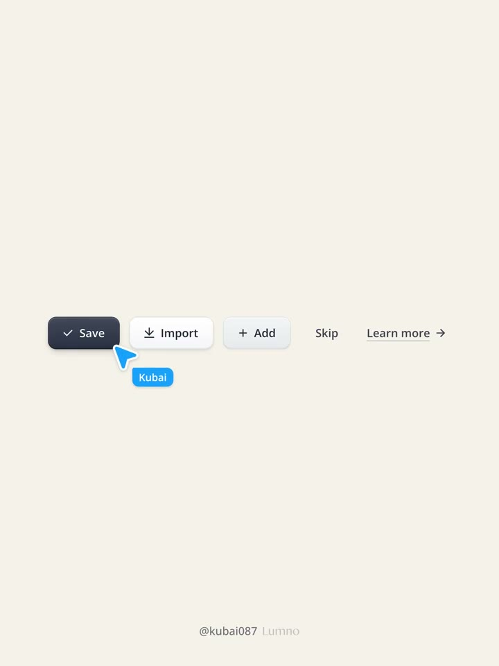
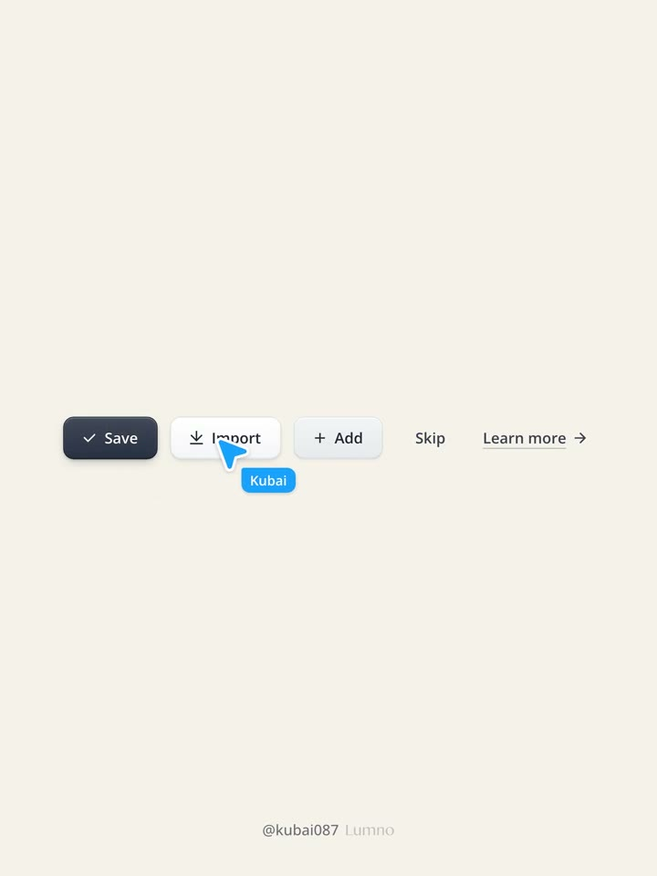
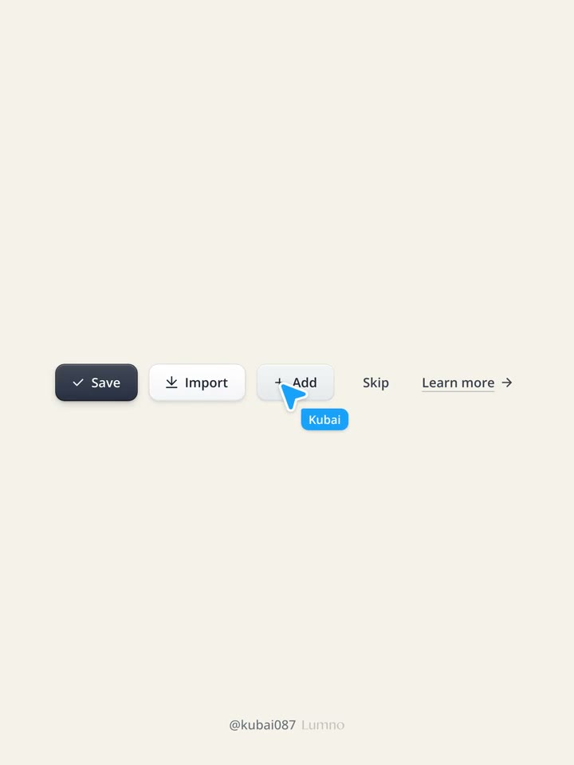
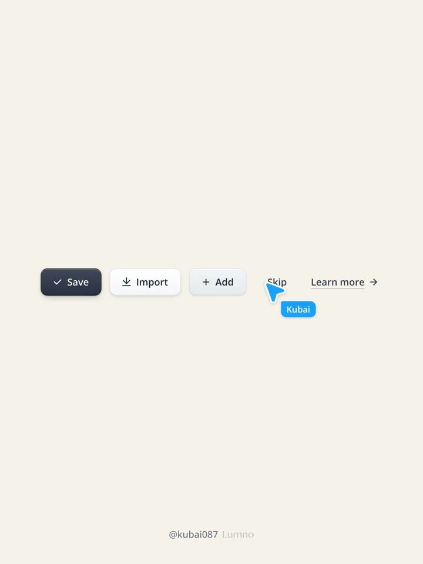
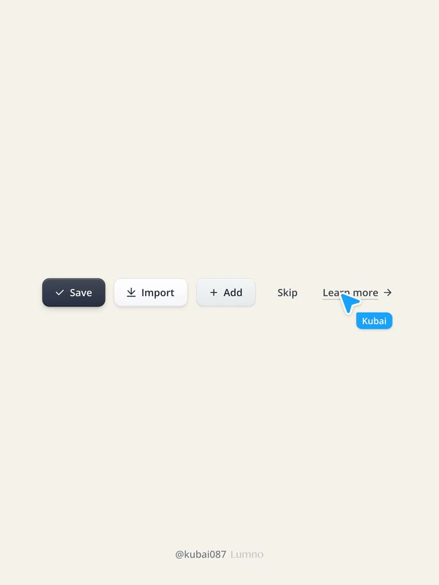
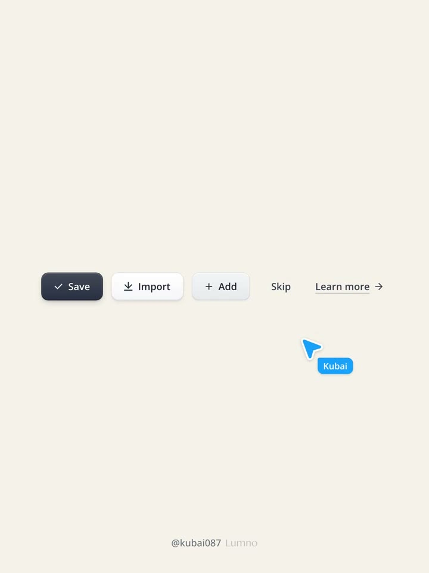

## 問題

按鈕需要讓人分清操作層級，並在懸停、按下時感覺到明確回應，同時維持一致的材質與尺寸規則。

## 做法

- 作者將按鈕分成五個層級，以深色主操作、白色與灰色實體按鍵、無底色及文字操作建立視覺優先序。
- 實體按鈕共用面材漸層、外框、頂部內高光、底部內暗部、接觸與抬升投影；各層級只改參數。按下時下移、反轉面材明暗並壓縮外陰影，形成被壓入的感覺。
- 作者的示例使用位移 120ms、陰影 140ms、色彩 160ms。休息與按下狀態保持相同數量的陰影層，避免切換時跳變。
- 尺寸隨文字等比例縮放；已有元件庫時沿用原 API、變體、焦點與停用狀態規則。

[原帖示範影片](01-source.mp4)；畫面依序展示 Save、Import、Add、Skip 與文字連結的互動。

*0.417 秒：深色主要操作與較輕的次要操作並排。*

*2.083 秒：游標移至白色 Import 按鈕，與主操作保持材質層級差異。*

*3.750 秒：Add 使用較輕的灰色按鈕面材。*

*5.417 秒：Skip 作為低強度操作，預設沒有實體按鍵外觀。*

*7.083 秒：文字操作使用底線與箭頭回應。*

*8.750 秒：游標離開後，五個操作層級仍可辨識。*

## 為什麼有效（推論）

方向一致的光影和位移可能幫助使用者理解「抬起／壓下」；共用材質參數則有利於維持層級一致。這是設計解讀，原帖沒有提供任務效率或轉換率測試。

## 借鑑要點

- **適合**：需要細緻操作回饋的工具列、表單與桌面型 Web 工具。
- **不適合**：同一畫面大量按鈕都使用高強度投影，可能搶走內容的注意力。
- **移植時注意**：先確認元件庫與尺寸 token；補驗鍵盤焦點、停用對比、觸控回饋與減少動態效果設定。示例時長是起點，需在目標產品驗證。
