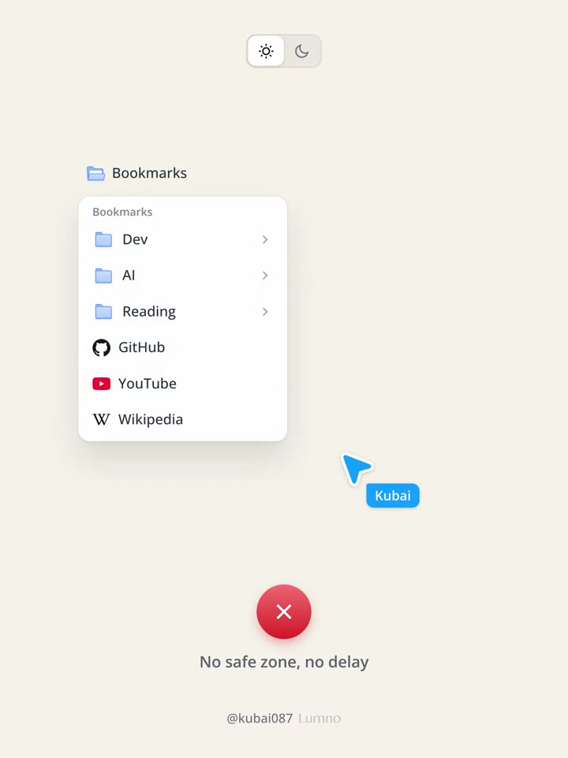
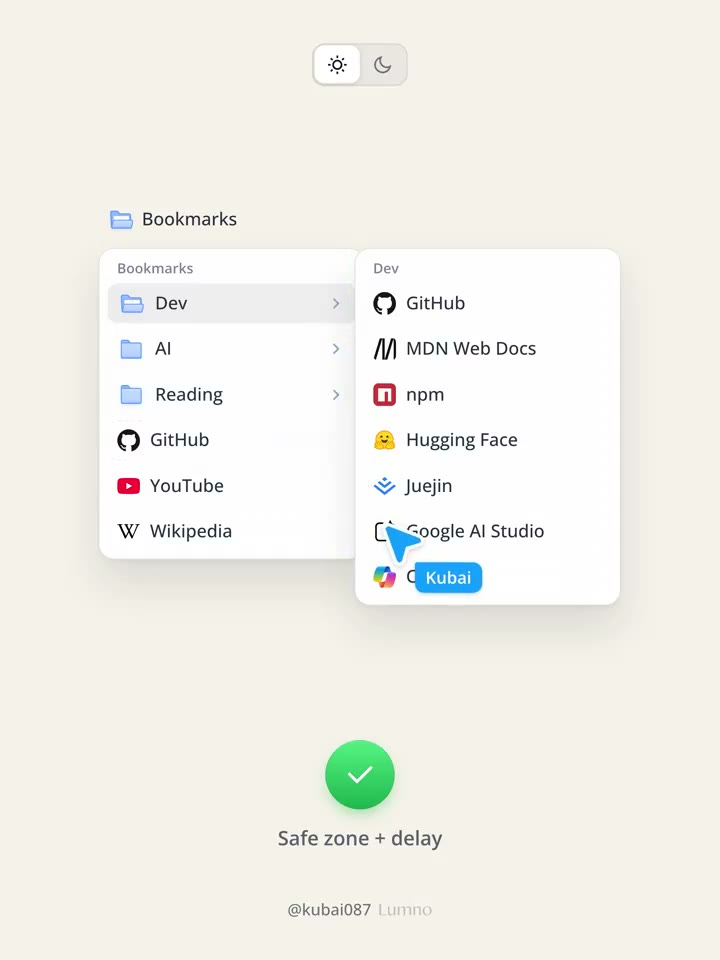
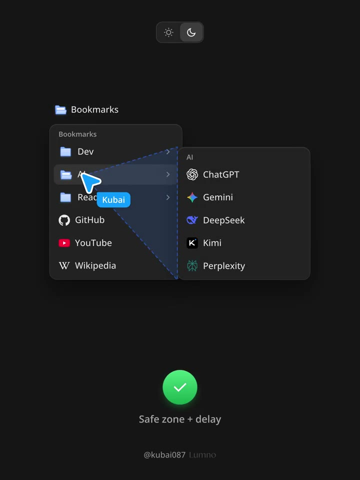
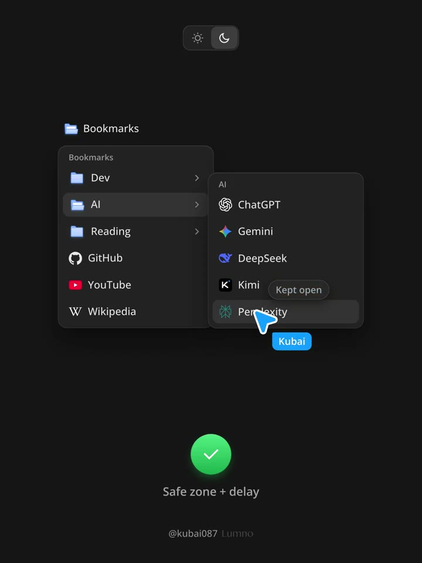

## 問題

滑鼠從父選單斜移到子選單時，路徑容易擦過其他列。若一碰就切換內容，原本要進入的子選單便會消失，迫使用者繞路或重開。

## 做法

原帖影片以淺、深色書籤選單對照無保護與安全區版本，並疊出藍色三角。依作者 2026-10-26 的官方完整長文，以上一刻指標位置為頂點，連到子選單近側的上下角；指標位於三角內、且接近父選單通往子選單的一側時，沿途其他列不更新高亮或子選單。

保護期間每 80ms 重查，離開安全區或停留達 1200ms 才允許切換，避免停在別列卻永久無反應。另設懸停 220ms 開啟、離開整組選單 360ms 關閉；及時返回便取消關閉，點外部則立即關閉。子選單改向左開時，三角改連右側邊；指標進入子選單後解除保護。

*4.788 秒：淺色對照標記 No safe zone, no delay，畫面只剩父選單。*

*8.619 秒：安全區版本保留右側 Dev 子選單，指標已移入子層。*

*16.280 秒：深色選單疊出藍色三角，連接指標附近與子選單近側邊。*

*20.110 秒：AI 子選單仍開啟，指標停在子項目上，旁邊顯示 Kept open。*

[本地示範影片](01-source.mp4)

## 為什麼有效（推論）

幾何範圍把「路過」與「準備選取」暫時分開，延時則容忍短暫滑出；超時上限避免保護變成卡住。影片呈現操作差異，沒有誤觸率測量。

## 借鑑要點

- **適合**：桌面滑鼠操作的多層分類、書籤與工具選單。
- **不適合**：把滑鼠路徑判定直接套到觸控；觸控宜立即回應。
- **移植時注意**：先沿用既有選單邏輯，測試斜移、停住、反向與視窗邊緣翻轉；保留方向鍵、Escape 關閉與焦點返回，勿只靠 CSS hover 決定高亮。

## 延伸閱讀

Kubai 另轉發了 [sanyam 的子選單機制說明](https://x.com/Kubai087/status/2115243997455376432)，指向[該作者的文章](https://sanyam.sh/blogs/the-submenu-closes-before-you-get-there)。此處保留閱讀入口；本卡的幾何與延時描述仍以枯白原帖和影片為依據。
