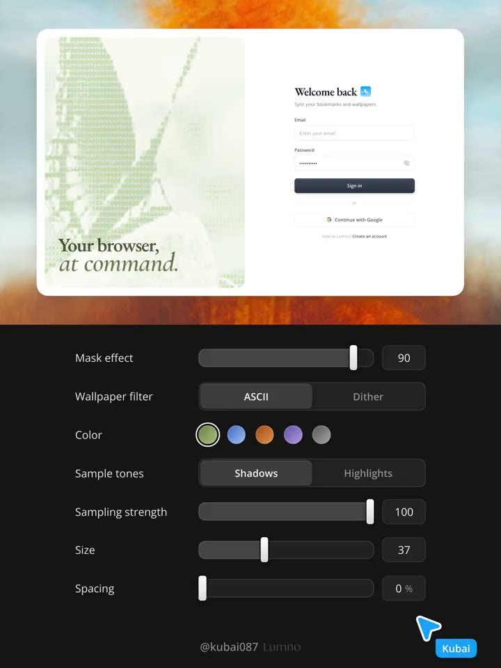
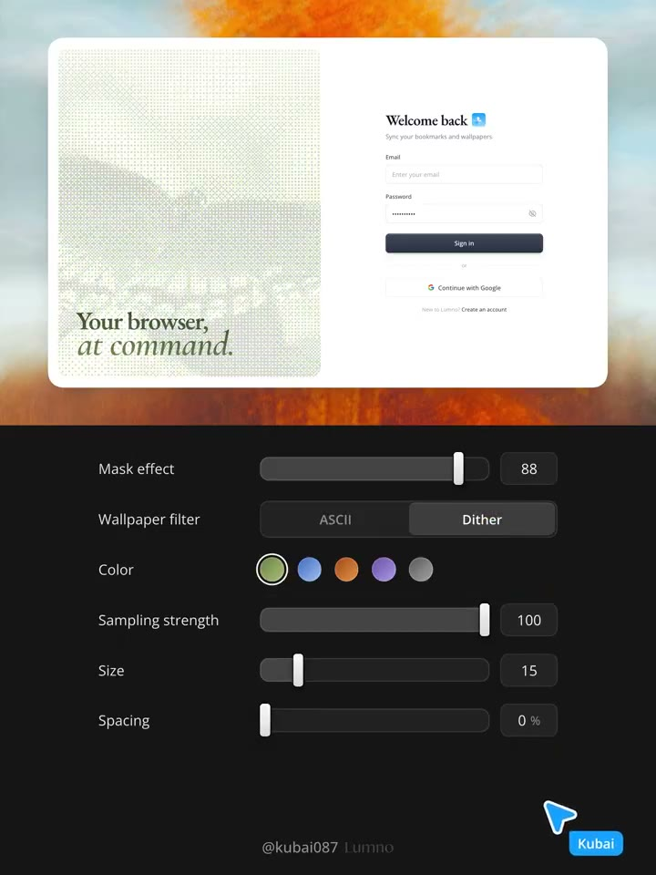
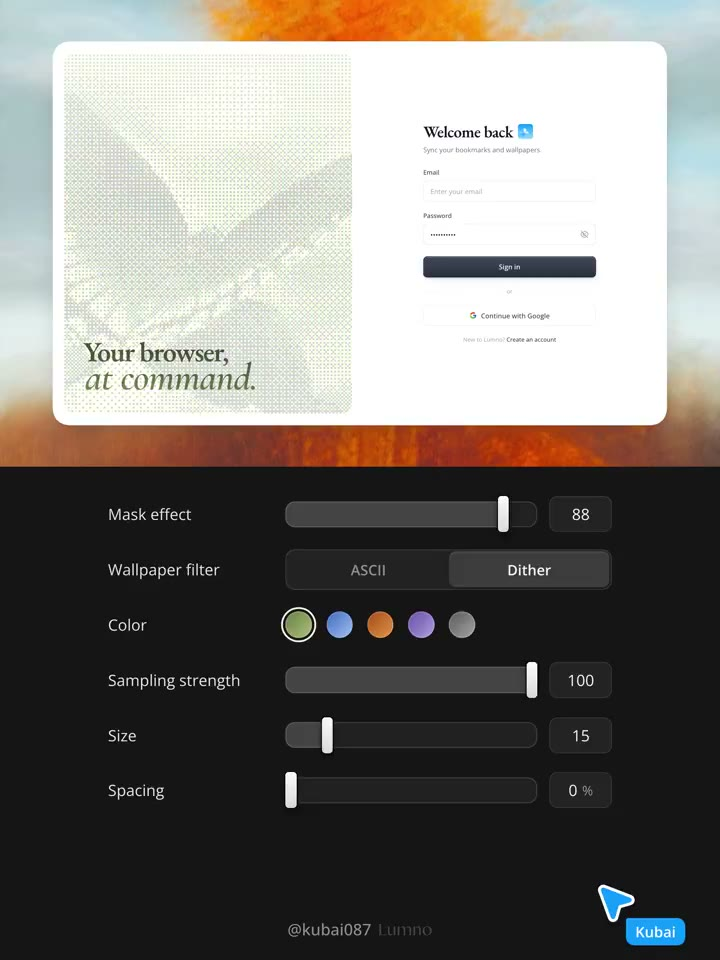

## 問題

登入卡想增加辨識度，但若把整張介面一起濾鏡化，文字與表單也會變成紋理。另一個難點是參數同名卻作用不同，調整時不易知道自己改的是什麼。

## 做法

來源核對：X 官方嵌入已證實作者、標題、篇號與影片；官方完整長文暫不可讀。2026-10-27 原帖的文字細節以 [FxTwitter 展開內容](https://api.fxtwitter.com/Kubai087/status/2115091203465290087) 補充，未完整核對官方長文；下列畫面觀察來自影片。

影片只處理登入卡左半圖像，疊字與右側表單保留正常文字。下方控制區依序安排遮罩、ASCII／Dither 切換、色票、取樣明暗、強度、大小與間距；切至 Dither 時不顯示取樣明暗。畫面中 ASCII 為遮罩 90、大小 37，Dither 為 88、15，兩者強度 100、間距 0；這些是示範值。

FxTwitter 補充文字把兩者拆開解釋：ASCII 依每格亮度選擇疏密不同的字元，大小控制字級；Dither 以 4×4 Bayer 閾值量化色階，大小控制像素塊。強度在前者調明暗對比，在後者調色階數，不能當作相同旋鈕理解。

*0.872 秒：ASCII 被選取，控制區含 Shadows／Highlights；右側登入表單保持原樣。*

*4.361 秒：切至 Dither，大小顯示 15，控制區不再列出取樣明暗。*

*18.317 秒：Dither 的藍色色票被選取，左側圖像色調改變，文字與表單仍正常顯示。*

[本地示範影片](01-source.mp4)

## 為什麼有效（推論）

把效果限制在圖像層，可讓品牌表現與輸入任務並存；即時參數區有助比較紋理差異。這不構成登入轉換、效能或目前瀏覽器支援的驗證。

## 借鑑要點

- **適合**：登入頁、封面與允許失去部分圖像細節的品牌區。
- **不適合**：需要精確辨認人物、商品細節或圖表數值的圖像。
- **移植時注意**：分別保存兩種模式設定，為控制項提供標籤與數值；用真實內容檢查對比，另測影片取樣成本及原圖回退。

## 相關實作

另見[先生成影片再轉 ASCII 的首頁動效流程](../kubai-video-to-ascii-animation/case.md)，這是 imperry 的實作回饋，由 Kubai 引用稱讚；不把它當成本篇作者的效果測試。
