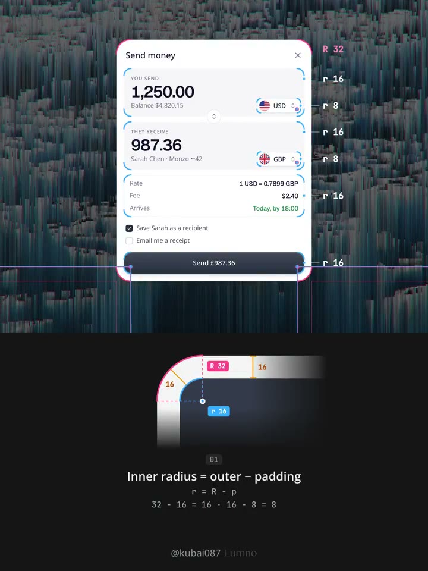
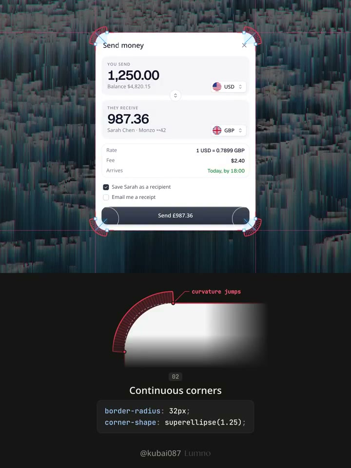
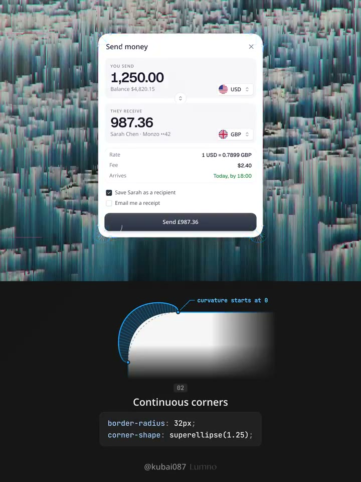
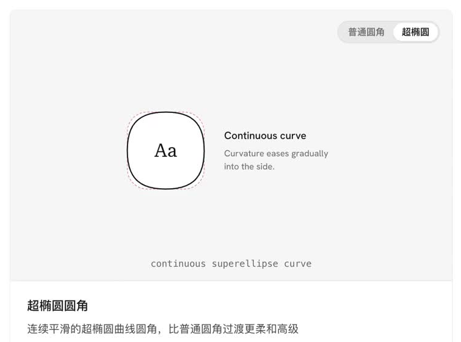
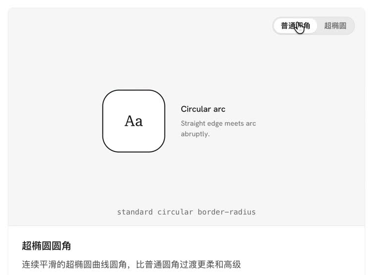
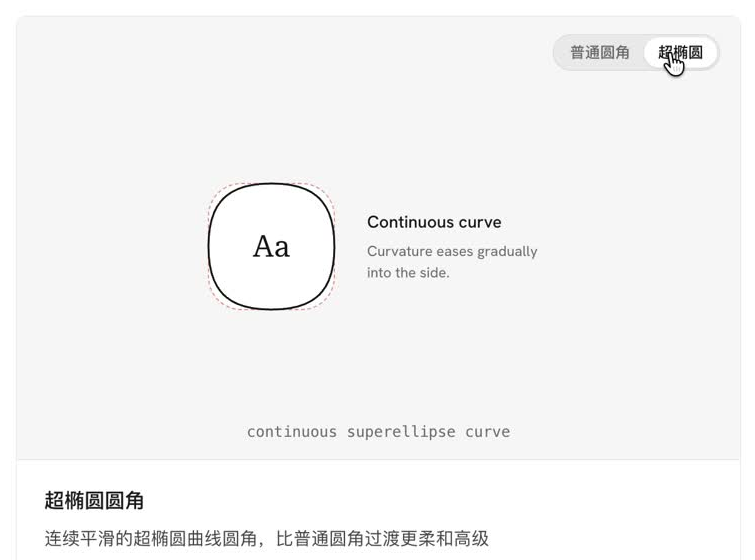

## 問題

表單或卡片逐層嵌套時，若每層任選圓角，轉角附近的留白容易忽寬忽窄。只把所有半徑一起放大，也無法建立內外輪廓的關係。

## 做法

原帖影片先在轉帳表單上標示外框、輸入區與按鈕的半徑，再拆開局部轉角說明：內圓角 = 外圓角 − 間距，使內外圓弧共用圓心。例如外框 32px、內距 16px，內層用 16px；再內縮 8px，下一層用 8px。原帖規格要求同層統一、數值落在 4px 網格，膠囊與圓形維持全圓。

影片接著以曲率示意對比普通圓角接直線時的突變，以及連續圓角的漸變。原帖保留 `border-radius: 32px`，以 `@supports` 條件加入 `corner-shape: superellipse(1.25)`。作者於 2026-10-28 稱 Chrome／Edge 139+ 支援，Safari／Firefox 回退普通圓角；這是當時說法，本卡未驗證目前相容性。

*2.625 秒：表單標出 32、16、8px 半徑，下方用共圓心示意解釋內外層關係。*

*6.825 秒：下方紅色曲率示意標出普通圓角接直線時的突變位置。*

*8.925 秒：下方藍色曲率示意呈現連續圓角接直線的漸變，並列出超橢圓設定。*

[本地示範影片](01-source.mp4)

## 為什麼有效（推論）

先用幾何關係約束半徑，可讓轉角留白接近直邊留白；再調曲率，可能減弱輪廓接點的突兀感。這是視覺推論，沒有可用性成效數據。

## 借鑑要點

- **適合**：有明確內距的對話框、巢狀面板與表單。
- **不適合**：輪廓刻意不規則，或內外層並非等距的構圖。
- **移植時注意**：先改半徑 token，再看實際留白；相減接近零時重審結構，勿硬套。另檢查背景、邊框與焦點框在回退樣式下是否一致。

## 2026-11-20 補充：同位切換普通圓角與超橢圓

Ian 的短片在同一張術語示範卡右上角提供「普通圓角／超橢圓」兩段切換。游標切換後，中央同一個帶 Aa 的輪廓在兩種外形間改變，旁邊英文標示分別是 Circular arc 與 Continuous curve；淡紅參考輪廓讓差異有共同對照。這是對本卡既有連續曲率問題的補充，不另建圓角案例。

*0 秒：超橢圓選中，Aa 外框旁顯示 Continuous curve，另有淡紅參考輪廓。*

*1.85 秒：同一位置改為 Circular arc，右上選中普通圓角。*

*3.08 秒：游標切回超橢圓，輪廓與標籤回到 Continuous curve。*

這段畫面未顯示 CSS 實作、曲率參數或瀏覽器相容性；不能由外觀反推使用了本卡前述的 `corner-shape`。可借鑑的是固定尺寸、內容與位置，只切一項輪廓屬性，使差異可比較；哪一種更柔和仍是視覺判斷。

[原帖](https://x.com/ianneo_ai/status/2123677360008695836)作者 Ian（@ianneo_ai），發布於 2026-11-20T07:18:33Z；[Kubai RT](https://x.com/Kubai087/status/2123684578623918468)發布於 07:47:14Z。以指定 fetch.py 核對官方 Tweet 作者、時間及影片 ID `2123677123638689792`，檢視 7.38 秒影片的 12 個取樣及原尺寸影格，保存三張裁切圖，未保留完整提示詞或原片。其介面與同作者的[設計詞彙比較工具](../ian-design-terminology-comparison/case.md)一致；來源未提供工具網址，未驗證其部署位置。
