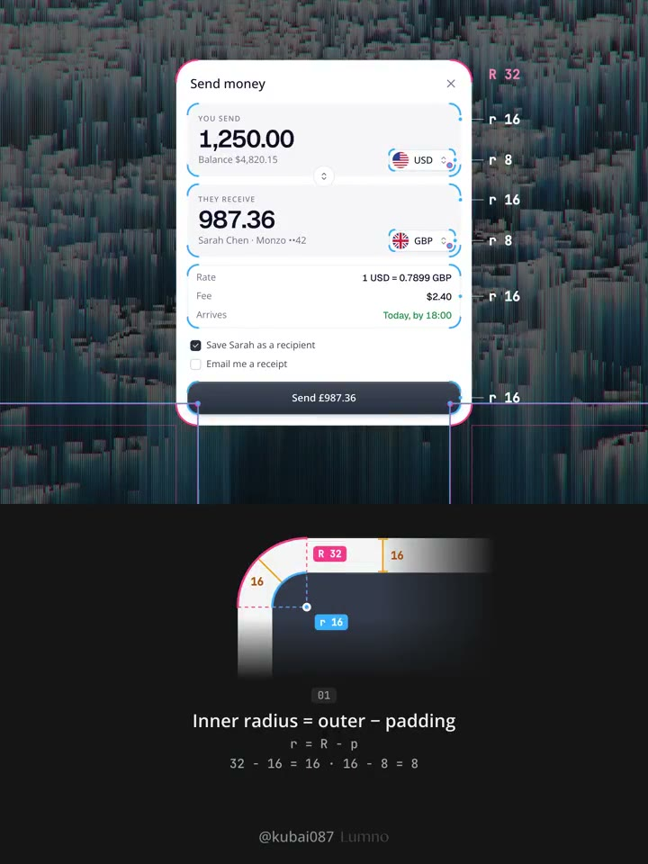
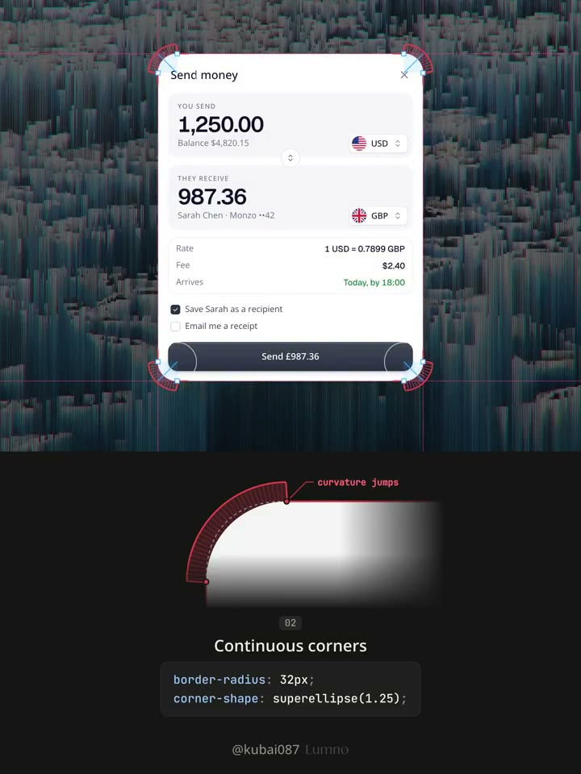
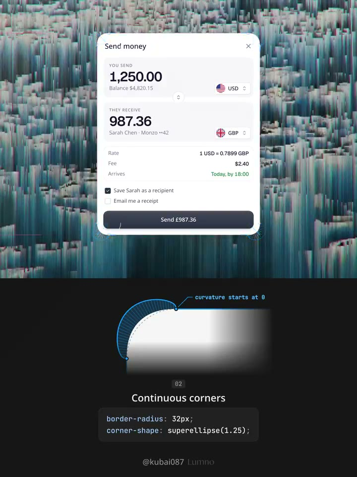

## 問題

表單或卡片逐層嵌套時，若每層任選圓角，轉角附近的留白容易忽寬忽窄。只把所有半徑一起放大，也無法建立內外輪廓的關係。

## 做法

原帖影片先在轉帳表單上標示外框、輸入區與按鈕的半徑，再拆開局部轉角說明：內圓角 = 外圓角 − 間距，使內外圓弧共用圓心。例如外框 32px、內距 16px，內層用 16px；再內縮 8px，下一層用 8px。原帖規格要求同層統一、數值落在 4px 網格，膠囊與圓形維持全圓。

影片接著以曲率示意對比普通圓角接直線時的突變，以及連續圓角的漸變。原帖保留 `border-radius: 32px`，以 `@supports` 條件加入 `corner-shape: superellipse(1.25)`。作者於 2026-10-28 稱 Chrome／Edge 139+ 支援，Safari／Firefox 回退普通圓角；這是當時說法，本卡未驗證目前相容性。

*2.625 秒：表單標出 32、16、8px 半徑，下方用共圓心示意解釋內外層關係。*

*6.825 秒：下方紅色曲率示意標出普通圓角接直線時的突變位置。*

*8.925 秒：下方藍色曲率示意呈現連續圓角接直線的漸變，並列出超橢圓設定。*

[本地示範影片](01-source.mp4)

## 為什麼有效（推論）

先用幾何關係約束半徑，可讓轉角留白接近直邊留白；再調曲率，可能減弱輪廓接點的突兀感。這是視覺推論，沒有可用性成效數據。

## 借鑑要點

- **適合**：有明確內距的對話框、巢狀面板與表單。
- **不適合**：輪廓刻意不規則，或內外層並非等距的構圖。
- **移植時注意**：先改半徑 token，再看實際留白；相減接近零時重審結構，勿硬套。另檢查背景、邊框與焦點框在回退樣式下是否一致。
