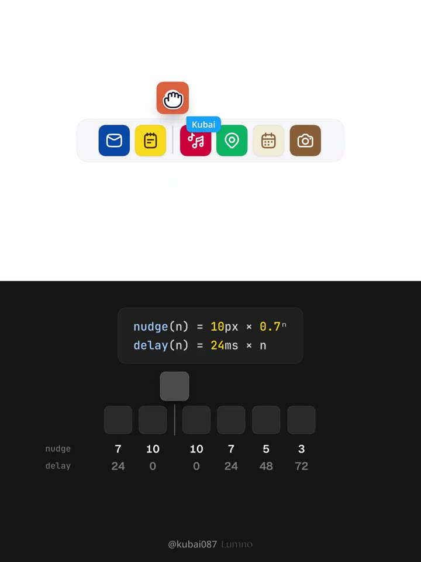
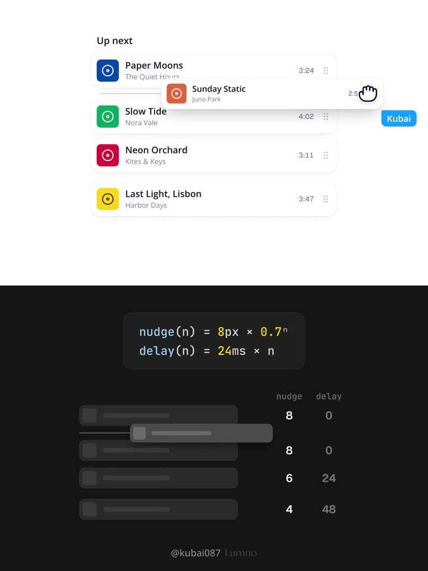
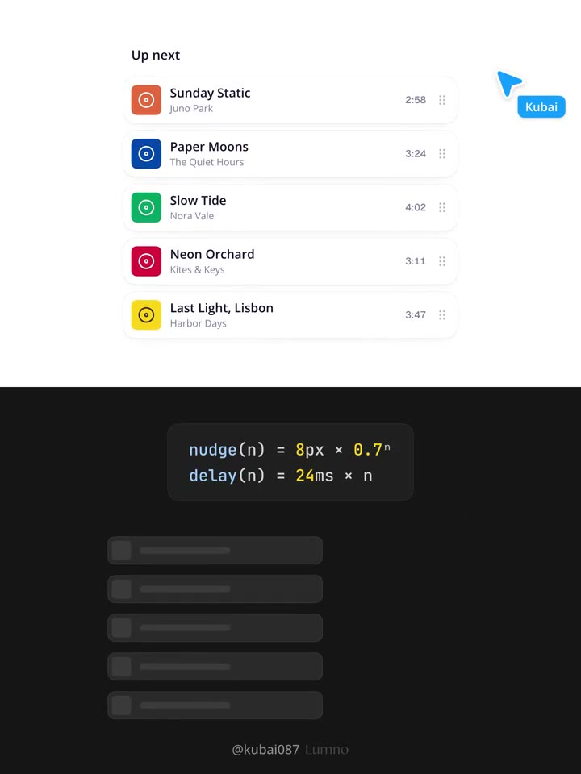

## 問題

拖動圖示或清單列時，浮起的項目容易遮住預定位置；若其他項目一起跳動，使用者也難以判斷放手後的順序。

## 做法

原帖影片分成橫向圖示列與縱向歌曲清單。項目被抓起後離開原槽：橫列向上抬起；直列向側邊移並縮至約九成，讓落點露出。原帖規格讓游標由可點擊手形切成抓取手形，插入線則從中央展開，隨候選間隙移動；回到原位時不畫線。

兩側項目向外避讓，距離插入線第 n 層，緊鄰者 n = 0。影片上半圖示列的位移為 10px × 0.7ⁿ，下半歌曲清單改為 8px × 0.7ⁿ；兩者啟動延遲均為 24ms × n。作者於 2026-10-29 建議用輕微超越、約 0.25 秒收斂的彈簧動作。放手後項目落入間隙，其餘歸位；Escape 或放到清單外則取消並還原。

*2.750 秒：橘色圖示抬到橫列上方，下方標出 10px × 0.7ⁿ 位移與 24ms × n 延遲。*

*9.350 秒：歌曲列浮在清單前方，下方位移公式改為 8px × 0.7ⁿ，延遲維持 24ms × n。*

*11.550 秒：橘色歌曲列出現在清單首位，下方示意列恢復平直排列。*

[本地示範影片](01-source.mp4)

## 為什麼有效（推論）

插入線提供明確落點，近處先動、遠處少動則可能把注意力集中在正在改變的間隙。作者形容它像推擠；不代表已證實能縮短排序時間。

## 借鑑要點

- **適合**：短清單、常用工具列與需要反覆調整的播放順序。
- **不適合**：必須同時精準比較多列數值、位移會干擾閱讀的表格。
- **移植時注意**：沿用既有拖曳邏輯，以 transform 呈現偏移，避免動畫改寫命中區；保留鍵盤排序與取消，減少動態效果時只留插入線。
