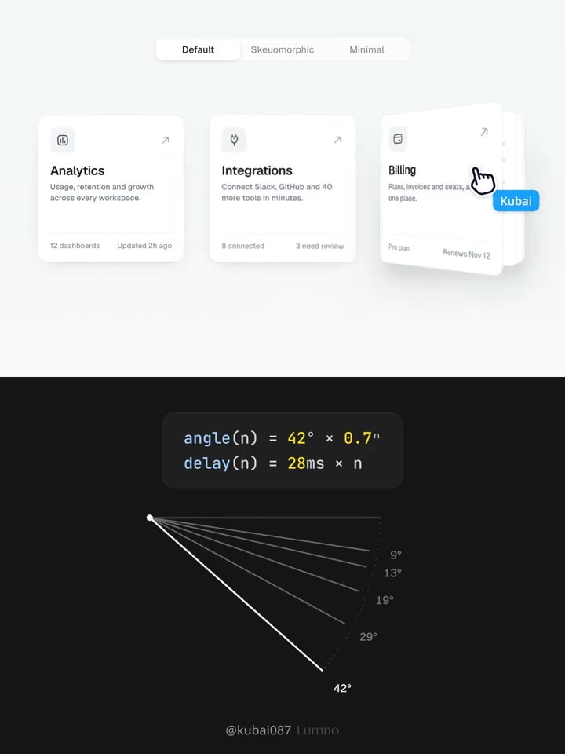
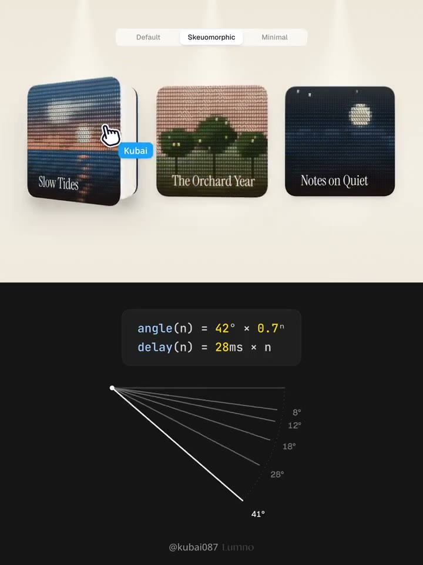
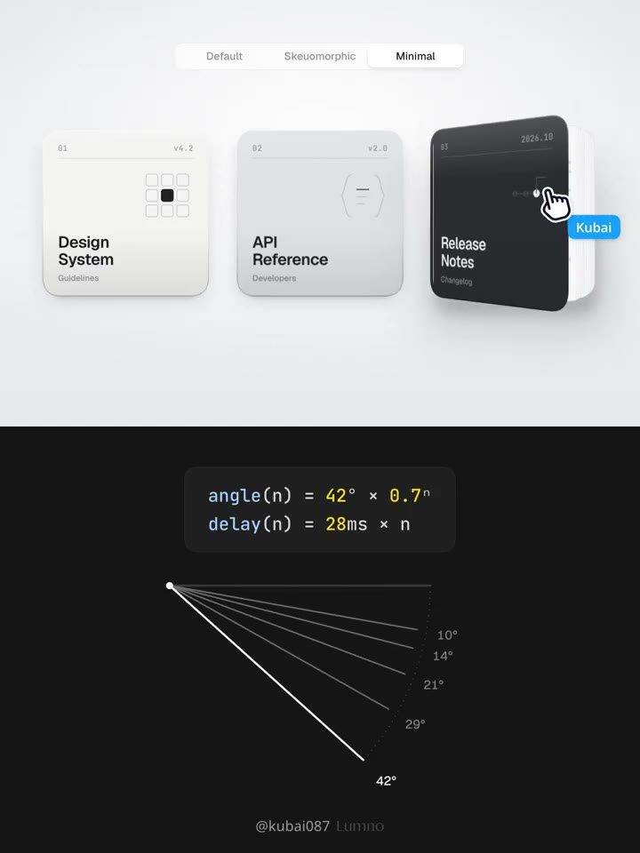

## 問題

卡片網格需要可互動的提示，但放大整張卡片可能擠到鄰居。若想露出內容層次，還得讓裝飾動作維持原本的點擊位置與閱讀順序。

## 做法

來源核對：X 官方嵌入已證實作者、標題、篇號與影片；官方完整長文暫不可讀。2026-10-30 原帖的文字細節以 [FxTwitter 展開內容](https://api.fxtwitter.com/Kubai087/status/2116198373040759107) 補充，未完整核對官方長文；翻頁與公式可直接從影片核對。

影片切換 Default 產品卡、Skeuomorphic 精裝書與 Minimal 文件冊。卡片以左側為書脊，懸停時封面向外翻、內頁逐層錯開，鄰近卡片維持位置。畫面公式為 angle(n) = 42° × 0.7ⁿ、delay(n) = 28ms × n；封面 n = 0，越內層角度越小、啟動越晚。這是示範動效的規格，不是通用最佳參數。

FxTwitter 補充文字把結構描述為封面、四頁內頁與固定封底，離開時倒序合上；並以接觸陰影、環境陰影兩層表現厚度，開啟時陰影向下延長、變柔。這些結構與陰影實作細節尚未與官方完整文字核對。

*5.816 秒：Default 的右側卡片沿左邊翻開，下方列出角度與延遲公式。*

*10.469 秒：Skeuomorphic 的左側書封轉出，內頁露在後方，其餘書冊維持原位。*

*24.427 秒：Minimal 的深色文件冊翻開並露出白色內頁，延續相同書脊方向。*

[本地示範影片](01-source.mp4)

## 為什麼有效（推論）

角度與延遲逐層遞減，可能讓多層旋轉讀成一本書，而非數張卡片各自移動。三種外觀沿用同一動作，也示範了材質與互動可分開調整，未提供操作成效數據。

## 借鑑要點

- **適合**：資源入口、作品集與有預覽意義的文件卡片。
- **不適合**：高密度資料表，或必須靠展開才看得到關鍵資訊的介面。
- **移植時注意**：命中區與焦點框留在靜止外框；裝飾頁不新增焦點。鍵盤可觸發、觸控首次點按仍啟用卡片，減少動態效果時改用輕抬或靜態提示。
