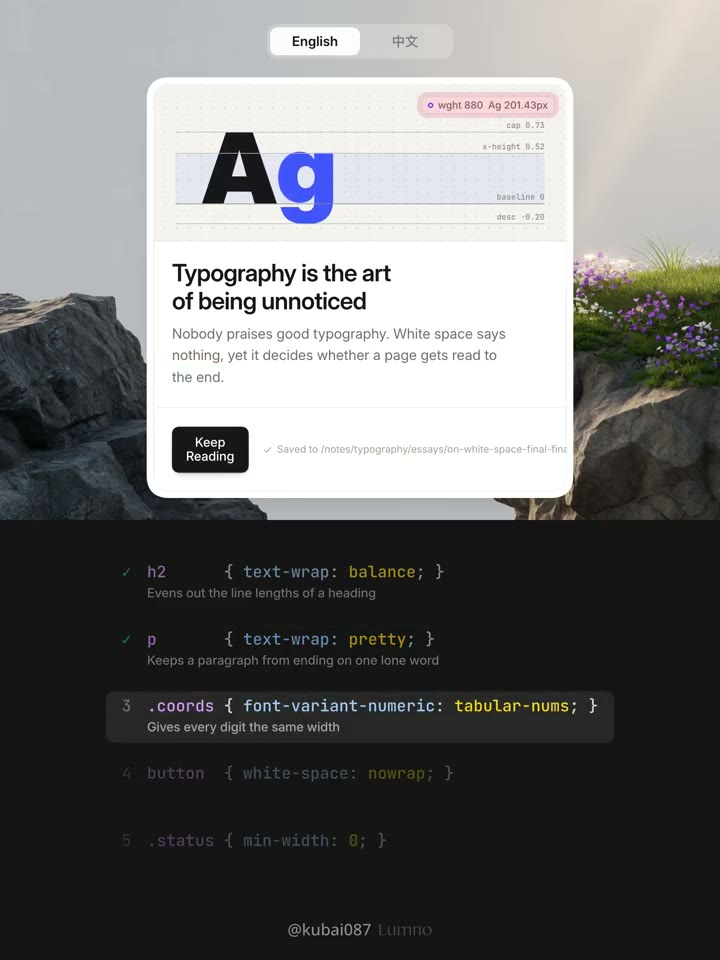
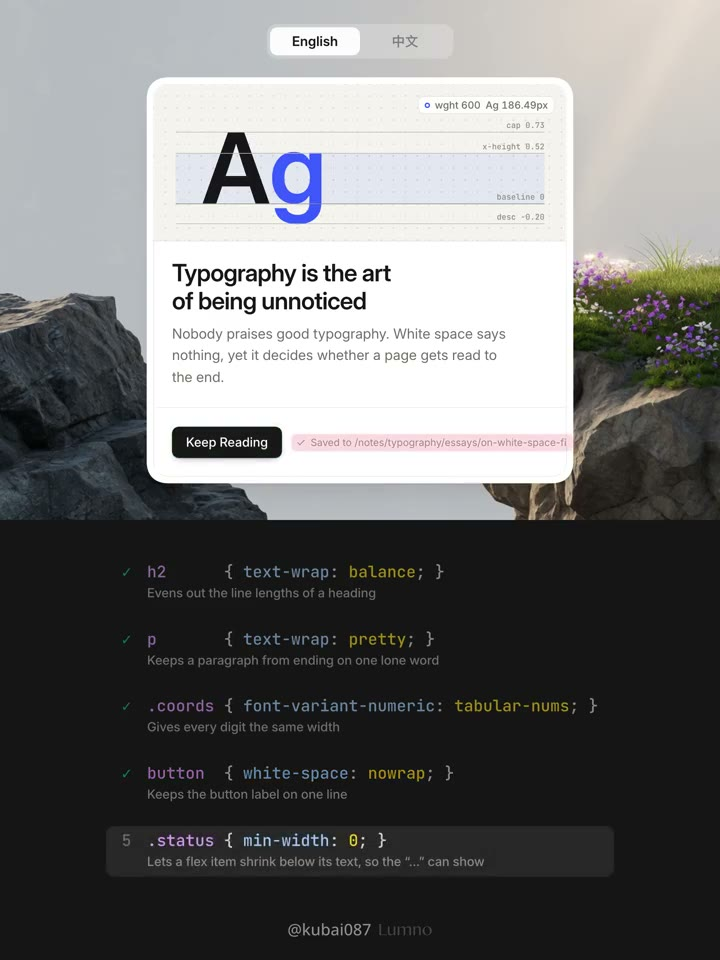
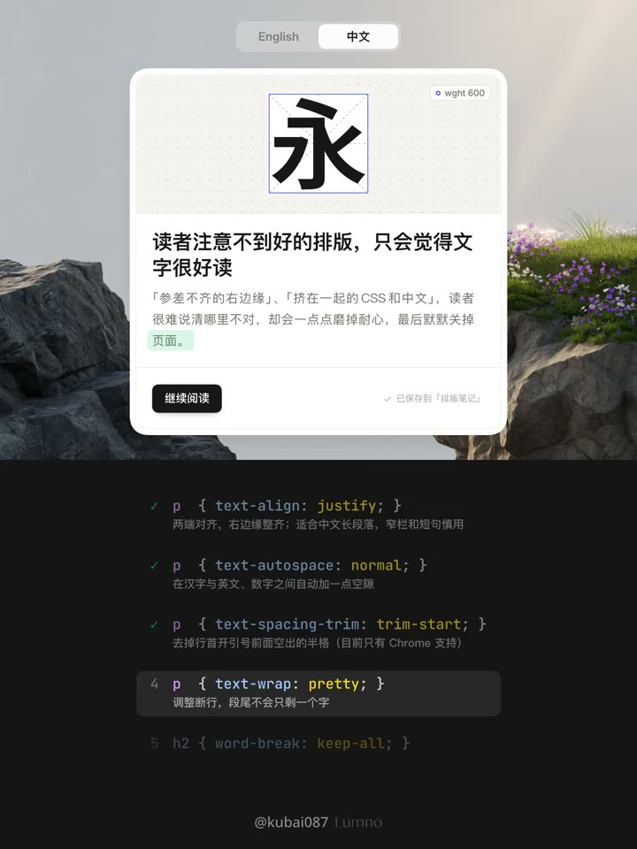

## 問題

同一張卡片切換中英文後，標題可能留下過短末行，按鈕可能拆成兩行，正文也可能出現不合適的標點位置或字間空隙。只換字串，無法保證版面仍然好讀。

## 做法

原帖影片用可切換 English／中文的閱讀卡片，逐項標示文字與 CSS 的對應關係。英文標題示範 `text-wrap: balance`，正文示範 `text-wrap: pretty`；數字以 `font-variant-numeric: tabular-nums` 統一寬度。底部按鈕用 `white-space: nowrap` 保持單行，相鄰狀態文字則以 `min-width: 0` 留出收縮空間。

影片中文段落依序展示 `text-align: justify`、`text-autospace: normal`、`text-spacing-trim: trim-start`，處理對齊、中西文間距與行首標點空間，再以 `text-wrap: pretty` 示範避免末行孤字。作者於 2026-10-31 強調，i18n 文案還要配合容器選詞，避免詞語拆行與空隙過多；本卡記錄示範，未驗證各屬性的目前相容性。

*11.014 秒：英文兩行標題下方，列出 balance、pretty 與 tabular-nums 等設定。*

*19.825 秒：底部按鈕保持單行，狀態文字區被標色，下方列出 nowrap 與 min-width: 0。*

*46.258 秒：中文正文末行被標色，下方列出 pretty，對照避免末行孤字的處理。*

[本地示範影片](01-source.mp4)

## 為什麼有效（推論）

讓標題追求行長平衡、正文照顧連續閱讀、控制項保住操作文字，可避免單一換行規則牽連整張卡片。這是排版推論，沒有閱讀速度或理解率測量。

## 借鑑要點

- **適合**：多語介紹卡、說明頁與含數字的狀態區。
- **不適合**：需要保留原始空白與逐字格式的程式碼、詩句。
- **移植時注意**：用真實長短譯文檢查窄螢幕與文字放大；先確認語義完整，再調文案與容器。兩端對齊須檢查空隙，新的文字屬性須另驗支援與回退。

## 原作者補充

以下為已核對直接回覆關係的作者 Prompt，保留原連結供參考，不在本庫整段轉載。

- [Prompt 1](https://x.com/Kubai087/status/2116555520274493582)
