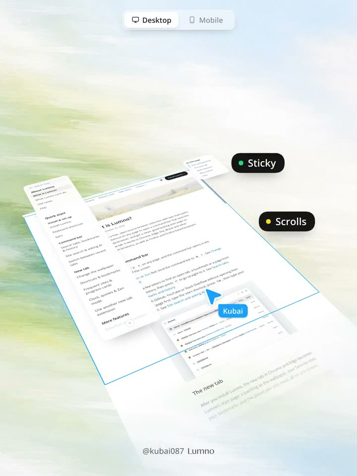
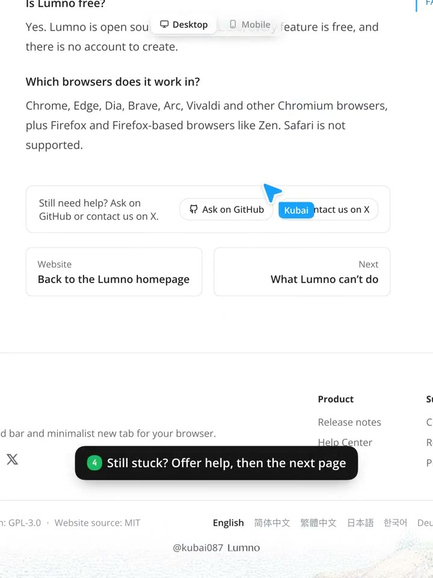
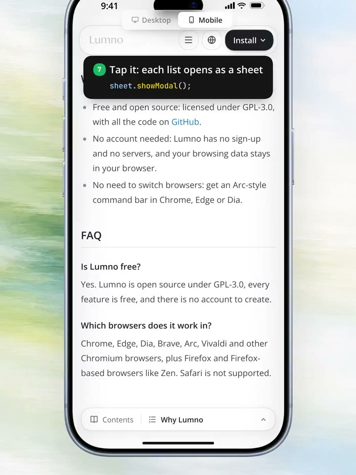

## 問題

Wiki 章節增加後，桌面側欄可能超出一屏，手機則沒有足夠寬度常駐目錄。讀者找到一篇解答後，也需要知道還能求助誰、下一步讀哪裡。

## 做法

桌面示範把章節導覽與正文分區，導覽使用獨立高度；超出範圍的邊緣加漸變遮罩與居中箭頭，提示仍有內容可捲。頂部導覽保持可見，安排返回官網的 Logo、關鍵頁面下拉選單與核心 CTA。

手機改在底部常駐章節列，原帖建議點開全螢幕選單，一行一章。文末接社群或聯絡入口、下一頁卡片，再進入有背景圖與實用連結的高頁腳。作者於 2026-11-01 主張這些安排有助 SEO、停留與轉換，並提醒 Safari 地址欄可能隨導覽配色變化；這些效益與瀏覽器行為均未在本卡獨立驗證。

*2.746 秒：傾斜的桌面頁面旁，以 Sticky 與 Scrolls 標籤區分固定和捲動區域。*

*35.696 秒：文章下方先放求助入口與下一篇卡片，再列出頁腳連結。*

*57.663 秒：手機底部保留章節列，字幕提示點按清單會開啟面板。*

[本地示範影片](01-source.mp4)

## 為什麼有效（推論）

獨立導覽可讓正文位置與目錄瀏覽分開；邊緣漸變可能比直接裁切更容易傳達溢出。文末先提供求助和下一篇，也讓讀者在結束閱讀時有具體出口，效果仍需實測。

## 借鑑要點

- **適合**：章節較多、內容持續擴充的產品說明與知識庫。
- **不適合**：只有少量段落的短頁，或主要任務需要立即完成的表單頁。
- **移植時注意**：選章後關閉面板並定位正文；檢查焦點返回、獨立捲動與安全區。漸變只在確有溢出時出現；頁腳高度依內容決定，勿把超過半屏當作效益保證。
