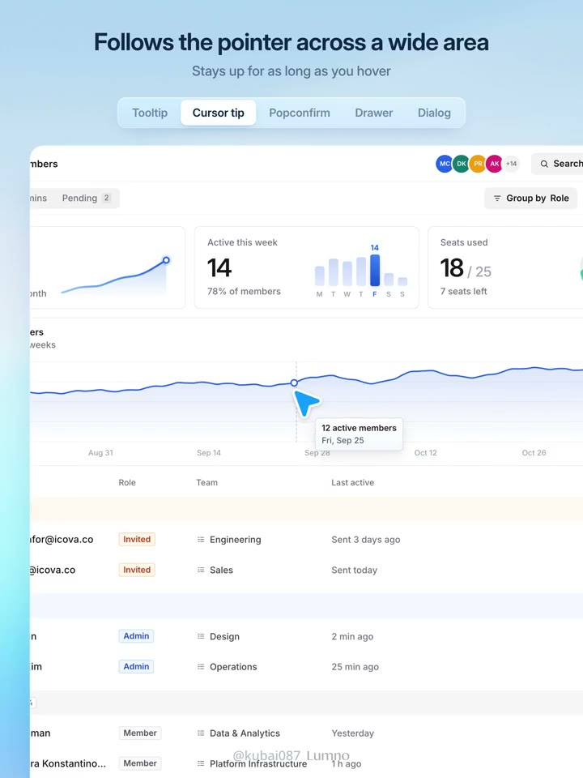
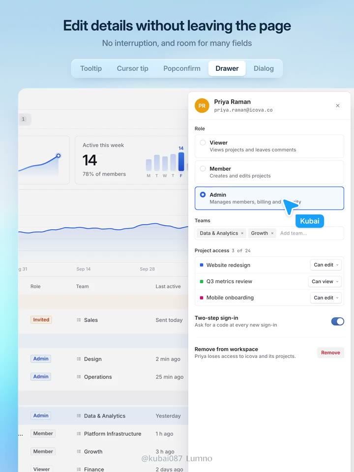
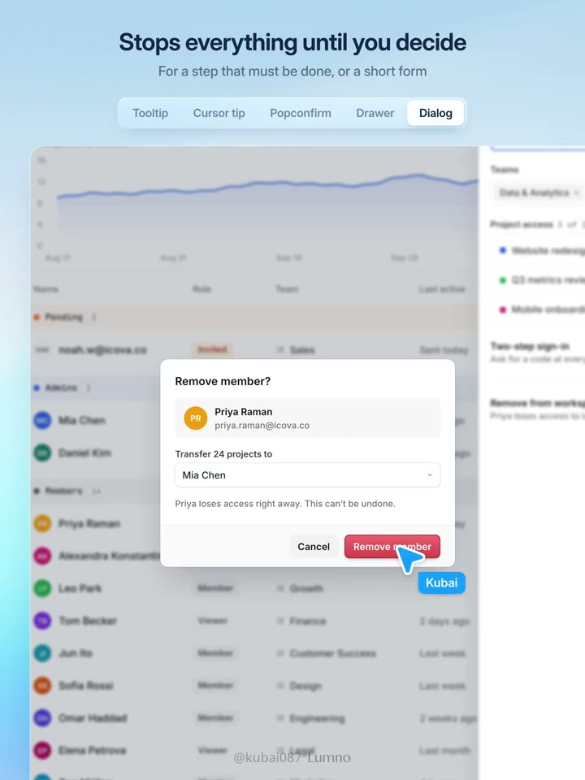

## 問題

管理介面同時需要補充說明、確認刪除與編輯資料。若全部塞進彈窗，使用者會反覆離開原本的工作脈絡；反過來，只用小氣泡又容不下長表單與重大決定。

## 做法

作者於 2026-11-02 將選擇拆成三組判斷：Tooltip 補充單一目標的文字，含操作則改用點擊開啟的 Popover；Cursor tip 在區域內跟隨游標提供資訊，行動端則改以點擊顯示。

可撤銷的操作先執行，再提供撤銷；不可逆操作才確認。局部操作用 Popconfirm，影響大、批次處理或必須中斷工作時用 Dialog。短且不用參照背景的表單放彈窗；長表單、需要對照背景或較寬空間時用抽屜；主要任務另開頁面。

*14.888 秒：折線圖資料點旁顯示數值氣泡。*

*28.121 秒：右側抽屜列出角色與專案權限，背景仍保留成員列表。*

*34.738 秒：中央確認框提供取消與紅色移除按鈕，背景覆有遮罩。*

[本地示範影片](01-source.mp4)（39.7 秒）。

## 為什麼有效（推論）

先看能否復原，再決定確認強度，可讓中斷程度對應操作後果。抽屜保留參照內容，也可能減少來回記憶欄位的負擔；這是對示範的解讀，原帖沒有提供效率測試。

## 借鑑要點

- **適合**：成員管理、權限設定及資料表中的局部編輯。
- **不適合**：把上述判斷當成所有裝置與任務的固定規格。
- **移植時注意**：先列出可撤銷性、影響範圍及參照需求；再檢查鍵盤焦點、關閉方式與手機點擊行為，避免必要資訊只能靠懸停取得。
