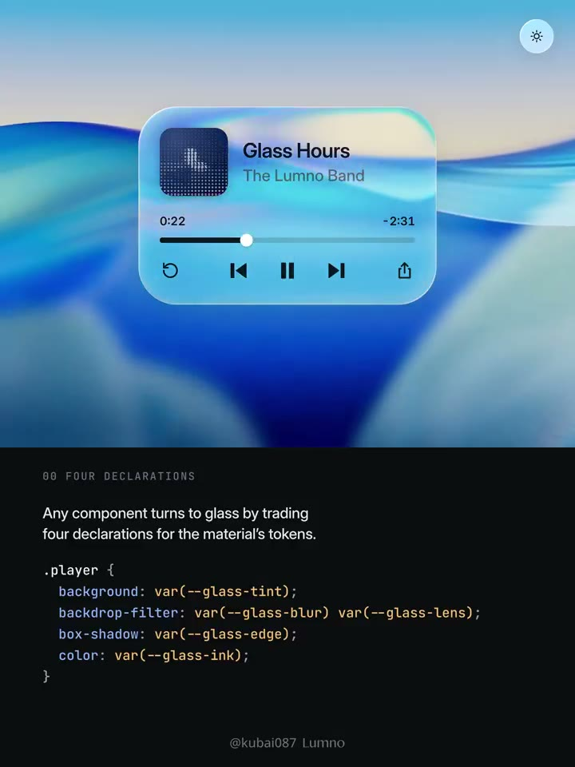
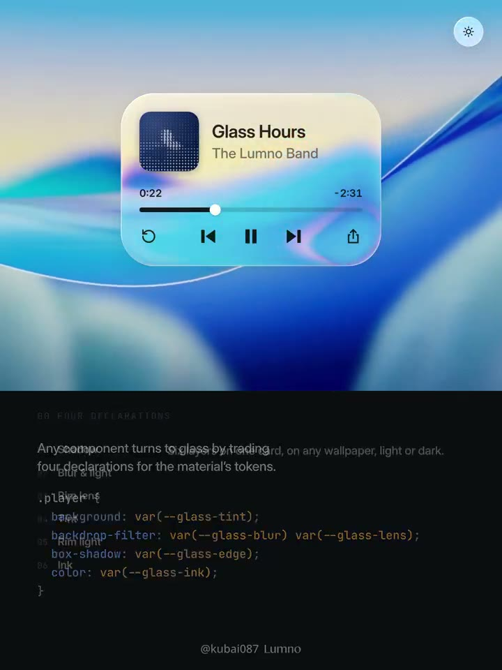
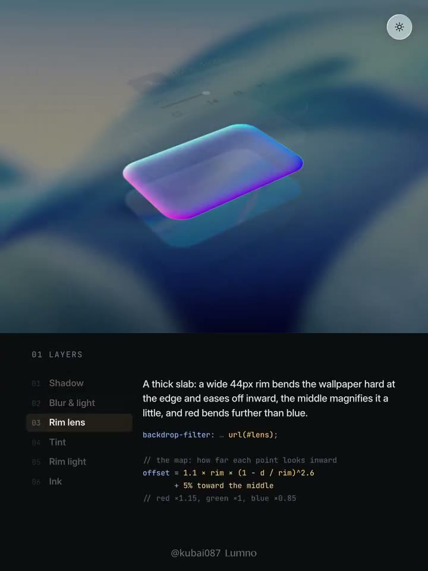
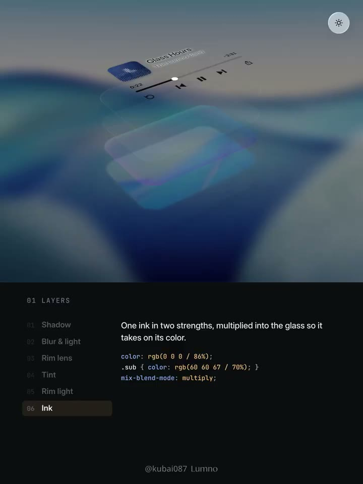
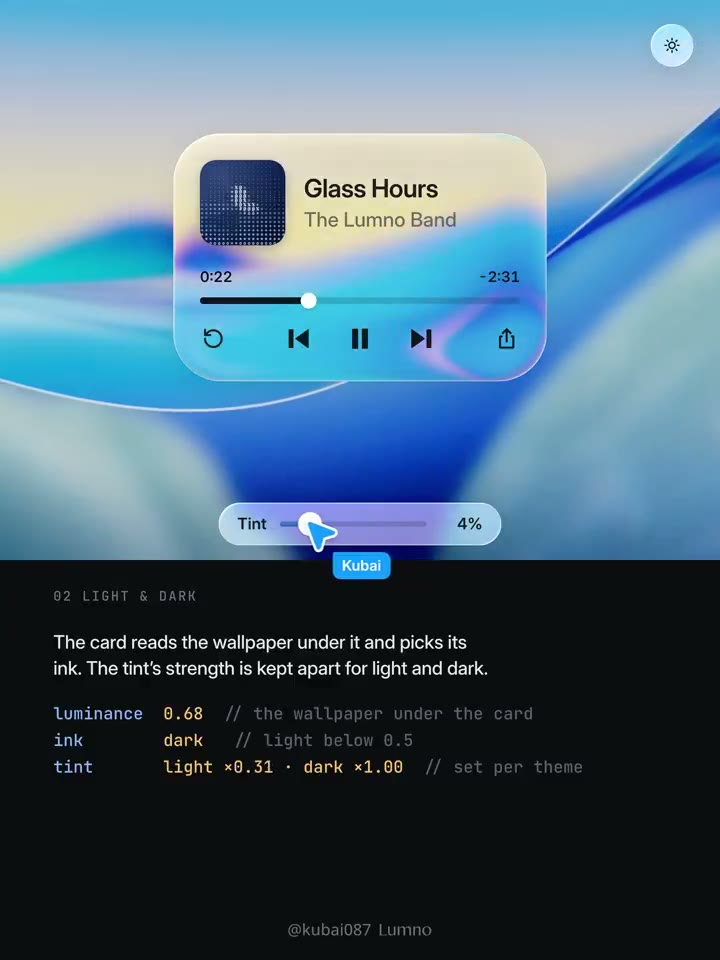
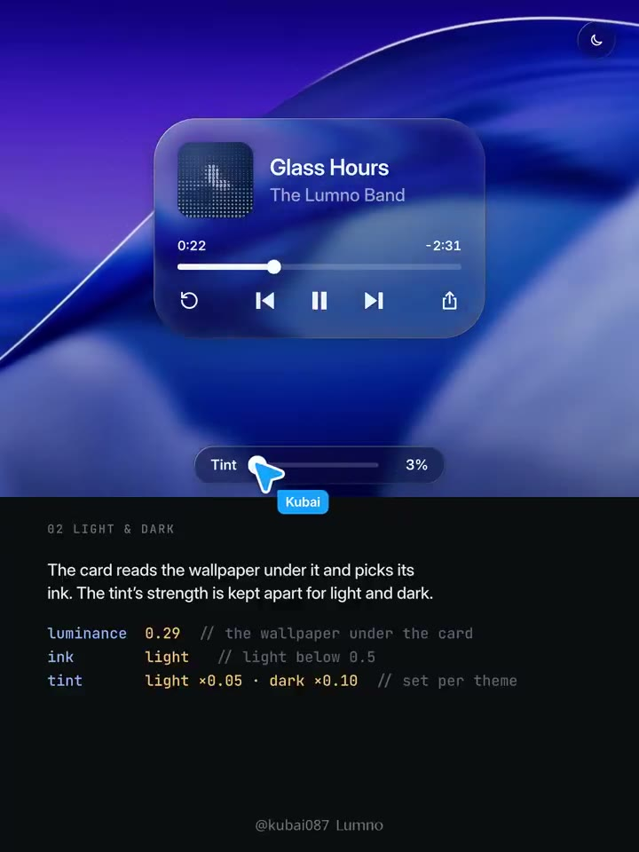

## 問題

同一張播放器或卡片放到不同背景、深淺主題時，透明材質容易失去邊界，或令文字難以閱讀。

## 做法

- 作者將材質拆成投影、背景模糊與提亮、邊緣折射、透明著色、邊緣光、文字著色，另以背景採樣控制深淺反應。畫面展示播放器及可分開觀察的材質層。
- 位移貼圖主要處理邊緣：向內壓縮背景，中間維持平整，並以不同色彩通道的位移量模擬色散。
- 原帖的起始參數：淺色白色著色 6%–22%、飽和度 180%、亮度 1.06；深色著色 16%–38%、飽和度 160%、亮度 0.8；兩者模糊皆為 2px。折射邊寬 44px、偏移約為邊寬 1.1 倍、色散 ±15%。
- 多點採樣背景平均亮度，作者以 0.5 作切換門檻；文字混合方式也隨深淺背景改變。上述是作者示例參數，並非已驗證的通用配方。

[原帖示範影片](01-source.mp4)。

*1.642 秒：播放器透出背景，邊緣保有亮線與折射感。*

*8.208 秒：影片將現有元件與材質 token 對照展示。*

*14.775 秒：分離材質層，說明邊緣折射在整體外觀中的位置。*

*21.342 秒：文字、背景與玻璃面材以分層視角呈現。*

*27.908 秒：淺色背景下調整著色，畫面保留可操作的播放器。*

*34.475 秒：深色背景使用另一組著色與文字處理。*

## 為什麼有效（推論）

將邊界、材質與文字分開控制，有機會同時保留透明感及可讀性；跟隨背景採樣則能減少固定透明度遇到複雜圖片時的不穩定。原帖沒有提供對比度、效能或閱讀測試。

## 借鑑要點

- **適合**：播放器、懸浮卡片和可控制背景的工具介面。
- **不適合**：高密度文字、強可讀性要求或背景不可預測的關鍵表單。
- **移植時注意**：實測文字對比、SVG 濾鏡支援與重繪成本；提供不透明降級。亮度門檻和原帖對深淺切換的描述需用實際背景驗證，不直接當成平台規則。
