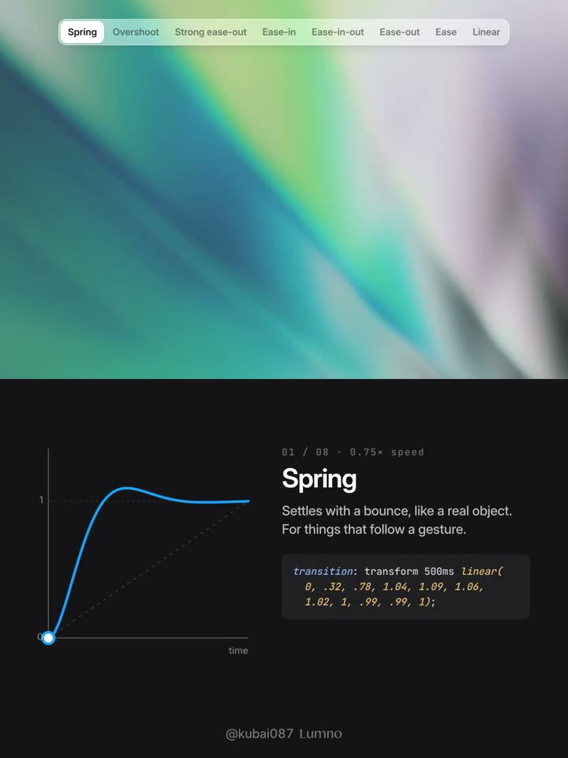
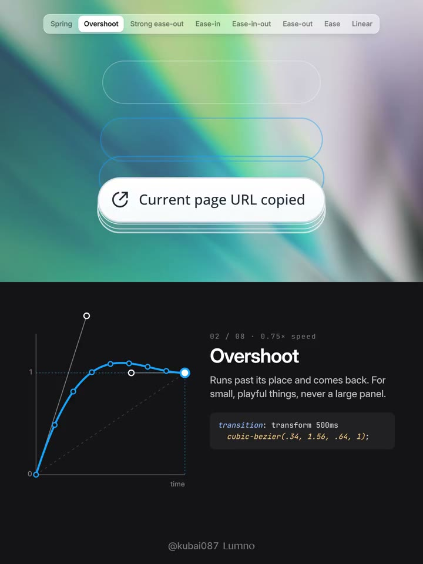
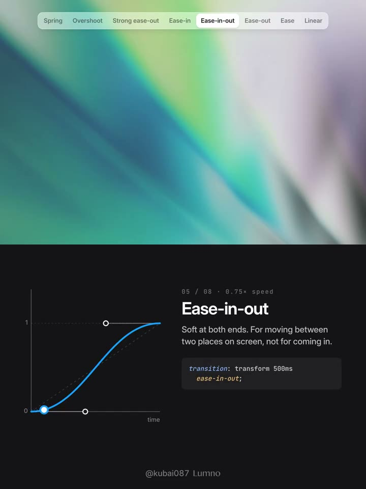

## 問題

同樣一段位移，通知進場、選中指示條移動與拖曳後歸位，需要表達的狀態不同。只統一動畫時間，仍可能出現回應遲鈍、停止生硬或大型面板過度彈跳的感覺。

## 做法

示範把通知殘影與時間曲線上下並列，頂部頁籤切換節奏。作者於 2026-11-05 建議：Linear 用於持續運行的載入或進度；Ease-out 先快後慢，用於選單、通知與抽屜入場；Strong ease-out 留給點擊後立即落位的圖示、文字或選中膠囊。

Ease-in 用於退場；Ease-in-out 用於畫面內兩位置之間的移動。Overshoot 可越過終點約 10% 再返回，作者建議限於勾選、按讚等小回饋；Spring 則在到位後再輕晃一兩次，用於鬆手歸位。這些是選型建議，並非每種元素都已驗證的參數。

*1.339 秒：Spring 頁籤下方列出帶回彈的曲線與用途說明。*

*6.694 秒：通知周圍的輪廓殘影與下方 Overshoot 曲線並列。*

*17.406 秒：Ease-in-out 頁籤顯示兩端平緩、中段較陡的曲線。*

[本地示範影片](01-source.mp4)（約 32.13 秒）。

## 為什麼有效（推論）

同時呈現軌跡與曲線，能把抽象節奏對應到物件行為。依操作目的選曲線，也可能讓進入、離開與歸位具有較一致的訊號；原帖沒有提供反應時間或偏好測試。

## 借鑑要點

- **適合**：建立元件動效規範，或比較同一元件的多種節奏。
- **不適合**：所有元素套用同一條彈簧曲線，尤其大面積面板。
- **移植時注意**：固定距離與時間後再比較曲線；實測連續點擊、途中反向與減少動態效果設定，別把示範的彈性幅度當成通用值。

## 原作者補充

以下為已核對直接回覆關係的作者 Prompt，保留原連結供參考，不在本庫整段轉載。

- [Prompt 1](https://x.com/Kubai087/status/2118143923571048817)

- [Prompt 2](https://x.com/Kubai087/status/2118144019545067872)
