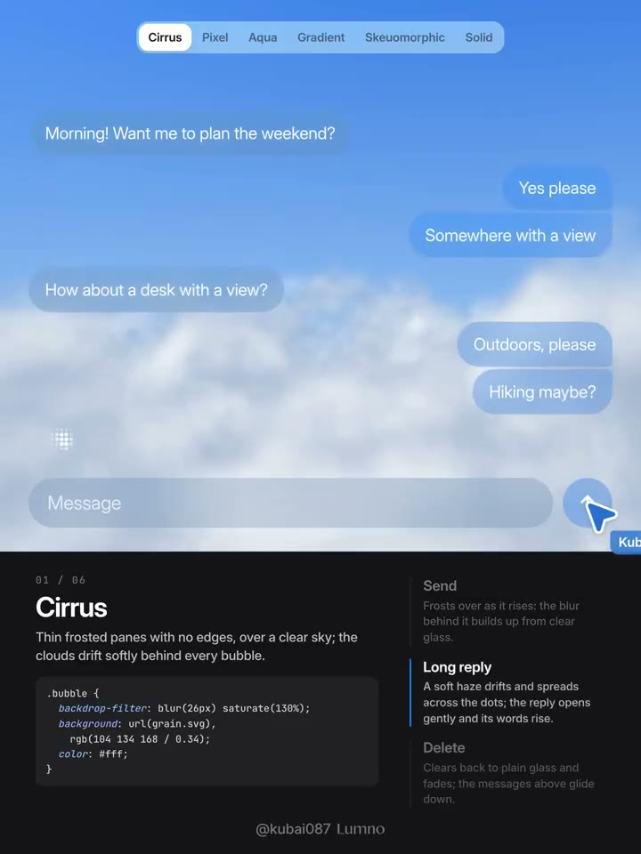
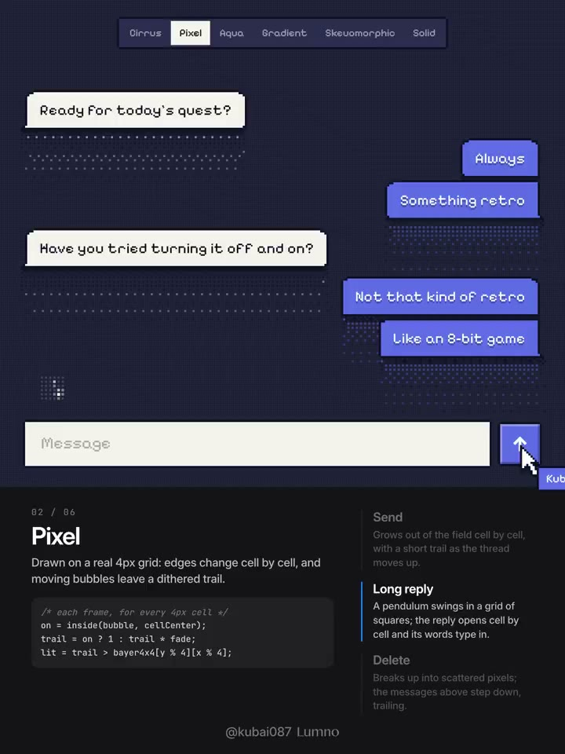
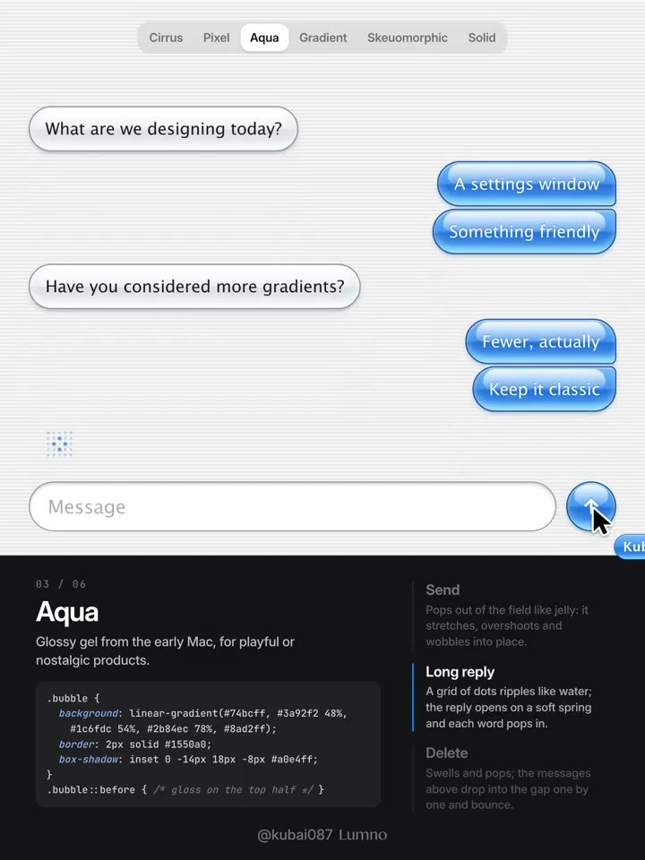
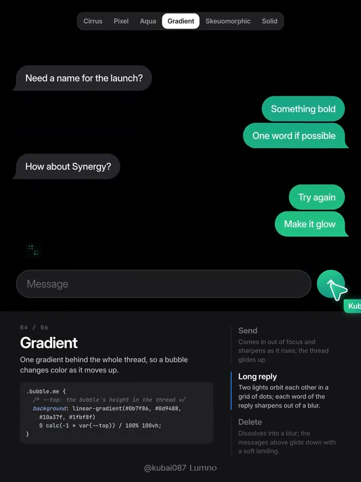
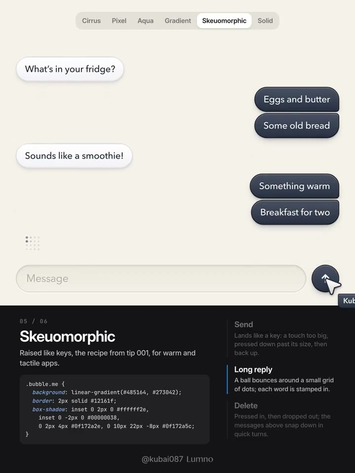
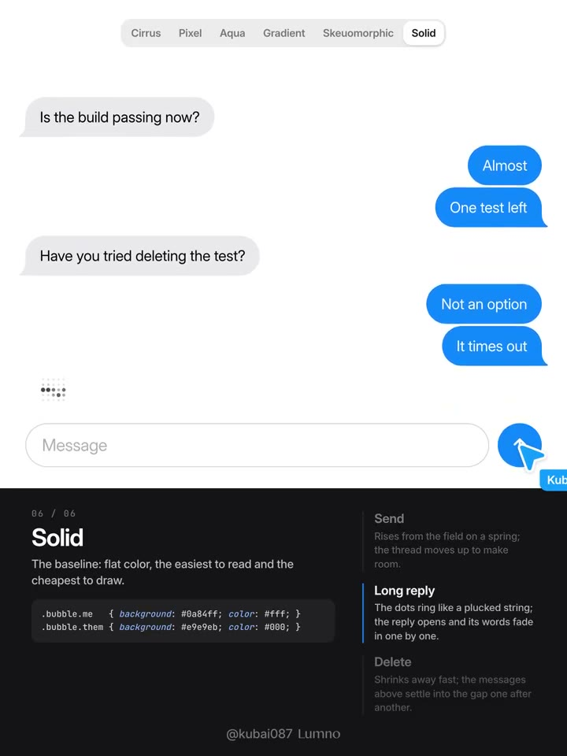

## 問題

聊天介面若只換氣泡顏色，產品個性仍有限；若材質、等待提示與訊息進出場各自設計，又容易產生風格斷裂。這份探索示範將三者一起比較。

## 做法

作者於 2026-11-06 提出六種方案，並為氣泡配置同風格的思考與出入場動效：Cirrus 用無描邊薄磨砂與天空背景；Pixel 用格狀邊緣及像素拖影；Aqua 用高光呈現老 Mac 果凍感。

Gradient 讓整段對話共用漸變，氣泡依所在高度取色，並以 Telegram 作為類比；Skeuomorphic 延續第 001 期的擬物做法；Solid 作為純色對照。作者稱純色最好讀、最省效能，這是當日主張，並非本卡的閱讀或效能測試結果。

*1.8 秒：天空雲層後景搭配半透明氣泡與輸入框。*

*9 秒：深色底上使用像素字形、方形氣泡與點陣紋理。*

*16.2 秒：藍白氣泡帶明顯高光與圓潤邊緣。*

*23.4 秒：黑色背景上的右側氣泡呈現綠色漸變。*

*30.6 秒：米色底上的氣泡與輸入框帶陰影和凹凸層次。*

*37.8 秒：白底搭配藍灰純色氣泡，作為材質比較的基準。*

[本地示範影片](01-source.mp4)（43.2 秒）。

## 為什麼有效（推論）

以同一個對話結構比較材質，較容易辨別風格差異，而不被版型改動干擾。將等待與訊息轉場一起設計，也可能讓回應過程保有一致的物理感。

## 借鑑要點

- **適合**：探索 Agent、陪伴或個性化聊天產品的視覺方向。
- **不適合**：直接把短句展示視為長文、程式碼與高密度對話的可讀性證明。
- **移植時注意**：用相同長文、串流輸出與錯誤訊息比較方案；檢查文字對比、背景變化及低效能裝置，保留純色版本作基準。
