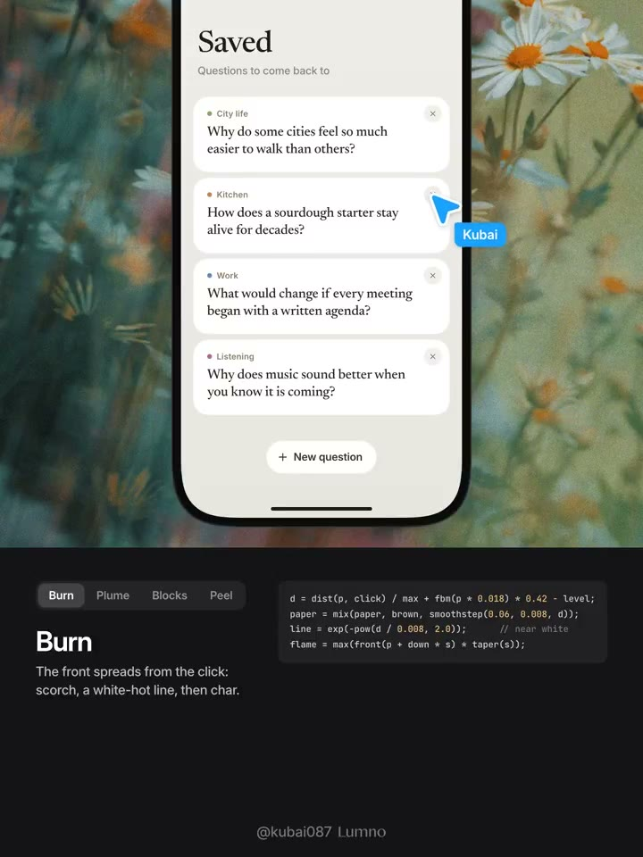
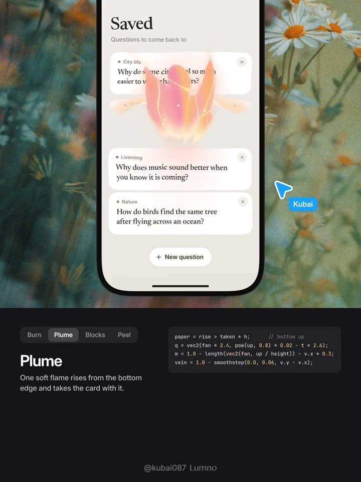
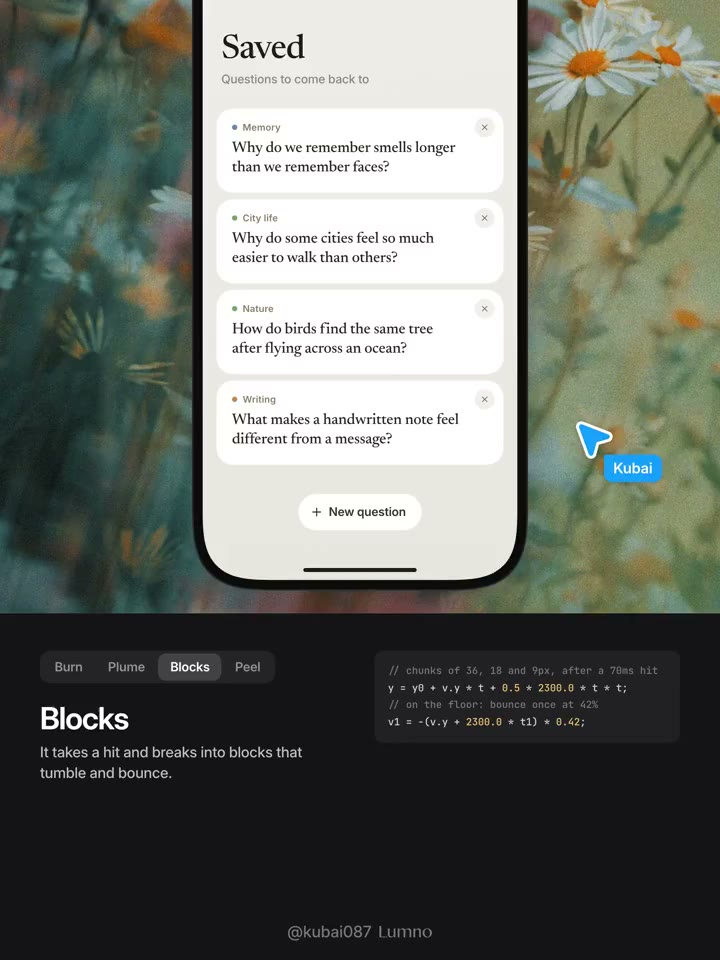
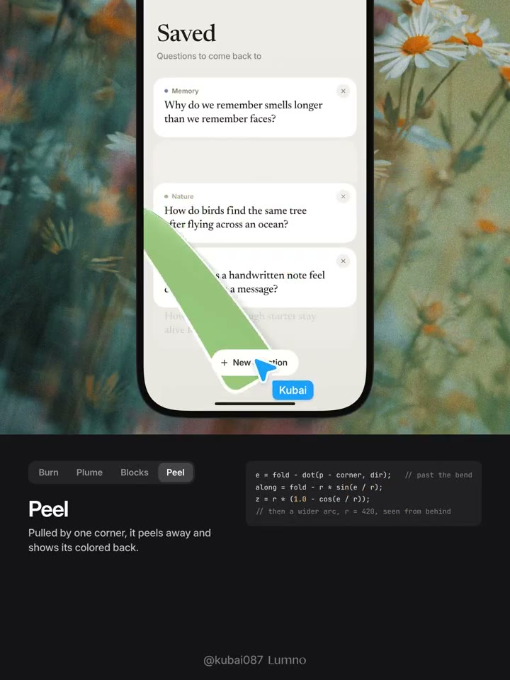

## 問題

卡片刪除若直接消失，使用者可能難以追蹤哪一項被移除；若只處理卡片的特效，周圍列表突然跳位，也會切斷操作與結果的關係。此例探索離場、鄰近影響與補位的連接方式。

## 做法

畫面以「Saved」直向卡片列表作為共同場景，卡片右上角有關閉控制，下方頁籤切換 Burn、Plume、Blocks 與 Peel，並附效果說明及程式片段。

作者於 2026-11-09 將四種方案稱為燃燒、火焰、碎塊與撕貼紙，並表示同時處理熱浪對周圍元素的扭曲與刪除後補位。示範的流程是操作移除 → 卡片呈現所選離場效果 → 剩餘卡片重新排列；靜態截幀只能記錄部分過程，不能單憑一幀判定完整節奏。

*0.533 秒：Burn 頁籤下顯示四張問題卡片與底部新增按鈕。*

*4.8 秒：Plume 頁籤下，上方卡片區域出現橘粉色火焰形狀。*

*9.067 秒：Blocks 頁籤下列表已換成另一組卡片，此幀未呈現碎裂瞬間。*

*11.2 秒：Peel 頁籤下可見翻起的綠色背面與列表中的空隙。*

[本地示範影片](01-source.mp4)（12.8 秒）。

## 為什麼有效（推論）

讓離場與補位屬於同一段狀態變化，可能幫助使用者辨認被移除的項目與列表的新位置。材質化離場也提供風格差異，但原帖沒有證明它比簡單淡出更快或更易理解。

## 借鑑要點

- **適合**：收藏卡片、低頻整理，以及需要探索品牌趣味的介面。
- **不適合**：高頻批次刪除，或把燃燒意象直接套用到敏感資料操作。
- **移植時注意**：分開定義資料刪除、視覺離場與補位時機；補上失敗恢復、撤銷及焦點去向，並檢查連續刪除和減少動態效果模式。

## 原作者補充

以下為已核對直接回覆關係的作者 Prompt，保留原連結供參考，不在本庫整段轉載。

- [Prompt 1](https://x.com/Kubai087/status/2119831540301692975)
