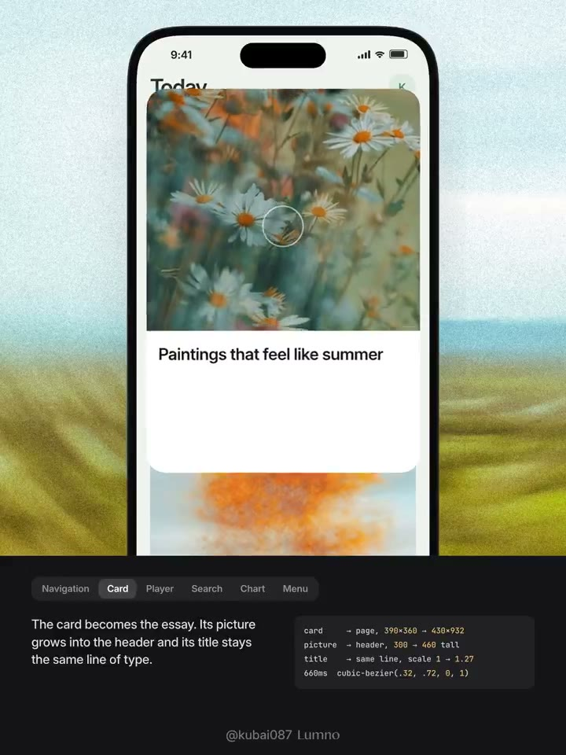
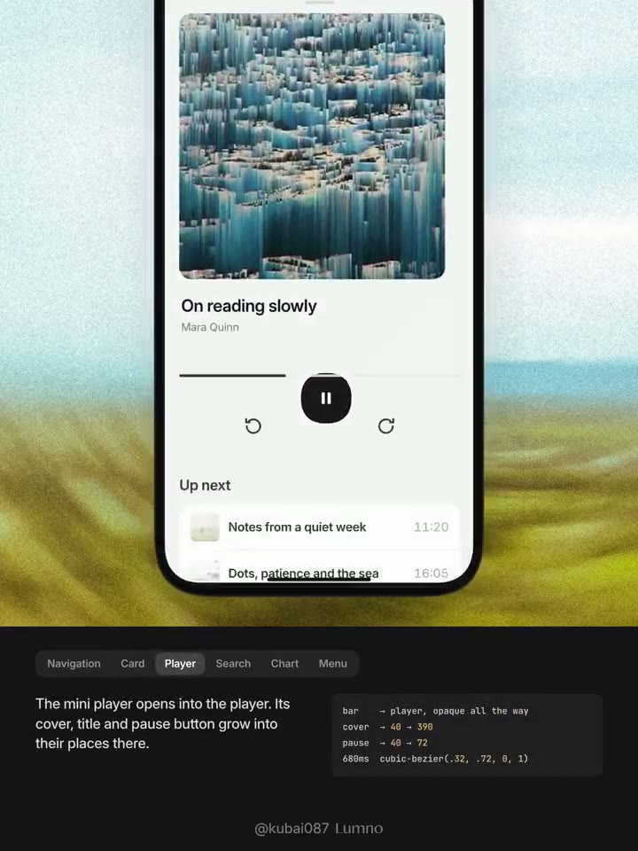
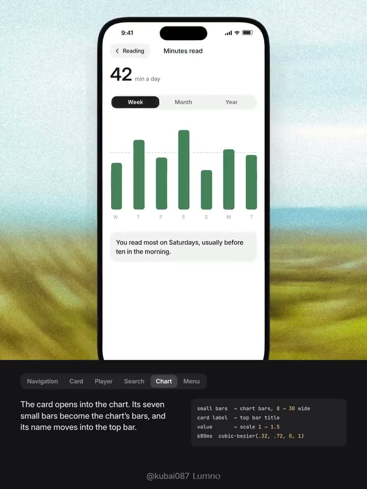
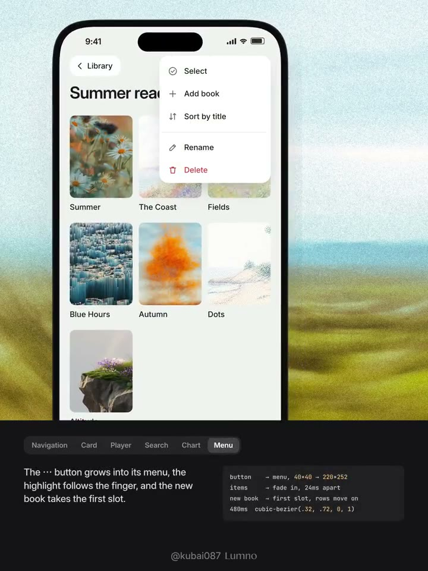

## 問題

列表、詳情與播放器若各自重新出現，使用者需要自行對照新舊畫面，才能理解剛才點到的內容去了哪裡。作者以 iOS 常見場景探索元素延續；這是概念示範，並非已上線產品紀錄。

## 做法

作者於 2026-11-11 將連續性描述為同一元素過渡到下一狀態：列表行標題接成頁面標題，舊標題收為返回入口，滾動時再收入頂欄；卡片圖片擴成頭圖，下拉則沿原路收回；迷你播放條展開時，封面、標題和按鈕移到完整播放頁的位置。

其他示例包括搜尋框上移、匹配結果上移而其餘淡出；資料卡的小柱接成圖表柱；選單由按鈕位置展開，新增項插入首位、其餘後移；Tab Bar 的選中膠囊先伸展再落位。原帖稱這些細節能改善體驗，未提供使用者測試。

*6.375 秒：Card 頁籤下可見花朵頭圖與下方文章標題。*

*11.475 秒：Player 頁籤下顯示大封面、標題、進度與播放控制。*

*21.675 秒：Chart 頁籤下顯示閱讀數值、週期切換與七根柱。*

*26.775 秒：Menu 頁籤下，書籍網格右上方開啟操作選單。*

[本地示範影片](01-source.mp4)（30.6 秒）；Tab Bar 做法依原文收錄，這組截幀未涵蓋。

## 為什麼有效（推論）

保留圖片、標題或圖表標記的對應關係，可能減少換頁後重新辨認內容的負擔。沿原路返回也讓入口與目的地保持關聯，前提是動畫沒有拖慢操作。

## 借鑑要點

- **適合**：列表到詳情、迷你播放器展開與資料摘要深入查看。
- **不適合**：為了形變而硬接語義無關的元素，或讓全部內容同時移動。
- **移植時注意**：每次選一個主要連續錨點；處理載入、途中返回與手勢取消，並提供減少動態效果的切換方式。

## 原作者補充

以下為已核對直接回覆關係的作者 Prompt，保留原連結供參考，不在本庫整段轉載。

- [Prompt 1](https://x.com/Kubai087/status/2120321469817483516)

## 較早的連續性討論

[2026-11-06 的原帖](https://x.com/Kubai087/status/2118570408953987093)已討論標題、選單、抽屜與手風琴展開時的注意力延續。本卡合併這則前導分享，與第 015 期的完整示範一起參考。
