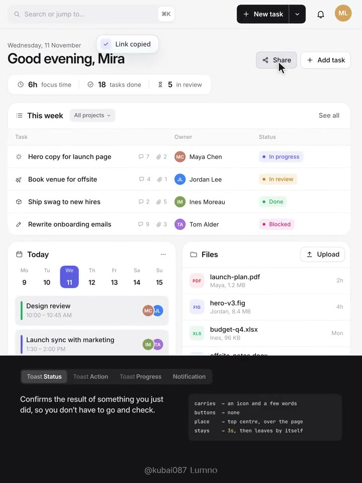
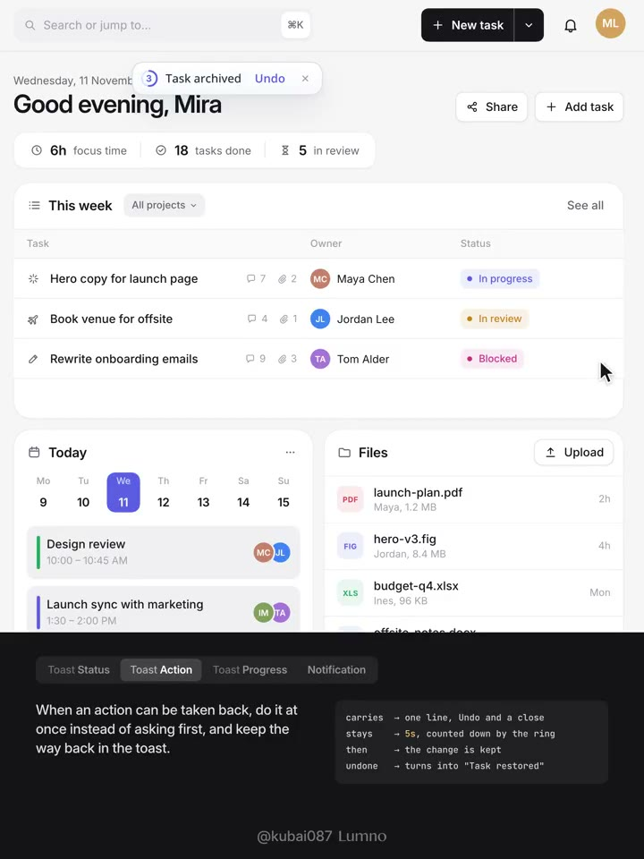
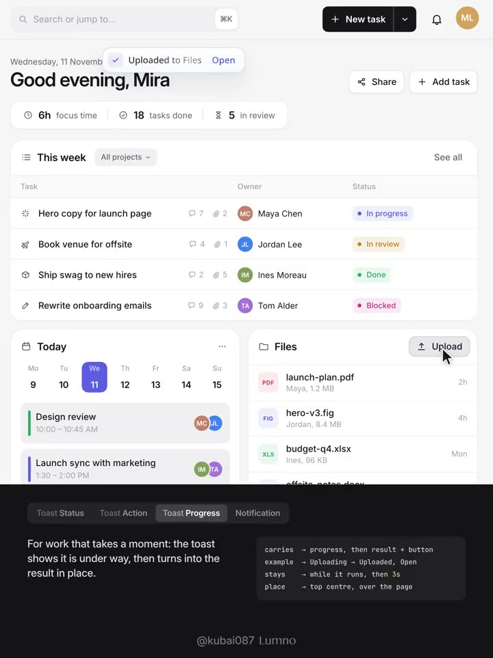
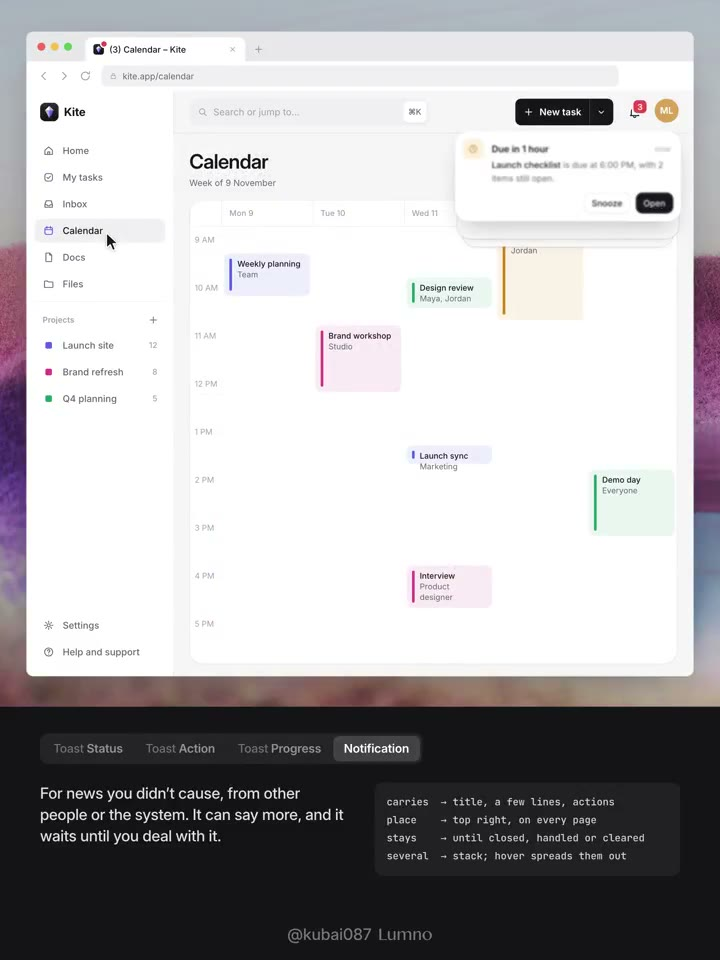
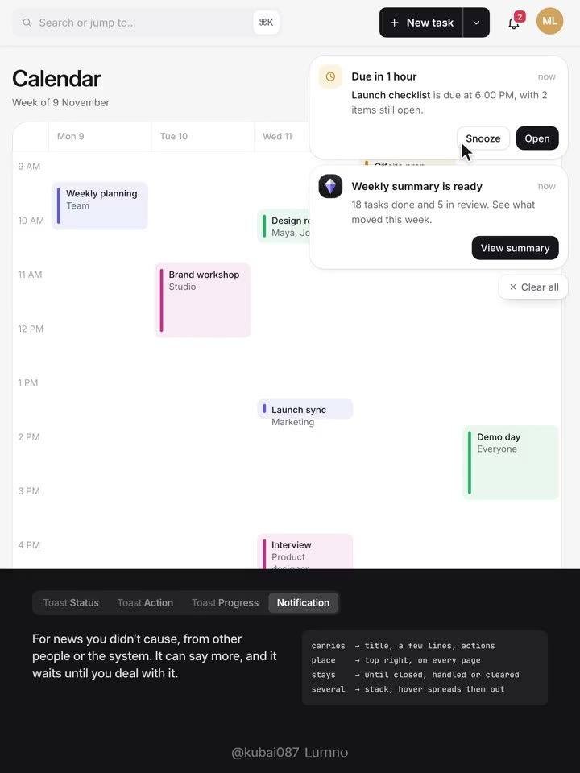

## 問題

網頁工作台常把所有事件都塞進同一種右上角浮出提示：使用者剛按下的小操作被厚重卡片干擾，而真正需要處理的系統提醒或表單錯誤卻在幾秒後自動消失、無處找回。

## 做法

作者於 2026-11-12 發布第 016 期（另有同日[自轉發](https://x.com/Kubai087/status/2120871815690232068)），以概念工作台 `Kite` 示範如何按「誰觸發」與「是否需要處理」將回饋拆成三種 **Toast**、跨頁保留的 **Notification**，以及兩者皆不該使用的情境：

*2.8 秒：點擊 Share 後，頂部中央浮出單行無按鈕的「Link copied」狀態 Toast，停留約 3 秒自動退場。*

*12.3 秒：封存任務時不先彈確認窗，而是立即執行並在頂部中央顯示帶圓環倒數秒數、「Undo」與關閉鈕的操作 Toast；點擊 Undo 後原地轉為「Task restored」。*

*21.4 秒：上傳檔案時先在同一膠囊內顯示進度環，完成後寬度平滑過渡並原地換成「Uploaded to Files」與「Open」按鈕。*

*30.6 秒：切換至 Calendar 頁面時，他人或系統發出的提醒固定在右上角（最多露出三層疊卡），並同步更新鈴鐺角標與瀏覽器分頁標題 `(3) Calendar – Kite`。*

*35.1 秒：游標移入右上角疊卡後，各卡片按自身高度展開為間距 8px 的清單，提供「Snooze／Open」等最多兩個操作鈕與底部的「Clear all」。*

- **選型判斷規則（先審計再改介面）**：
  - **Toast（回應使用者當下剛做的動作，頂部中央、一次只出一條、自動消失）**：細分為 `Status`（純確認如複製連結，停留 `3–5s`，無按鈕）、`Action`（可逆操作立即執行並提供 `Undo` 與圓環秒數倒數，停留至少 `5s`）、`Progress`（短時背景任務先顯示進度環，完成後在原位置變形為結果與查看入口）。游標懸停或鍵盤聚焦時倒數暫停。
  - **Notification（他人、系統或排程觸發的外部消息，右上角跨頁固定、可堆疊、保留至處理或關閉）**：寬度 `344px`，承載標題、時間、最多三行說明與最多兩個行動按鈕；即使從畫面滑除，需決策的通知（如帳務、安全提醒）仍保留在鈴鐺收件匣內供事後查找。
  - **兩者皆不用（Neither）**：單一欄位驗證錯誤直接貼在欄位旁；必須修正的失敗（上傳失敗、扣款失敗）留在該項目原地直到解決；不可逆的高風險操作在執行前用按鈕旁確認或對話框攔截；僅供被動查看的變化只改狀態點或角標，不出彈條。
- **容器同心圓角與動效細節**（摘自作者隨附規範預設值）：
  - **Toast**：高 `40px`、外圓角 `16px`，內嵌 `24px` 圖示塊（內縮 `8px`、圓角 `8px`）與 `28px` 按鈕（內縮 `6px`、圓角 `10px`）保持同心；入場 `500ms`（由上方 `-10px`、`96%` 縮放與 `8px` 模糊收斂）、退場 `220ms`；僅在「完成態」掃過一道 `900ms` 柔光（等待使用者點擊 `Undo` 時不掃光）；原地換字時舊行上移淡出、新行下移淡入，外框寬度以 `380ms` `cubic-bezier(0.32, 0.72, 0, 1)` 過渡。
  - **Notification 疊卡**：外圓角 `24px`、內距 `12px`，內部 `32px` 頭像／標誌與 `32px` 高按鈕皆設 `12px` 同心圓角。新卡自上方 `-56px` 滑入（`560ms`），舊卡裁齊前卡高度並向下露出 `12px`（縮放 `95%`、`90%`）；游標懸停（觸控改為點擊）以 `380ms` 展開成列表並減輕單卡陰影避免互疊變髒；單張卡片懸停左上角浮出仿 macOS 的 `24px` 關閉鈕，移除時向右滑出 `48px` 並由下方卡片補位。
- **無障礙與減敏**：Toast 使用 `role="status"` 禮貌播報，兩者皆不搶奪當前輸入焦點，按鈕支援鍵盤抵達與 `Escape` 關閉；開啟 `prefers-reduced-motion` 時移除位移、縮放與模糊，僅保留約 `150ms` 淡入淡出。

[本地示範影片](01-source.mp4)（36.6 秒）。上述為概念示範與預設參數，未附真實產品成效數據。

## 為什麼有效（推論）

- **把「我的操作回音」與「外部打斷事件」在空間和壽命上拆開**：頂部中央短暫出現的膠囊不會遮擋右上角工具列，右上角常駐疊卡則明確代表「收件匣裡有待辦外部事件」，使用者不必每次看到浮層都停下來判斷會不會消失。
- **可逆操作改用 Action Toast 取代事前確認窗**：封存、移動等低風險操作直接生效並給倒數 `Undo`，減少打斷流暢度的二次確認，同時保留反悔窗口。
- **先列審計表再改樣式**：強制 Agent 先盤點全站事件觸發源與留存需求，能避免把表單錯誤或不可逆刪除也套上漂亮卻錯誤的 Toast 動畫。

## 借鑑要點

- **適合**：SaaS 工作台、專案協作工具、文件與資產管理系統等同時存在「高頻微操作」與「多人／背景事件通知」的網頁應用。
- **不適合**：使用者離開當前分頁後才結束的長耗時任務若僅靠頁內 Toast 會漏接，需搭配鈴鐺通知清單或經授權的系統／瀏覽器通知。
- **移植時注意**：先跑事件分類審計，將失敗修復與欄位錯誤留在原元件；實作疊卡展開時需同步測量各卡真實高度，並在觸控裝置改以點擊展開與滑動關閉替代懸停。

## 原作者補充

以下為已核對直接回覆關係的作者英文長文 Prompt（含事件審計表規格與雙元件預設參數），保留原連結供參考，不在本庫整段轉載：

- [Prompt 1](https://x.com/Kubai087/status/2120685913441456371)
