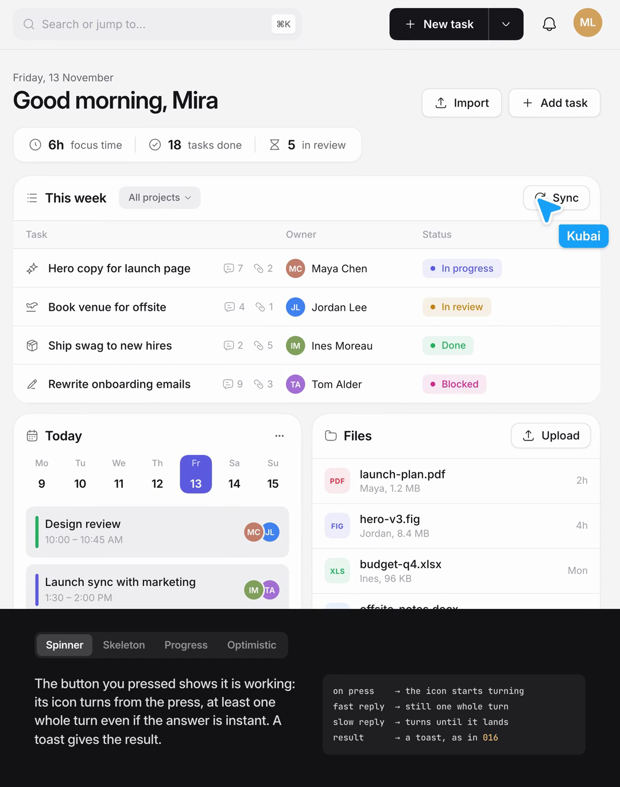
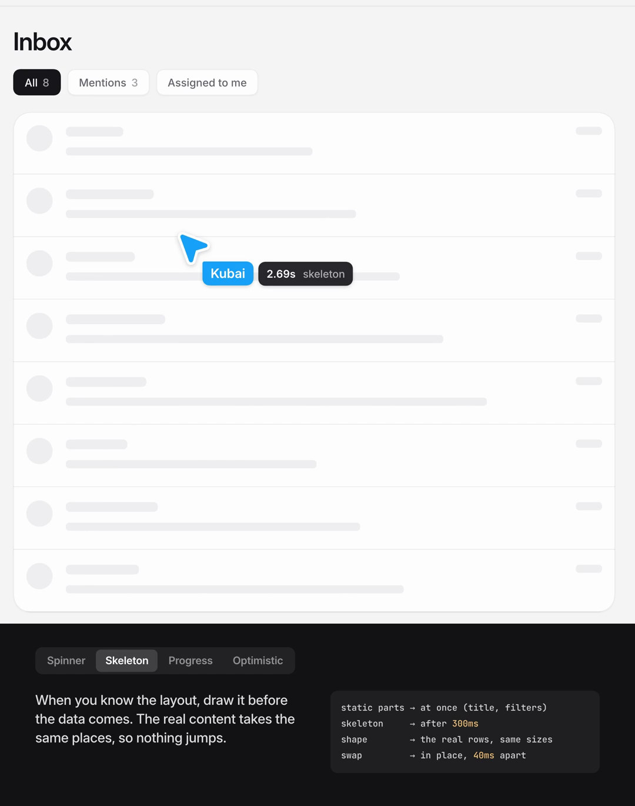
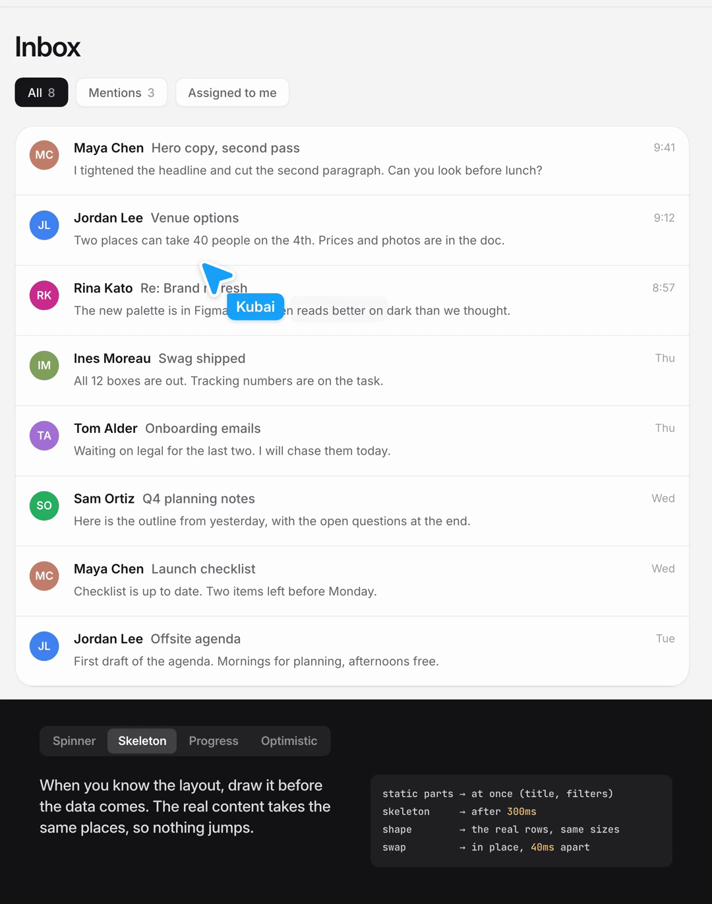
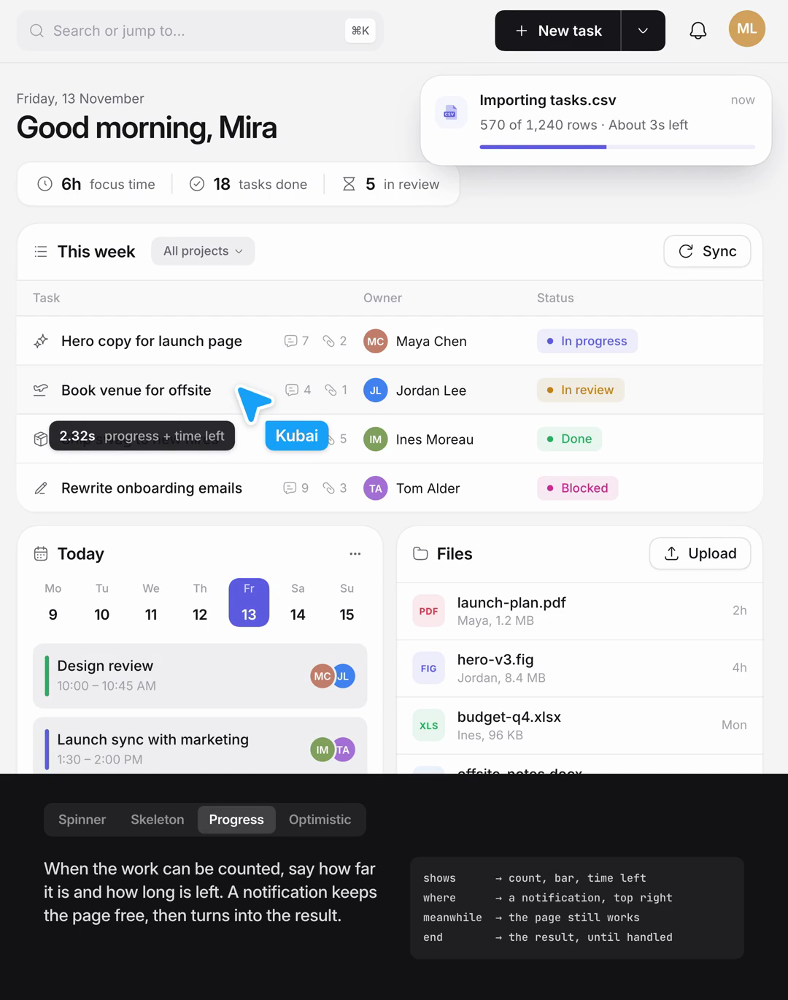
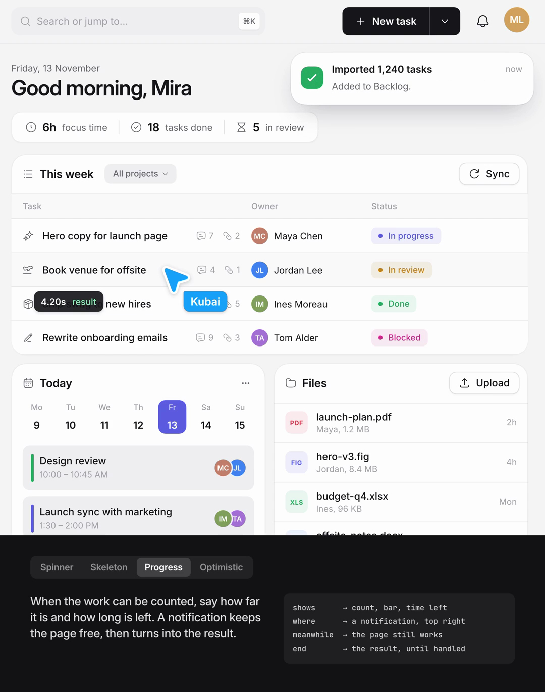
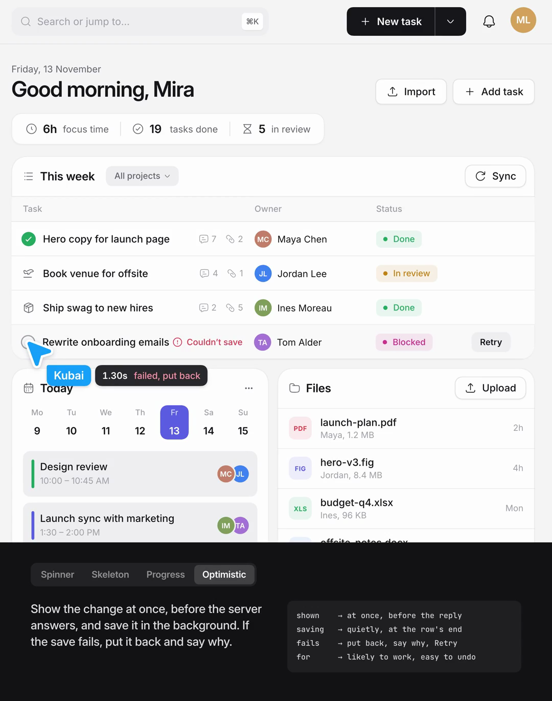

## 問題

同樣是等待，短暫同步、整頁載入與可逆儲存需要的提示不同；若一律擋住畫面或只顯示旋轉圖示，使用者難以判斷進展與失敗後怎麼恢復。

## 做法

*1.47 秒：工作台的 Sync 操作搭配原地等待提示。*

*10.32 秒：Inbox 先顯示對齊列表結構的灰色占位列。*

*13.27 秒：相同列表區域換成實際內容。*

*19.18 秒：匯入過程在右上角卡片呈現進度。*

*22.12 秒：同一位置換成綠色完成提示。*

*30.97 秒：樂觀變更失敗後，原列出現 Couldn’t save 與 Retry。*

**影片觀察**：示範下方用四個切換項標記策略。Spinner 段從 Sync 操作開始；Skeleton 段先占位再換列表；Progress 段從匯入提示轉成完成卡片；Optimistic 段立即改變任務狀態，之後示範失敗復原並在原列保留重試入口。畫面內的人名與任務屬作者示範資料，不視為實際使用者紀錄。

**作者說明**：短時間操作可用按鈕 Spinner 搭配結果 Toast；結構已知的大區塊先用 Skeleton；上傳／匯入用 Progress；高成功機率、容易退回的動作用 Optimistic。作者建議 300ms 內通常不顯示獨立載入狀態，避免閃現，這是本帖建議而非通用效能標準。

與 [016 的通知選型](../kubai-999-016-toast-vs-notification/case.md)不同，本卡聚焦請求開始、等待、成功與失敗復原的策略。

## 為什麼有效（推論）

占位與結果共用位置可能減少視線重找；進度能交代任務仍在進行；失敗回退與原列 Retry 則避免把未保存狀態誤認為成功。影片未提供真實產品成效。

## 借鑑要點

- **適合**：同時有同步、內容載入、匯入與低風險可逆操作的工作台。
- **不適合**：把扣款、不可逆刪除等高風險操作一律樂觀更新。
- **移植時注意**：按操作選策略，進度只使用可信數據；定義逾時、取消、重試與回退，另補讀屏播報和減少動效。

## 來源與核對範圍

[Kubai 第 017 期原帖](https://x.com/Kubai087/status/2121449185014845794)的官方長文快取與官方附片均已核對；保留六張影格，不保留原始影片。原帖提到另附 Prompt，但本次快取未包含該回覆，沒有將其當成已核對規範。
