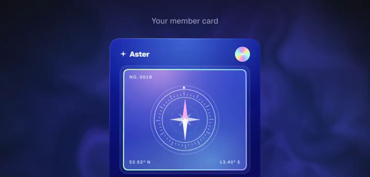
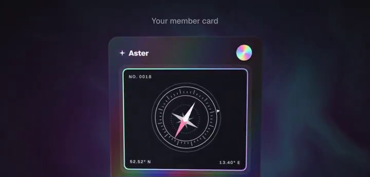
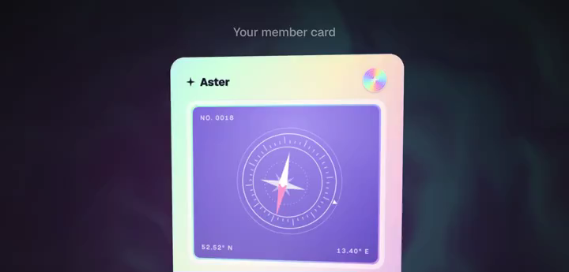
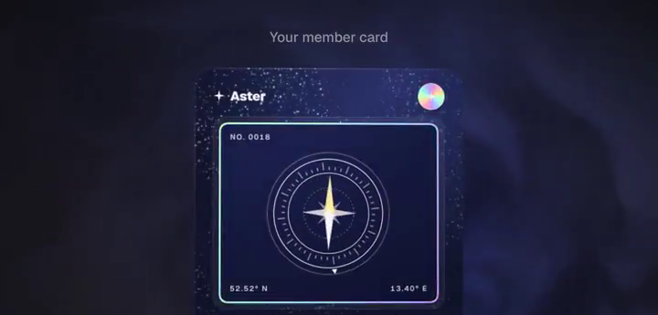
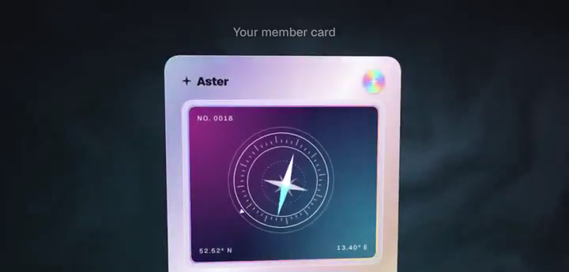
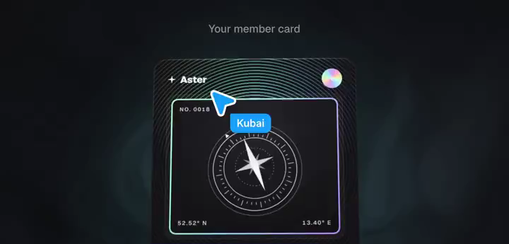

## 問題

會員卡、票券或收藏憑證需要呈現「持有一件物品」的感覺，但單純加彩虹漸層，只會改變底色，無法交代光線、材質和翻面之間的關係。本例是 Aster 會員卡的設計展示，沒有上線產品或成效的驗證。

## 做法

官方 40.8 秒示範在同一卡片上切換 Prism、Rainbow、Pearl、Sparkle、Chrome、Etched 六個預設。以下依影片時間保留六張材質關鍵畫面；圖片只保留卡片上半部的材質與圖像視窗，裁掉示例會員姓名、游標名稱、掃碼區與頁尾；完整佈局描述來自原始影片觀察。

*0 秒，Prism 用深藍卡底、內嵌方形指南針視窗和彩色圓形封印，讓光澤集中在圖像區。*

*8 秒，Rainbow 的暗色底面出現局部彩虹反射，指南針視窗仍維持獨立邊框。*

*12 秒，Pearl 換成淺色卡底和粉彩邊緣，同一內容結構保留不變。*

*20 秒，Sparkle 在深色卡面分布細小亮點，沒有把整張卡平均照亮。*

*28 秒，Chrome 的銀色與彩色反射帶穿過卡面，視窗與卡底有不同的明暗分布。*

*36 秒，Etched 用黑色霧面卡底與細密環形紋路，亮部才顯露局部刻紋。*

- **觸發 → 傾斜與光點**：影片中的游標進入卡面後，卡片轉向、局部高光和亮邊一起變化；離開後回到輕微搖晃狀態。六種預設在同一個畫面下方切換，便於比較材質，而不是混用不同版式。
- **觸發 → 翻面 → 結束**：影片約 4 秒和 24 秒可見背面的掃碼區；翻轉過程卡片經過側面，再停在背面。卡片下方另有 Add to Wallet 按鈕，沒有把外部操作塞入材質切換列。本次不保存背面的 QR 圖像，避免留下可掃描資料。
- **作者規格，非像素量測**：主帖列出最大傾斜 12°、離開輕微回彈、無操作時微晃；光點附近的全息層較亮，亮邊只照亮局部；視窗元素分層產生視差，翻轉時略微抬起並露出 10px 厚度。
- **原始 Prompt**：已從主帖官方公開 HTML 的 SelfThread 作者直接回覆 [2121892403212964060](https://x.com/Kubai087/status/2121892403212964060) 取得完整英文 NoteTweet（回覆發布於 2026-11-15T09:05:46+00:00），本庫保留原文連結與下列做法摘要，不整段轉載。單獨開啟回覆未返回完整 Tweet；完整內容來自主帖內嵌回覆，不以第三方轉述補寫。
- **Prompt 的可重用結構**：先盤點現有卡片、平台與背面內容，再選材質、動態強度、輸入方式、厚度、視差及背景。原文把數值標為建議，並要求保留原卡片內容和功能；手機陀螺儀預設關閉。這是作者提出的實作指引，不是已在本倉庫執行的功能。

## 為什麼有效（推論）

- 光點同時控制表面、高光和局部邊緣，可能比各層獨立播放更容易被理解成同一件物體受光。
- 六個預設沿用相同內容與版式，讓材質差異可比較；品牌不必同時接受深藍底、閃粉與流動背景全部設定。
- 把圖像視窗、印刷文字與全息層分開，可能較容易控制可讀性。影片和 Prompt 沒有提供閱讀速度、轉換率或實機效能數據。

## 借鑑要點

- **適合**：單張會員憑證、活動票券、成就或收藏卡，材質本身可以表達身份或稀有度的情境。
- **不適合**：密集列表、長文閱讀、需要快速核對金額的帳單；整頁每張卡都發光會削弱層級。
- **移植時注意**：先選一張卡和一種材質；文字不要跟著高光消失。翻面前定義背面資訊和鍵盤操作，拖曳與點按需分開判斷；手機優先保留捲動。減少動態偏好下提供靜態材質、關閉待機晃動；離開視窗停止更新。這些是移植建議，非影片已證明的行為。
