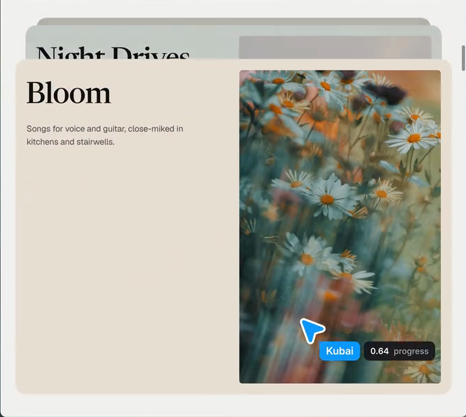
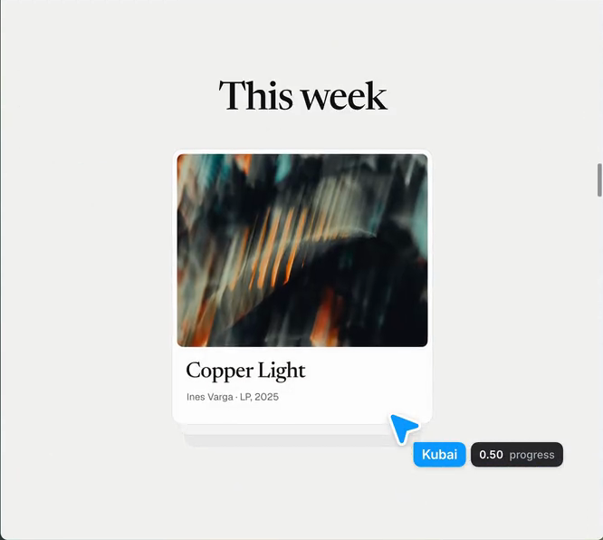
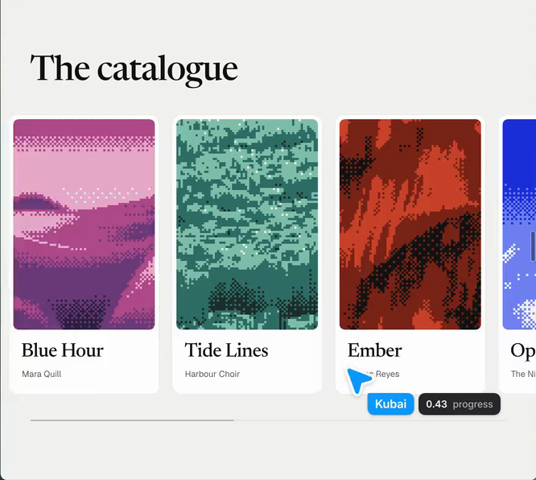
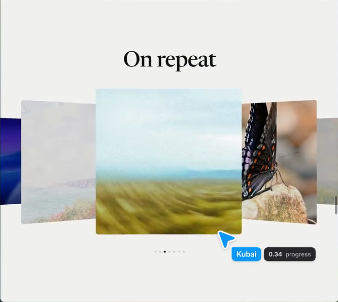
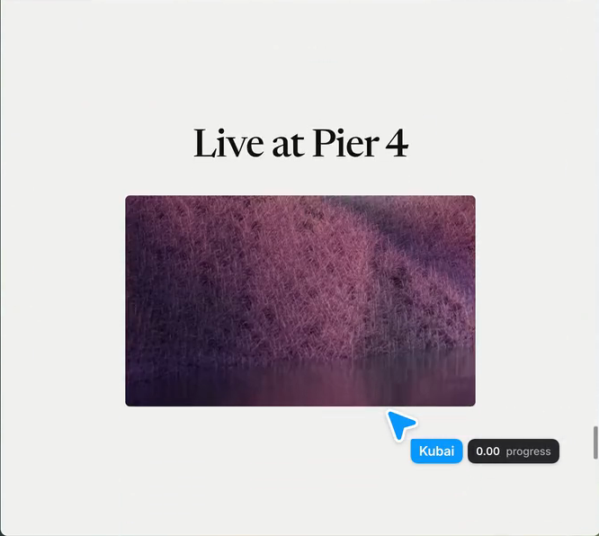
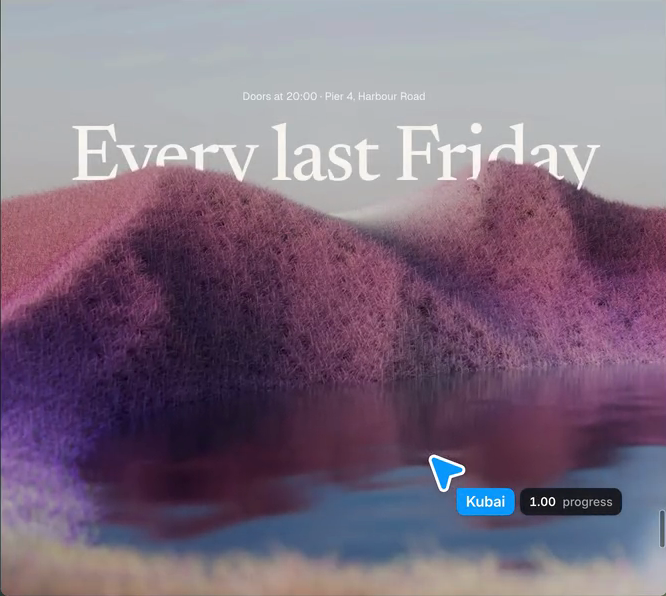

## 問題

長篇產品頁若每節都是標題、段落與圖片，閱讀節奏容易單一；若每個元素都自行飛入，又可能讓動效搶走內容。如何讓少數重要段落有變化，同時保留讀者對閱讀進度的控制？

## 做法

**系列與來源核對**：[官方索引](https://vibedesign.tips/)直接列出 `019` 並連到[本篇詳情](https://vibedesign.tips/019-scroll-cards/)，標題為「Five card interactions driven by scrolling」；官方公開的 [i18n 資料模組](https://vibedesign.tips/_app/i18n-SlnnMrPu.js)更以同一筆記錄列出 `issue: 019`、`slug: 019-scroll-cards`、`x: 2122492414598459820`，對應 [Kubai 的 X 來源貼文](https://x.com/Kubai087/status/2122492414598459820)。本篇的標題與路徑共同確認篇號，並非從側欄 `No. 019 / 999` 的全站計數反推。詳情頁結構化資料的作者與發布者均為 Kubai，連到 `@kubai087`。

**日期**：官方 `TechArticle.datePublished` 與 `VideoObject.uploadDate` 均為 **2026-11-17T00:50:00.299Z**；另核對官方 X 原帖資料，發布時間為 **2026-11-17T00:50:00+00:00**，與官網精確度不同，分別保存。收錄日期為 **2026-11-18**。

**與下拉案例的關係**：本篇由長頁捲動控制卡片堆疊、飛離、水平位移、封面轉向與圖片放大；[Emil 的下拉案例](../emil-dropdown-trigger-transform-origin/case.md)由局部按鈕叫出選單，比較縮放錨點。兩者的觸發方式、內容與官方來源不同，因此另建 019，不替下拉案例加上篇號。既有 [015 連續性案例](../kubai-999-015-continuity/case.md)雖也提到卡片圖片放大，但不是本篇五段捲動編排，亦不改動。

以下六張圖來自[官方示範影片](https://vibedesign.tips/_app/019-Bq8LgVUZ.mp4)，已裁去瀏覽器工具列與外部背景。藍色 Kubai 游標及 progress 數值是作者錄製中的演示疊層，不代表已驗證的產品功能。秒數是影片取樣位置，不是動畫時長。

*4 秒：Bloom 卡片在前，前一張 Night Drives 與更早卡片的頂緣露在後面；文字在左、圖片在右。*

*12 秒：This week 標題下是一張置中的圖文卡 Copper Light，底部露出後續卡片的堆疊邊緣。*

*20 秒：The catalogue 下方橫排多張封面與名稱，左右邊緣裁切未完整進場的卡片，底部有細進度線。*

*28 秒：On repeat 下方中央封面最大，兩側封面縮小並轉向，下面用圓點表示序列位置。*

*35 秒：Live at Pier 4 標題下方是一張有留白包圍的圓角橫向圖片，進度顯示 0.00。*

*38 秒：同一紫色景觀填滿可見頁面，大標題 Every last Friday 的下半部被前景山丘遮住，進度到 1.00。*

- **可見流程**：影片依序演示堆疊卡片 → 置中牌堆輪替 → 橫向目錄 → 封面流 → 圖片展開，最後接回一般日期列表。牌堆的前卡離開後，後卡補上；橫排目錄向左移動；封面流以中央圖片為視覺焦點。
- **作者解釋的觸發與狀態**：官方正文說明以捲動位置作為時間軸，停下便停在當前狀態，反向捲動沿原路返回；不是捲到某點就播放一段固定時間動畫。這是作者對機制的說明，本卡未以真實輸入事件驗證。
- **作者提供的可移植參數**：堆疊卡片每層向下錯開 16px，後退時每層縮小 0.05、加深 12%；牌堆每段以 420px 捲動距離送走一張卡；圖庫把垂直距離 1:1 映成水平位移；封面流每 320px 換一張居中，兩側最多轉 30°；圖片以 900px 距離放大、再停留 300px。這些是[官方文字 JSON](https://vibedesign.tips/019-scroll-cards/tip.en.json)的示例建議，沒有從影格量測，也不是任意螢幕都通用的規格。
- **作者規定的收尾與回退**：一般內容穿插在效果之間，完成後恢復正常段落；短於 560px 的視窗取消釘選，減少動態效果時改成清單、橫向列或全寬圖片。這些為來源要求，未以本次媒體驗證實際支援。

## 為什麼有效（推論）

- 捲動同時決定位移與進度，可能讓讀者把動作理解成閱讀位置的回饋；能否順暢回捲仍須實測。
- 堆疊保留已讀內容的頂緣，封面流只突出一項，橫向圖庫則保留並排關係，適合不同的內容組織方式。這些是視覺解讀，沒有閱讀率或轉換率數據。

## 借鑑要點

- **適合**：少量重點的產品介紹、作品集、專題敘事。先依內容選效果：並列章節可堆疊，逐項推薦可用牌堆，封面集合可用圖庫或封面流，章節主圖可放大。
- **不適合**：需要快速搜尋、比較大量資料或反覆掃讀的工作頁；不要把每段都做成釘選舞台。
- **移植時注意**：保留正常捲動，不攔截滾輪；依小視窗高度與固定頂欄計算可用空間，避免卡片比視窗高。逐項檢查回捲、快速捲動、鍵盤可達與減少動態效果；不要把官方提示詞的檢查清單當成已通過的測試。

## 驗證與缺漏

已公開取得官方索引、篇章詳情、文字 JSON、站點主程式與原始示範媒體，檢視整段影片的取樣聯絡表，再保留六張關鍵影格。沒有登入或使用受保護入口；原始影片與暫存影格已刪除。官方網站資料模組已核對 019 的 X backlink，另已取得官方 X 原帖全文與發布時間，並核對[作者直接 Prompt 回覆](https://x.com/Kubai087/status/2122496665571803155)；只保存來源與摘要，不複製完整指令。不拿 11 月 18 日的下拉貼文當作 019 來源。這是參考資料收錄，沒有新增網站功能或執行瀏覽器 E2E。
