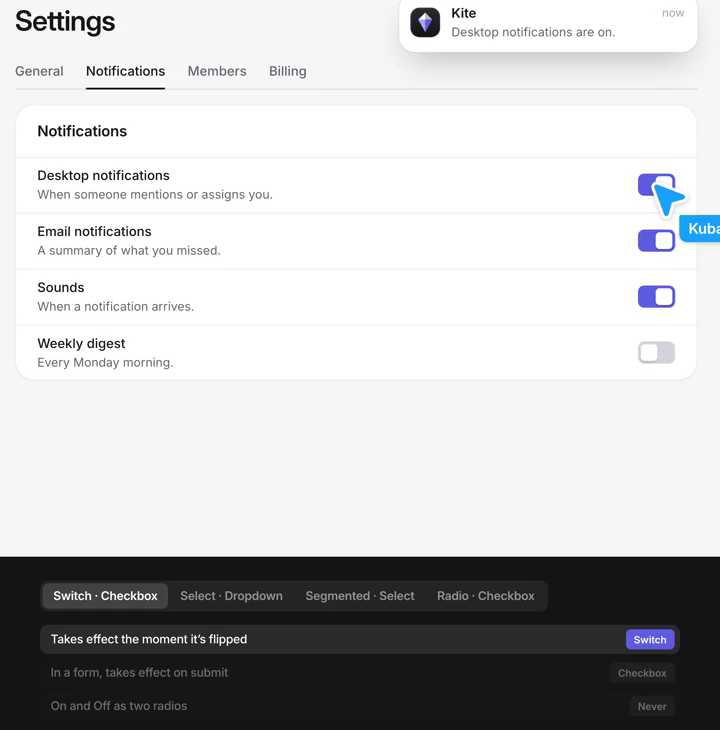
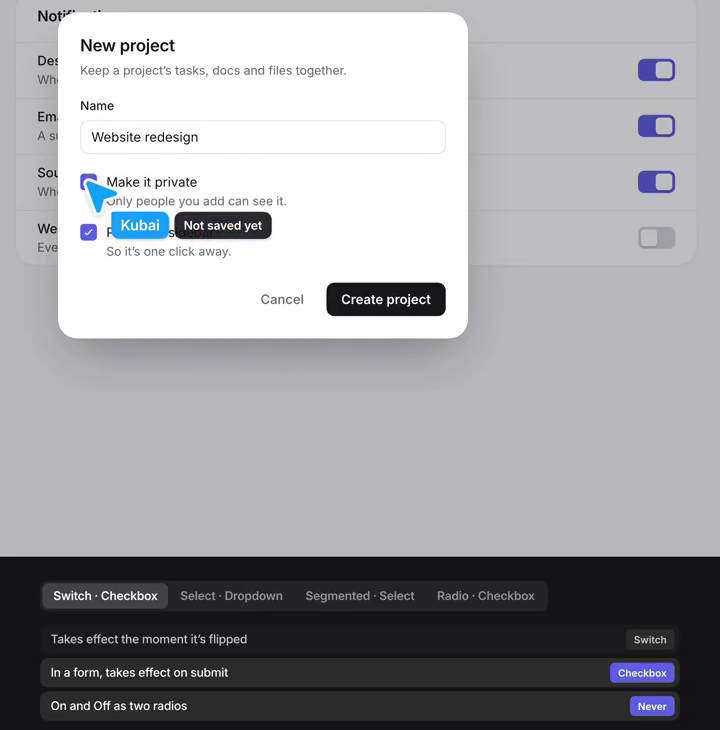
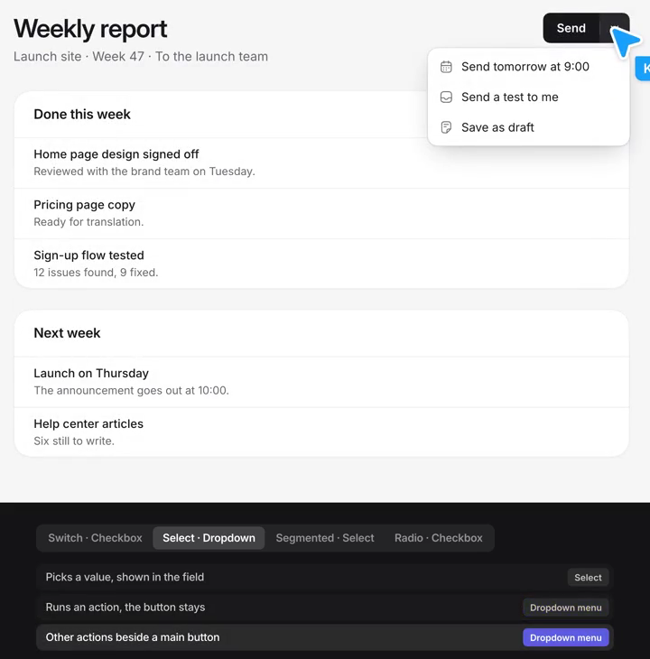
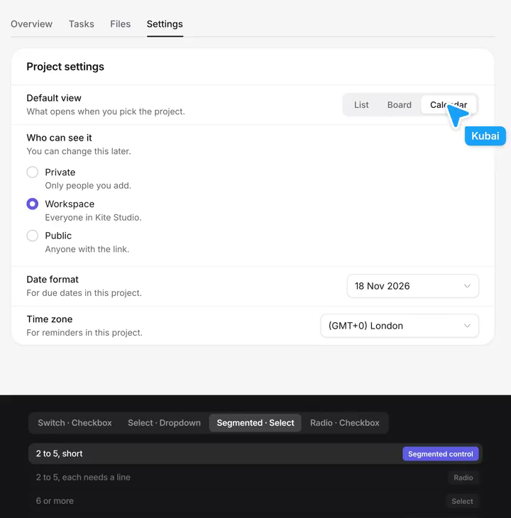
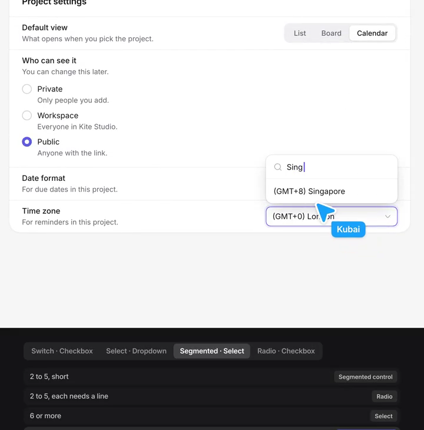
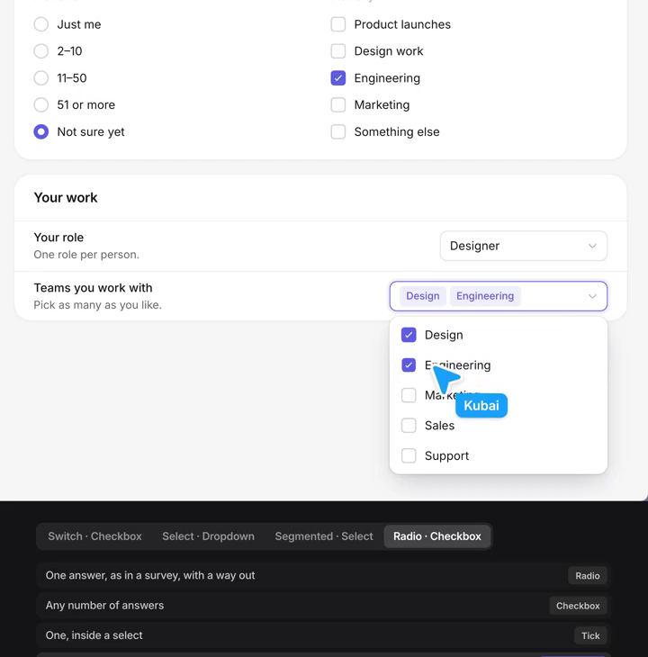

## 問題

選擇控制項外觀相近，卻可能代表立即生效、等待提交、設定值或執行動作。若不先區分這些行為，使用者會誤以為設定已保存，或把動作誤讀成當前值。

## 做法

來源為作者的教學概念示範；影片中的 Kite 介面不作為真實上線產品證據。[官方文章](https://vibedesign.tips/020-choice-controls/)及首頁目前載入的[官方公開模組](https://vibedesign.tips/_app/i18n-DOAboJWQ.js)明確列出 `issue: 020`、`slug: 020-choice-controls` 與 `x: 2123217190052827633`；[X 原帖](https://x.com/Kubai087/status/2123217190052827633)標題亦明寫 020。篇號不是依發文先後推算。原帖官方資料確認作者為 Kubai087，發布時間為上方 UTC 時間，附片長約 62.421 秒。

*3 秒：Desktop notifications 開關已開啟，右上出現通知回饋，示範立即生效。*

*7 秒：New project 彈窗內以 Make it private 複選框表示提交時才採用的值，底部保留 Create project 按鈕。*

- **觸發 → 變化 → 結束**：切換通知開關後顯示回饋；勾選建立專案表單中的私密選項後仍停留在彈窗，旁邊以 Not saved yet 說明尚未提交。這是影片呈現的狀態，不代表已驗證後端保存。

*23 秒：Send 主按鈕旁的箭頭展開定時寄送、測試寄送與存草稿動作，主按鈕名稱仍為 Send。*

- 選值控制項將目前值顯示在欄位內；動作選單收納動詞，結果在其他位置回饋。影片先示範語言選擇改變介面，再示範匯出回饋與 Send 分割按鈕；不把這些演示當成實際寄信或下載完成。

*30 秒：Default view 用 List／Board／Calendar 分段選擇，權限則用帶解釋文字的垂直單選，日期與時區收在欄位內。*

*38 秒：時區選單內輸入 Sing，清單縮至 Singapore，原本欄位仍顯示 London。*

- 作者建議：2–5 個短選項用分段選擇；每項需補一行說明時用垂直單選；選項多、標籤長或會增長時用 Select，大量選項再加搜尋。這是作者的設計準則，不是所有平台都必須遵守的硬限制。

*58 秒：單選題保留 Not sure yet；多選下拉在各選項前放複選框，欄位以 Design／Engineering 標籤呈現已選項。*

- **觸發 → 變化 → 結束**：展開多選欄位、勾選團隊後，清單保持可繼續選擇，欄位同步顯示多個值。作者另建議單值 Select 用勾號表示選中；影片不支持將所有 Checkbox 一概視為延後儲存，多選欄位仍須按所屬任務判斷生效時機。
- [診斷 Prompt 回覆](https://x.com/Kubai087/status/2123219668165140511)已由官方資料識別；只保留出處，不複製全文或執行其指令。

## 為什麼有效（推論）

- 用「何時生效、值或動作、選項數與長度、可選幾項」拆解問題，可能比只看元件形狀更容易找出行為錯配。
- 當前值、提交按鈕和操作回饋各有位置，可以減少使用者猜測是否保存；來源未提供可用性或轉換率數據。

## 借鑑要點

- **適合**：設定頁、建立資料表單、問卷、篩選器與工具列的控制項審查。
- **不適合**：只按選項數量機械替換元件，忽略既有平台習慣、標籤長度與是否需比較全部選項。
- **移植時注意**：先記錄生效時機及取消方式，再決定控制項。改開關為表單選項會改變保存行為，需同步調整文案、回饋與測試；搜尋需有無結果狀態，多選需可移除，單選需考慮「不確定」。實作另驗證鍵盤、讀屏及權限失敗狀態。
