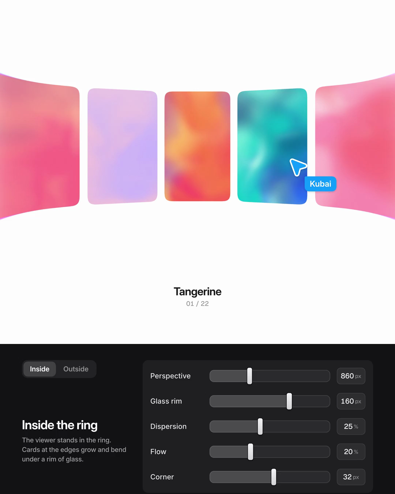
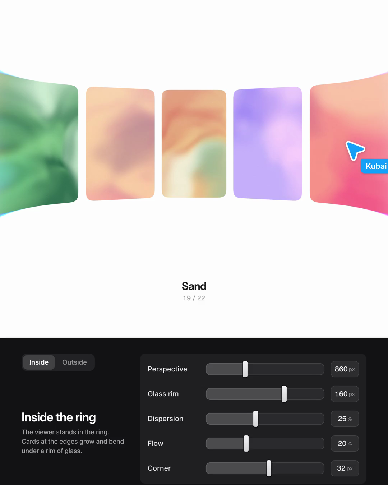
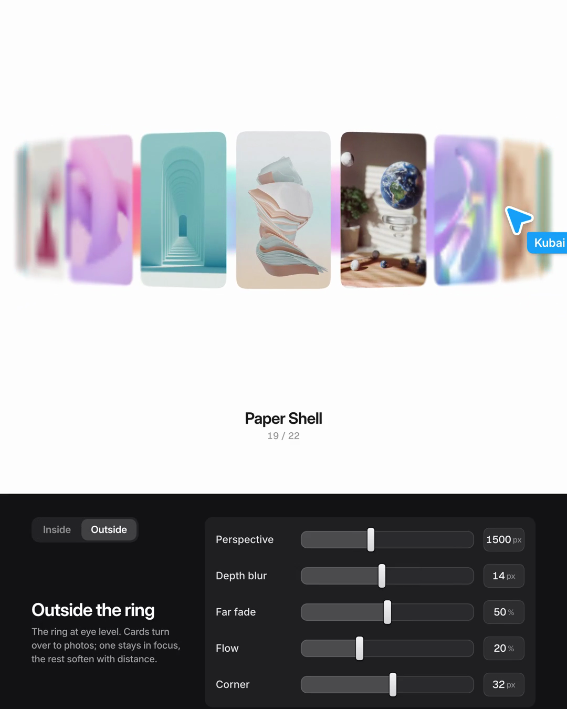
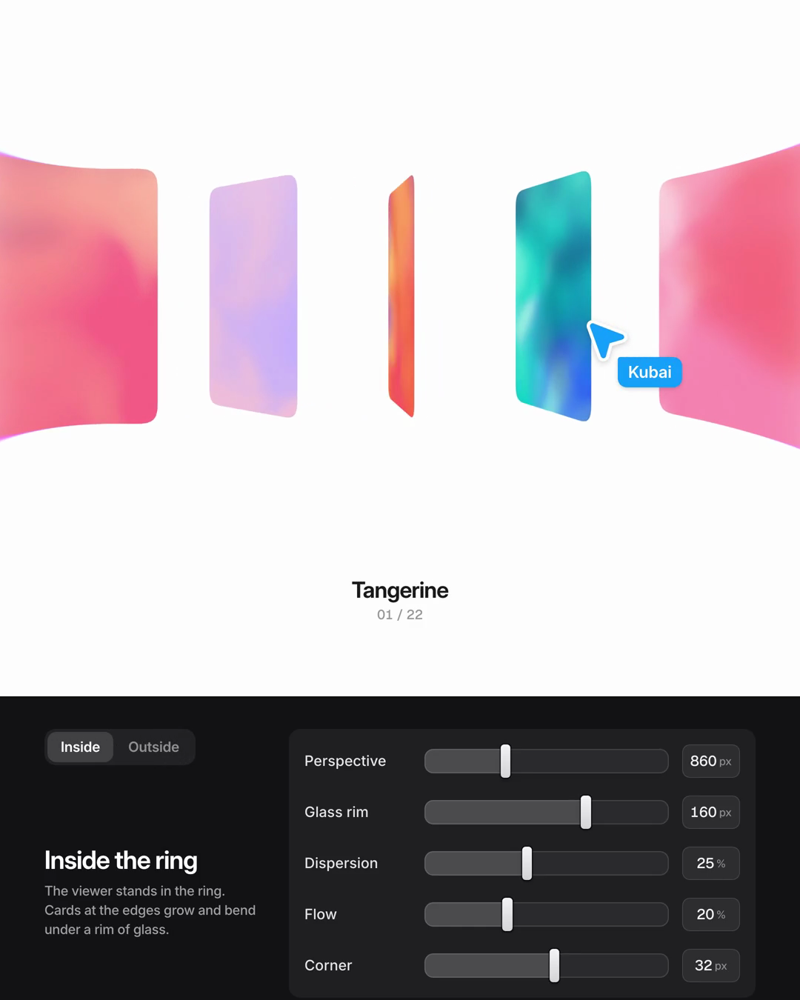
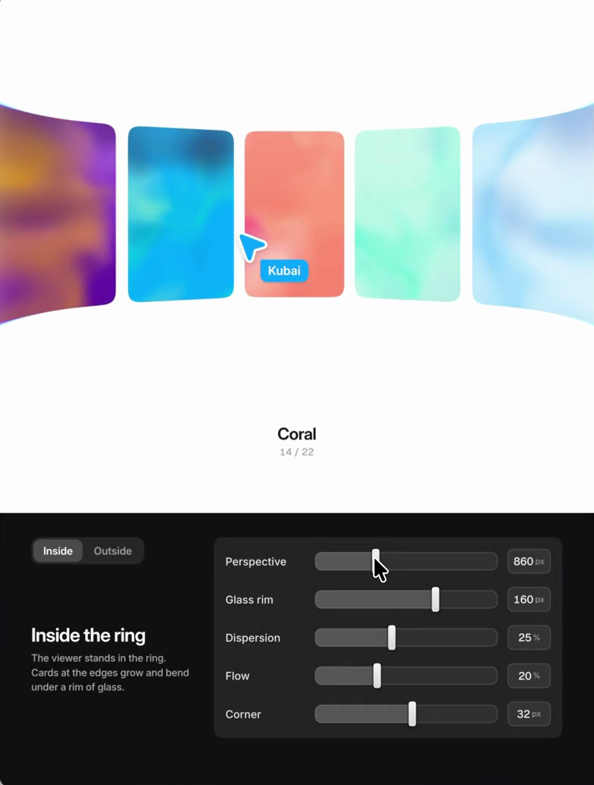
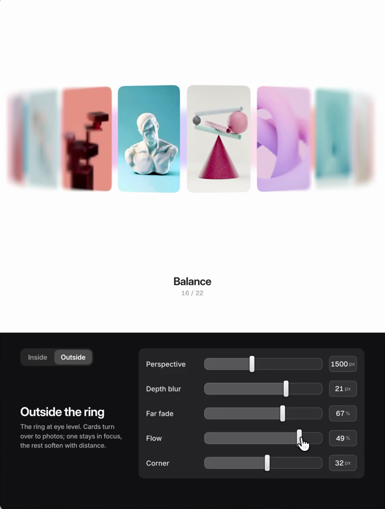

## 問題

平面輪播只能交代左右順序。若希望圖像有環繞感，又能切換到單張聚焦，需要讓曲率、翻面與景深共同表達視角改變，而不是只堆疊模糊效果。

## 做法

[原帖](https://x.com/Kubai087/status/2123579578098536608)明寫系列 021；[自轉發](https://x.com/Kubai087/status/2123671794657931389)不是新篇，官方 syndication 以該轉發 ID 查詢亦回傳原帖 ID、作者與原始發布時間。[官網首頁](https://vibedesign.tips/)當前載入的[公開模組](https://vibedesign.tips/_app/i18n-DOAboJWQ.js)對應 `issue: 021`、`slug: 021-ring-cards`、`x: 2123579578098536608`。原帖影片約 17.066 秒；以下前四圖取自原片。

*0 秒：Inside 模式沿弧線排列彩色漸層卡片，兩側向外張開，下方顯示目前圖名、位置與參數。*

*6 秒：仍在 Inside 模式，移動後由 Sand 位於中央，環內曲率及玻璃邊設定仍保留。*

- **觸發 → 變化 → 結束**：影片中的指標帶動卡片橫向流動，圖名與位置隨主圖更換；Inside／Outside 控制項切換視角，卡片由同一排列逐步彎曲並翻面。作者說明曲率正負控制環內、環外，且翻面由中央往兩側依次發生；這些實作說明來自原帖，未做程式或手勢測試。
- 原帖指定環內透視 860px、兩側玻璃邊各 160px；控制面板可見 Perspective、Glass rim、Dispersion、Flow、Corner。數值是此示範預設，不是通用規格。

*8 秒：Outside 模式露出圖像背面，中央圖片清楚，左右側列逐漸模糊、淡化，面板換成 Depth blur 與 Far fade。*

*16 秒：切回 Inside 後，中央部分卡片仍以薄側面呈現，兩旁已有漸層正面，顯示翻面中的中間狀態。*

- 環外面板可見透視 1500px、景深模糊與遠處淡出；圖像不是全列同等清晰。片段以回到環內的過程結束，不能據此認定任意資料量下都能無縫循環。

### 同一效果的 Playground 補充

[作者補充帖](https://x.com/Kubai087/status/2123640171841368384)發布於 `2026-11-20T04:50:46+00:00`，影片約 19.771 秒，展示在官網[021 頁面](https://vibedesign.tips/021-ring-cards/)旁調參數。它是同一流程的補充，不另建卡；下兩圖只保留示範及面板，裁掉頁面外圍與右欄長文。

*補充片 4 秒：Inside 預覽下方滑動 Perspective，數值為 860px，旁邊保留玻璃邊、色散、流速與圓角控制。*

*補充片 12 秒：Outside 預覽顯示 Balance，指標位於 Flow 滑桿上，下面的 Corner 顯示32px，畫面同時可見景深、淡出及流速等調整值。*

- **觸發 → 變化 → 結束**：補充片拖動滑桿、切換模式，預覽隨之改變，控制面板留在畫面下方。這是作者錄影中可見的反應，不代表本次已實際操作網站。
- 作者明說行動端因自適應與效能問題暫用影片；參數／配置匯出是後續考慮，不能記成已交付功能。案例僅收錄設計示範，不把教程站等同正式產品驗收。
- 與[既有四軌跡輪播](../kubai-carousel-loop-variants/case.md)比較：後者是 desdivj 的 Spiral Trail／Dealt Hand／Rising Current／Depth Rail 自動展示；本例是 Kubai 明確編號 021 的環內外切換、漸層翻面及調參面板，作者、素材與流程皆不同，因此保留獨立卡片。

## 為什麼有效（推論）

- 以同一排列改變曲率和卡片正反面，可能讓視角切換保持脈絡；環內偏重包圍感，環外以清晰度分配注意力。
- 面板與預覽同時存在，便於比較單一參數對曲率、邊緣或焦點的影響；沒有來源數據可證明提升操作效率。

## 借鑑要點

- **適合**：作品集、封面挑選、圖像展覽，以及需要可比較參數的效果 Playground。
- **不適合**：文字密集卡片、價格比較、必須一次讀清所有項目的列表，或把被模糊的卡片作唯一導航入口。
- **移植時注意**：先提供清楚的目前項目與上一張／下一張控制；景深不能遮掉必要資訊。參數需有單位、界限與重設；行動端與減少動態偏好提供穩定替代。不要承諾作者尚在考慮的匯出功能，並另測觸控、鍵盤、性能與翻面期間的點擊目標。

## 2026-11-21 文章來源回補

[官方021文章](https://vibedesign.tips/021-ring-cards/)本次已恢復可讀。標題、環內860px／環外1500px透視、160px玻璃邊與流體漸層說明，均與已核對原帖及影片對應，解除文章頁缺漏。文章另聲明減少動態時停止漸層、立即切換視角；這是文件敘述，本次未操作驗證。作者直接X Prompt回覆仍待補，不把官網正文等同回覆串已讀取。
