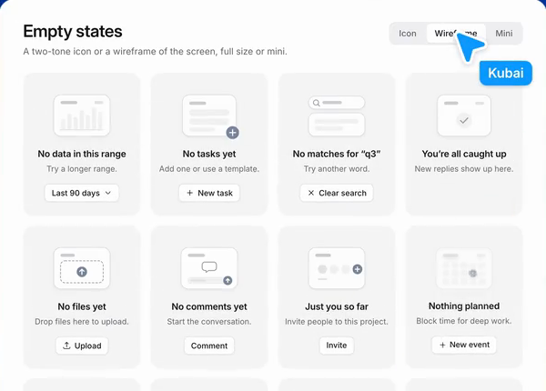
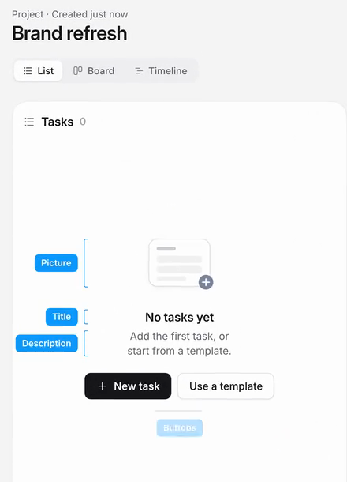
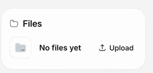
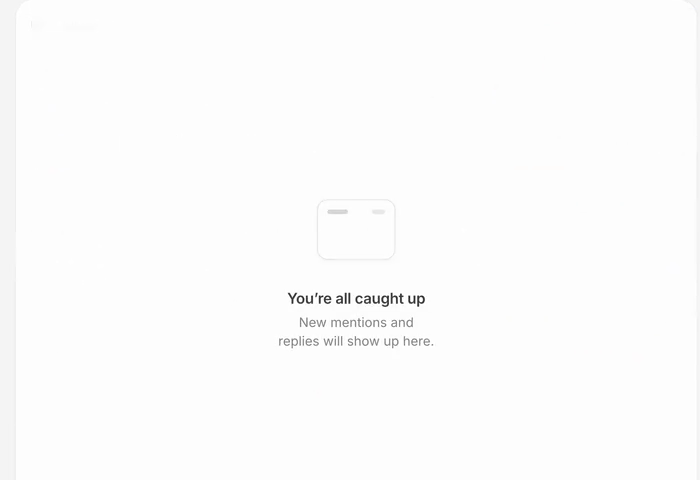
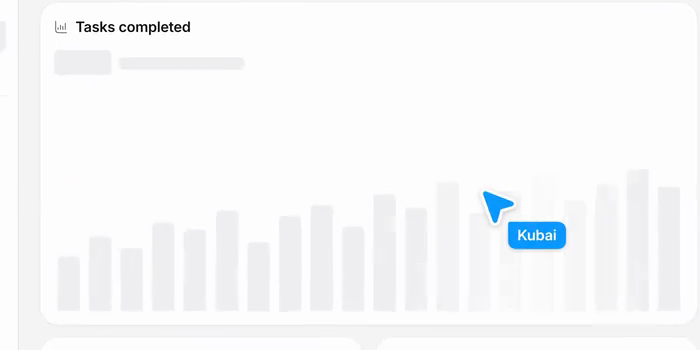
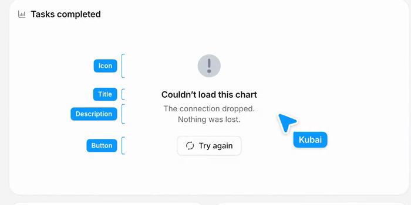

## 問題

首次使用、搜尋無結果、全部處理完成與載入失敗，不能只靠同一張插圖解釋。整頁、卡片與列表行的空間也不同；全部使用大型空狀態會使次要區域搶走注意力。

## 做法

以下是作者影片中的概念介面，並非已驗證的上線產品。保留六張局部影格；裁去示範帳號、頭像、人物名與底部提示詞區域。

*4 秒：線框頁籤下，圖表、任務、搜尋與收件匣各有對應的小型結構圖；裁圖僅保留前兩列。*

*12 秒：空任務區由圖示、標題、說明及兩個按鈕組成，上方列表與檢視切換保留。*

*12 秒：Files 卡片只用一行排列小圖示、No files yet 與 Upload，沒有額外說明段落。*

*30 秒：收件匣顯示已處理完成的標題與後續內容說明，沒有新增或重試按鈕。*

*36 秒：報表卡片以淡灰文字條和長條圖骨架佔住原本內容區。*

*39 秒：相同圖表區改成警示圖示、失敗原因、資料安全說明與 Try again 按鈕。*

影片先切換 Icon、Wireframe、Mini，再依序展示首次使用、搜尋、完成、失敗與無權限情境。失敗段落先出現骨架，再換成原位錯誤訊息，稍後恢復圖表；影片可見變化不等於已驗證真實網路錯誤或後端重試。

**原文及作者 Prompt 的規則（文字主張，不冒充影片實測）**：

- 線框呈現目前頁面填滿後的縮影；圖標版用雙色圖標表達內容；迷你版以圖示、標題和操作同列排列。
- 整頁保留完整結構，主要與次要操作合計至多兩個；卡片用低權重連結或 Ghost 按鈕，列表行與選單可只留一行文字。空間不足先省說明、再縮圖，保留標題。
- 作者直接 Prompt 將原因分為首次使用、無結果、已完成、失敗與無權限，另列不需要顯示空狀態的位置。搜尋無結果保留輸入與篩選；已完成不強塞操作；失敗只替換失敗區域；權限申請後在原位回報。
- Prompt 要求先盤點、提出逐處建議，再由使用者選擇修改；沿用現有元件與 tokens。其尺寸、淡入時間、SVG 結構及跨平台建議是預設起點，不是實測標準。

## 為什麼有效（推論）

- 將「原因」與「尺寸」分開決定，可能讓同一種失敗同時適用整頁與局部卡片，而不必複製大型版面。
- 以所在功能的縮影說明未來內容，可能比無關插畫更容易交代下一步；卡片內降低按鈕權重，可能保留頁面主操作的層級。
- 原位骨架、錯誤及內容切換可能降低布局跳動。未取得使用者研究、轉換率或布局位移數據。

## 借鑑要點

- **適合**：同時有整頁清單、儀表盤卡片、搜尋與局部載入的產品。
- **不適合**：把載入中、離線、權限不足一律當成無資料；或在任務已完成時硬加建立按鈕。
- **移植時注意**：先列原因、所在區域與可執行動作，再決定尺寸。只有產品真能保證資料未遺失時，才使用這類安撫文案；無權限插圖不得洩漏實際受限內容。另測長翻譯、讀屏公告、焦點、深色與 reduced motion，不能憑影片宣稱通過。

## 來源與去重

- [官方原帖全文](https://x.com/Kubai087/status/2124170395825873348)：已讀官方 NoteTweet 全文，標題明列 022；發布於 2026-11-21 15:57:42 UTC（台北 23:57:42、洛杉磯 07:57:42），不是從收錄日期反推。
- [作者第 022 期文章與官網 Prompt](https://vibedesign.tips/022-empty-states/)：已取得文章及官網完整 Prompt 區塊，僅記摘要與來源，不轉存全文；未核對 X 直接回覆 ID。
- 媒體來自作者網站的 52.200 秒影片，與 X 附件時長相同；兩份媒體未作逐位元相等性驗證。X 媒體 ID 為 2124165390314131456，直接下載回覆 403，改取作者公開網站影片。
- 既有 [Lumno 功能關聯空狀態 SVG](../kubai-empty-state-svg/case.md) 對應 2113849121299894727、2114233252009664659，側重產品 SVG；本卡收錄獨立編號 022 的原因與尺寸分類，不重複宣稱是 Lumno 新流程。
