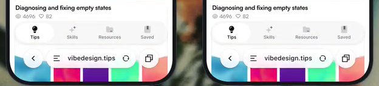
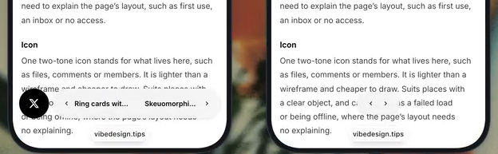
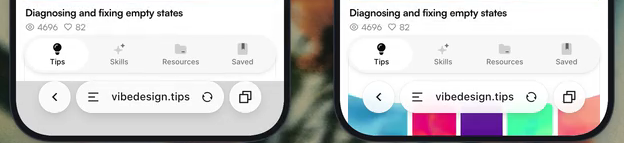
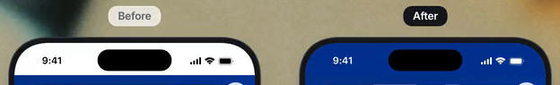

## 問題

桌面網頁縮成手機寬度後，仍可能有點按黑塊、hover 殘留、導覽離拇指太遠、底欄遮文，以及 Safari 工具列和內容顏色不連續的問題。作者以自己的教程網站整理四項改造方向。

## 做法

[官方 023 文章](https://vibedesign.tips/023-mobile-web/)明列四部分：處理點按／hover、底部導覽收合、Safari 取色、PWA。以下先記錄示例影片中看得到的狀態，再分列文章規則；本卡是教學與前後比較稿，故列為 concept，不把 before／after 手機外框當成本輪實機驗收。

*3 秒：左右示例底部都有 Tips、Skills、Resources、Saved 四項導覽，下方另是 Safari 網址與工具列；只保留導覽區，裁去署名與示例主體。*

*14 秒：左側保留帶前後篇標題的長閱讀列與 X 入口；右側縮為只顯示兩支箭頭的短膠囊，正文可延伸到更低的位置。*

*22 秒：左側 Safari 底部仍有灰色帶，右側可見後方彩色內容延伸到工具列下；這是作者影片的前後比較，不是本輪重現結果。*

*12 秒的頂部局部：Before 狀態列為白底黑字，After 改成與示例相接的藍底白字；裝置時間與圖示是示範畫面。*

影片流程先比較點按，再捲動列表、開啟教程、上下閱讀，後段展開／關閉選單並繼續捲動；導覽、狀態列與底部工具列隨這些情境變化。保留影格按設計問題排列，不代表嚴格的擷取時間順序。影片本身未演示加入主畫面、安裝成功或離線開頁。

### 官方文章的規則（作者說法，未實測）

- **點按反饋**：移除預設 tap highlight，將 hover 放在 `@media (hover: hover)` 條件內；不要只以視口寬度判斷是否觸控。移植時應保留按下與鍵盤焦點反饋，不能直接刪光所有互動狀態。
- **底欄收合**：正文向下捲動超過 8px 後收為目前分區或前後箭頭的小膠囊；向上、接近頁頂或點膠囊時展開。忽略細小抖動及程式跳位，避免動畫未完成即反向。8px 是文章的預設值，需依產品調整。
- **Safari 邊緣取色**：作者將問題歸因於貼著畫面頂／底的渲染層，建議避免固定全螢幕遮罩污染底緣、把底欄玻璃放到內層，並以 `visibility: hidden` 隱藏未使用的全螢幕層。文章長版明稱這是測試觀察、Apple 未文件化；本卡未查核 Apple 官方資料，不將取樣機制、iOS 版本行為或模擬器與實機一致性寫成已證實規格。
- **PWA**：文章建議提供 manifest、清晰不透明圖示、短名稱與 service worker 快取已讀頁面。這是改造建議，不表示本次網站已完成離線、安裝、啟動或所有平台相容驗證。

## 為什麼有效（推論）

把分區導覽放在底部，並在閱讀時縮小，可能兼顧觸及與閱讀面積；狀態列和頁面邊緣連續配色，可減少視覺割裂。將 hover 與觸控條件分開，也有助避免把滑鼠反饋硬套到點按。這些是設計推論，沒有操作效率、留存或原生體驗一致性的量測。

## 借鑑要點

- **適合**：已有穩定桌面版、手機以瀏覽／連續閱讀為主，且有少量頂層分區的內容網站。
- **不適合**：結帳總額、輸入框或播放器等必須持續完整顯示的底欄；勿為統一而全部收合。
- **移植時注意**：先清點觸控、hover、focus 與邊緣固定層；保留安全區、末行閱讀空間和焦點入口。使用者聚焦底欄時不應突然收合，減少動態偏好下需驗證立即切換；在正式建置和目標裝置逐項驗證，而非只比較錄製外觀。
- **與產品公告的區別**：[Vibe Design Tips 卡片](../kubai-magazine-design-notes/case.md)保存版本修正與產品導覽歷史；本卡保留正式第 023 期的四項教學與規則。同產品但不同資料層級，交叉連結，不把先前公告當成本輪驗收證據。

## 來源、日期與素材查證

2026-11-24 先開啟官網首頁，由公開連結找到 `/023-mobile-web/`；讀取官方文章、頁面 JSON-LD 與當頁載入的 `/_app/main-BIS0S_9b.js`。資料明列 `issue: 023`、`slug: 023-mobile-web`、X `2125029129619644704`，日期為 2026-11-24；JSON-LD 的 `datePublished` 為 `2026-11-24T00:50:00.290Z`。指定 fetch helper 再核對官方 X 完整長文、作者與毫秒時間，X 顯示 `2026-11-24T00:50:00Z`，採其秒級時間作 `published_at`。

官方文章提供 `/_app/023-CdxS_1BT.mp4`，取得 720×960、34.70 秒影片；官方 X 媒體關聯為 `2124926647690563584`、34.699 秒，時長相符，未宣稱兩者檔案逐位元相同。已檢視全片分段取樣及原尺寸影格，僅留四張裁切圖，排除帳號、署名、完整指令與示例主體；不保留原始影片。文章的長篇 Prompt 僅作來源內容，不執行、不整段收存到卡片。此輪不收錄 024。
