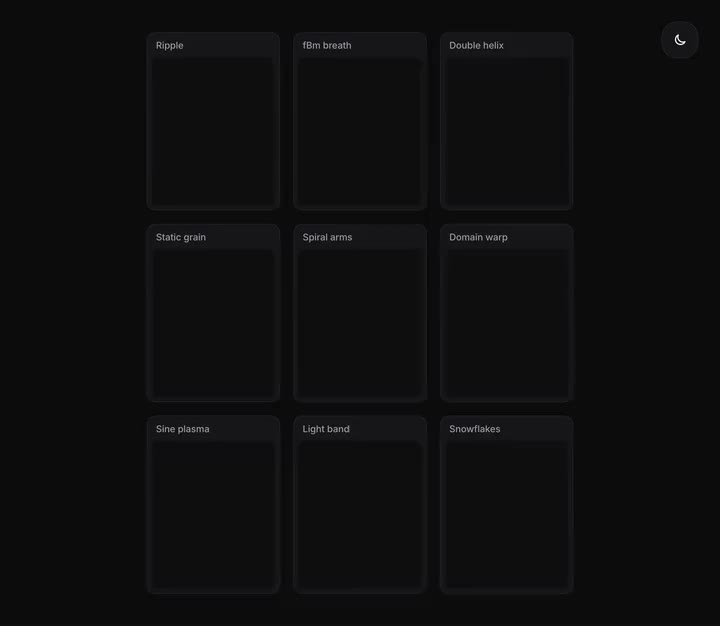
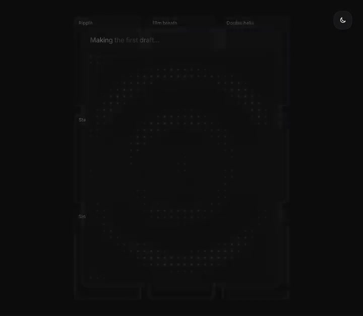
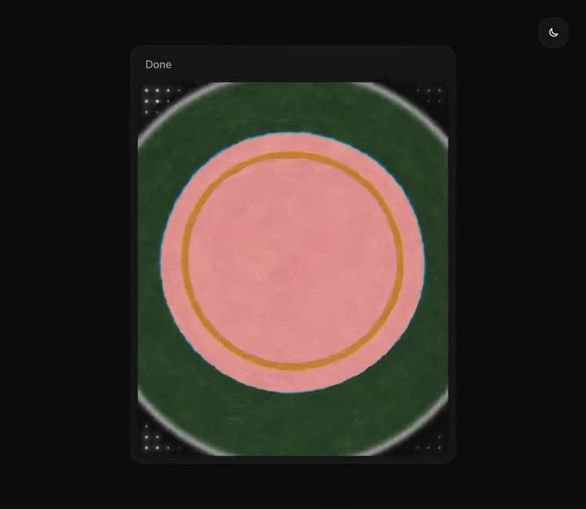
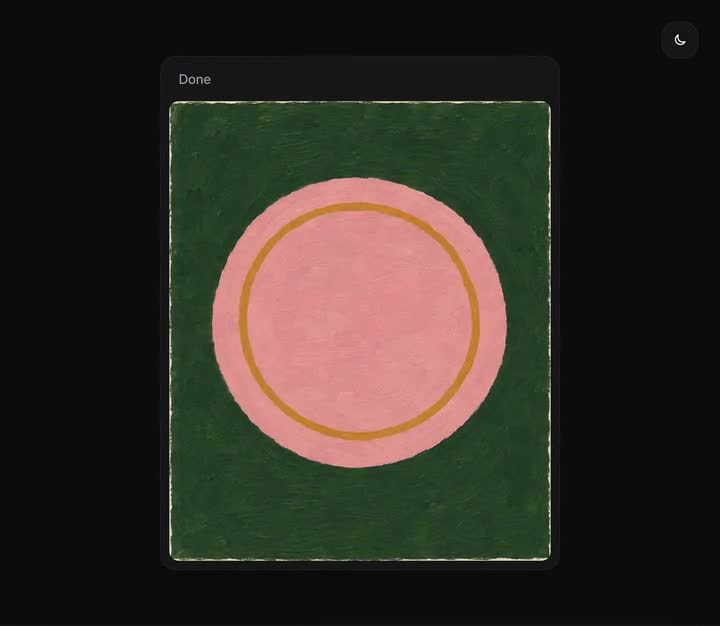
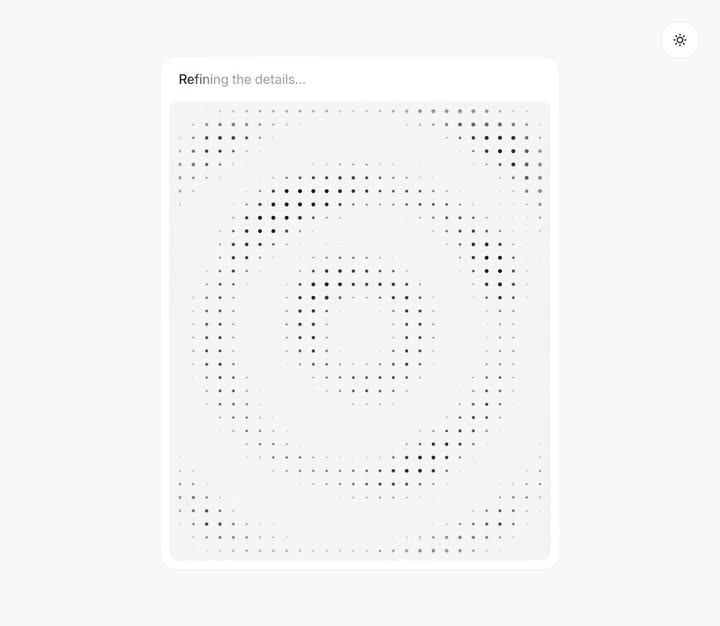
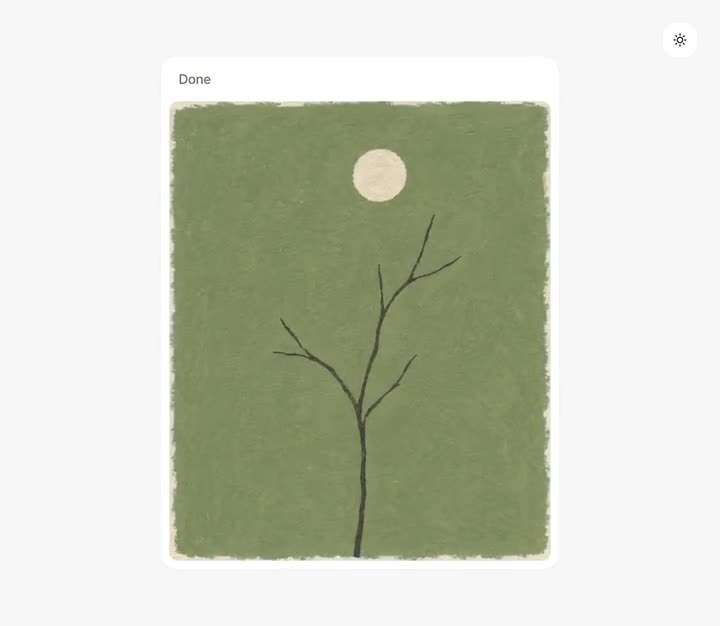

## 問題

AI 圖片尚未完成時，如何讓等待和結果抵達看起來是同一段過程？

## 做法

- 官網影片以九格展示不同點陣；單格示範先顯示流動點陣及狀態文字，接著在同一外框內揭示圖片，最後留下清晰完整圖像。
- 深色示範的亮點形成環紋；圖片由中央擴張，邊緣出現彎曲與色差，完成後回到矩形。另有淺色點陣與不同圖案。
- 原帖稱效果參數可調，靈感來自 GPT 生圖元件；本次只核對示範，不推定是 GPT 官方實作或真實生成進度。

*初始九格模式清單；點陣尚未出現。*

*深色外框內呈現等待點陣。*

*圖片擴張進入，四角仍可見點陣。*

*同一外框留下完整圖像。*

*淺色版本以深點與狀態文字呈現等待。*

*另一組示範最終留下綠底枝條圖像。*

## 為什麼有效（推論）

保留外框與位置，可能減少結果突然替換的割裂感；裝飾性動態不能提供可信的完成百分比。

## 借鑑要點

- **適合**：圖片生成、結果抵達過渡。
- **不適合**：偽裝實際進度、把長動畫當成必要等待。
- **移植時注意**：另做超時、錯誤與重試；短等待與減少動態偏好採簡化過渡；先確認解碼完成，並測試多圖同時呈現的負載。

## 來源與核對範圍

- [X 原帖](https://x.com/Kubai087/status/2125220063301271808)：官方同 ID 正文、日期與影片欄位可讀。
- [作者官網024文章](https://vibedesign.tips/024-image-loading/)與當前官方 bundle 明列期號及原帖 ID；文章的實作建議與Prompt不作已測結果，也不全文轉存。
- 素材取自文章頁關聯的[官方影片](https://vibedesign.tips/_app/024-NCNQG7Rb.mp4)，時長51.1秒；逐段抽樣，保留0、14、16.8、18、22、48秒六幀，未保留完整影片。官方站影片與X影片來源分別記錄，不宣稱兩者逐像素相同。
