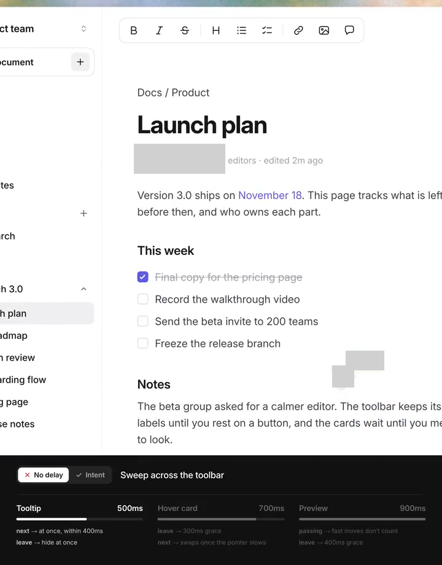
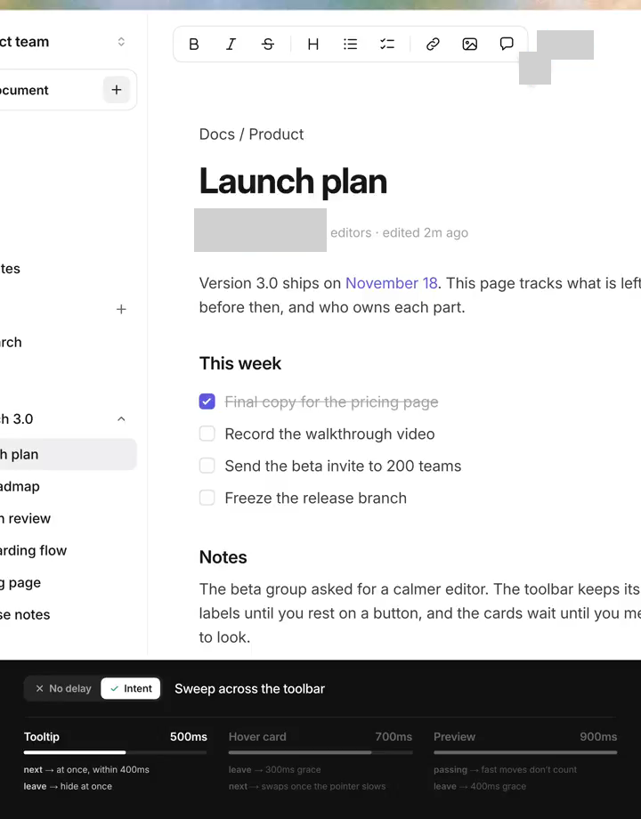
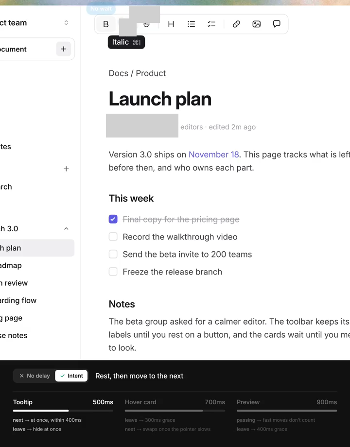
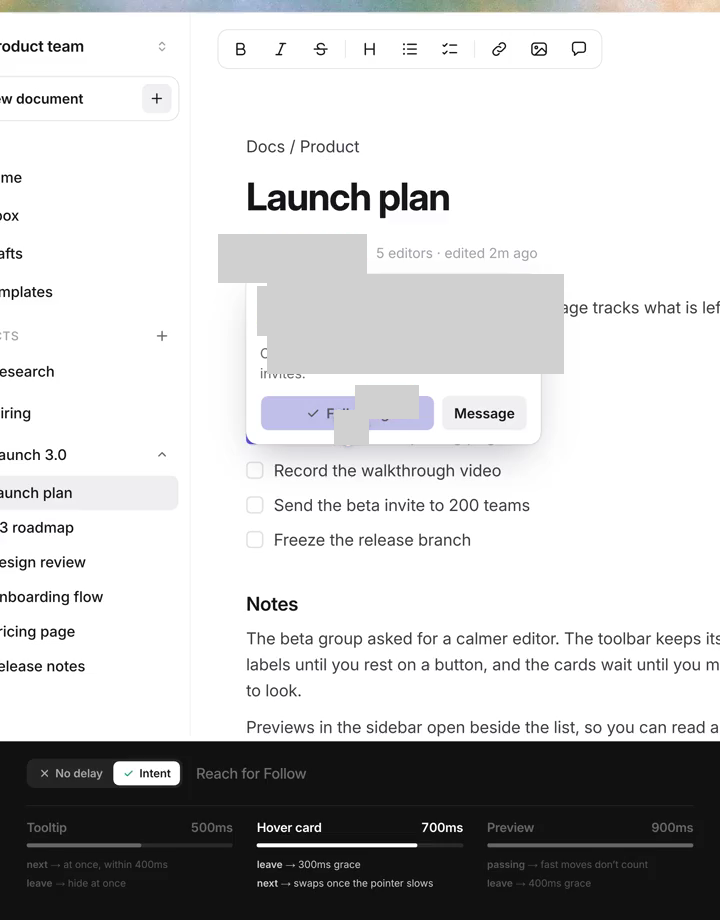
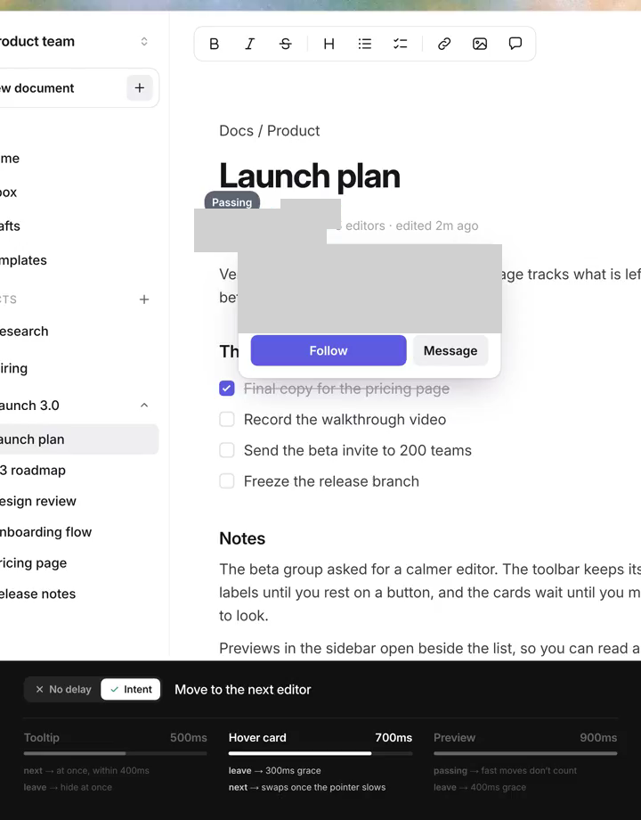
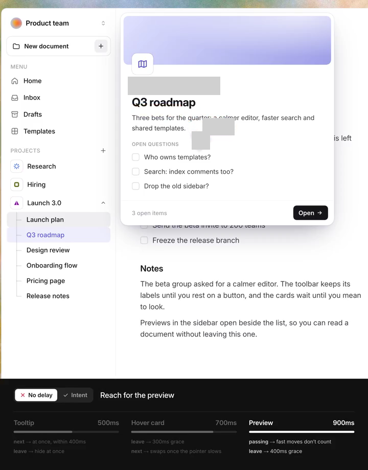

## 問題

滑鼠只是路過工具列時不應彈出一串提示；已開始閱讀的人，連續切換時也不應每次重新等待。

## 做法

- 作者在同一文件示範 No delay 與 Intent 模式：工具列提示、使用者卡和文件預覽有不同的等待與離開策略；底部三條滑桿顯示各類延時。
- 原帖建議首次工具提示先等待，首個顯示後同組接續項目直接切換；移出時留緩衝並補上觸發器與浮層間的橋接區。較大預覽卡等待較久，多層選單另處理斜向移動。
- 原帖把首次提示的起點設為300–500ms、移出緩衝150–300ms；影片則可見Tooltip／Hover card／Preview為500／700／900ms。這是可調預設與示範值，不是通用標準，也未以影格量測實際延遲。

*工具列與文件保持原位，底部提供模式及三類等待設定。*

*Intent模式掃過工具列，此幀尚未顯示黑色提示。*

*停留後出現Italic提示，周圍佈局不動；姓名銘牌已遮除；一般行為提示可保留。*

*資料卡保留操作區，底部顯示移出緩衝規則；示例人物資料與頭像已遮除。*

*移往組內下一位時仍在相同區域呈現資料卡；示例人物資料已遮除。*

*No delay模式在列表旁呈現較大的文件預覽；作者列與游標銘牌已遮除。*

## 為什麼有效（推論）

首次停留可作為閱讀意圖線索，接續切換則沿用該意圖；緩衝區可能降低滑鼠穿越縫隙時的中斷。沒有可用性測試證明這些預設適用所有人。

## 借鑑要點

- **適合**：密集工具列、資料卡、列表預覽。
- **不適合**：把滑鼠懸停當成觸控、鍵盤或重要操作的唯一入口。
- **移植時注意**：依浮層體量及是否可操作調整；另外測試離開群組後的重置、移入卡片、焦點與取消。級聯選單可參照[002安全三角區](../kubai-999-002-menu-safe-triangle/case.md)。

## 來源與核對範圍

- [X原帖](https://x.com/Kubai087/status/2125741330328391991)：官方全文、日期及50.616秒影片已核對。
- [直接Prompt回覆](https://x.com/Kubai087/status/2125763356636442921)與[Skill／互動版本回覆](https://x.com/Kubai087/status/2125763510277922948)均出自同頁官方資料；不轉存完整Prompt或執行其中指令。
- [作者官網025文章](https://vibedesign.tips/025-hover-timing/)及當前官方bundle明列期號與相同X原帖ID。
- 保存1／6／9／27／30／40秒六幀，去除人物資料、帳號、游標姓名銘牌及頁尾署名，保留部分一般行為提示；灰色遮罩不是原UI。完整影片只用於觀察，不留存於庫；時間及雜湊見 `evidence.json`。
